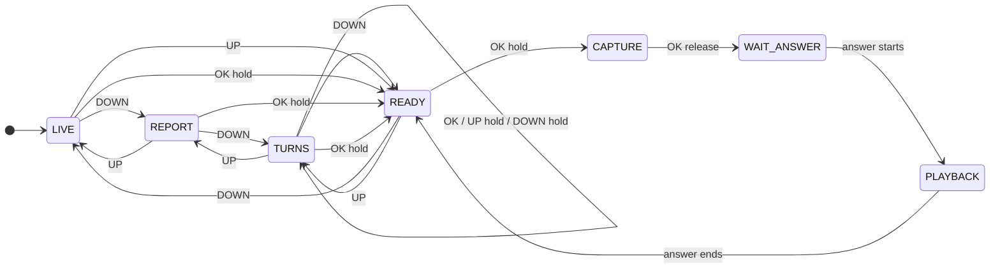

<p align="right">
  <a href="README.zh_CN.md">简体中文</a> · <strong>English</strong>
</p>

# Heygo AI Passport

This is the project repository of Heygo AI Passport.
The device has four pages at one level: live data, run report, turn shape, and AI coach. Short UP and DOWN presses change the page. An OK hold on any page opens the Coach page.
The device connects to a phone over BLE. The phone does speech recognition, speech synthesis, the ski data, and the AI coach. The device does the buttons, the microphone, the speaker, and the screen.

## What the device does

| Increment | Function | Status |
| --- | --- | --- |
| Increment 1: Coach voice | An OK hold on any page opens the Coach page. Another OK hold asks the AI coach. The device plays the answer. | Code done. Device tests NOT RUN. |
| Increment 2: ski data and reports | During a run, show the speed, vertical drop, distance, turns, and time. After each run, show the Heygo IQ (0 to 200), the core problem, and one short tip. | Code done. Device tests NOT RUN. |
| Increment 3: turn shape | After each run, draw the line of the run, 8 turns at a time. OK selects the next turn. An UP hold selects the previous turn. A DOWN hold goes to the next page. | Code done. Device tests NOT RUN. |

The BLE protocol is version 0.2. The phone application team accepted it.
On `main`, the firmware gate `./tools/validate.sh` gives exit code 0.

## Interactive simulator

**Try it in the browser: [https://azuresword.github.io/Heygo-AiPassport/](https://azuresword.github.io/Heygo-AiPassport/)**

The link opens `assets/sim/coach-flow.html` through GitHub Pages. You can press the buttons of the device there.

[](https://azuresword.github.io/Heygo-AiPassport/)

`assets/sim/coach-flow.html` is a single web page. You can also download it and open it on a computer.
It needs no server and no network.

- On the left are the device screen and the three buttons. A press of 500 ms is a hold. The keys Up, Space, and Down are UP, OK, and DOWN.
- The phone panel can send an answer, cut the BLE link, start a run, end the run, or open the Report page.
- In the middle are the state diagram and the trigger matrix. They show the current state and the target of each button.
- On the right are the state machine log and the BLE messages.

To open it:

```bash
open assets/sim/coach-flow.html
```

The flow graph `Firmware/flows/coach.flow.json` makes the page. The firmware uses the same state machine.
Do not edit the page by hand. After a change to the flow graph, run `python3 tools/flow/flow_sim.py` in `Firmware`.
The browser draws the screen with system fonts. The images in `assets/mockups` show the real pixels.

## State machine

GitHub draws this diagram from the text. The interactive simulator shows every transition.



## Turns page


The device drawing code makes this animation: `Firmware/tools/host_render/turns_gif.py`.
The page draws the first 8 turns point by point. Then the rider replays turns 1, 2, and 3.

## Screen images

LVGL draws the 20 images in `assets/mockups` on a computer with the device settings. They are not drawings.
[contact-sheet.png](assets/mockups/contact-sheet.png) shows all of them in one image.

| Images | Content |
| --- | --- |
| 01–08 | The live data page with no data, and each Coach page state |
| 10–12 | Ski data during a run, out-of-date data, and the report after a run |
| 13–15 | The Report page: no report, a report, and the longest texts |
| 16–21 | The Turns page. 16: no shape. 17: the first page draws. 18: a heel side turn. 19: a schematic run of 255 turns. 20: a page that is on its way. 21: a run of one page. |

## Folders

| Folder | Content |
| --- | --- |
| [需求文件夹](%E9%9C%80%E6%B1%82%E6%96%87%E4%BB%B6%E5%A4%B9/README.md) | Requirements, architecture, backlog, decisions, the BLE protocol, and the four-hour Sprint roadmap. |
| [Firmware](Firmware/docs/heygo-changes.md) | ESP-IDF firmware based on FoloToy/ai-passport. Read `docs/heygo-changes.md` first. |
| [assets](assets/README.md) | Screen texts, fonts, screen images, and the interactive simulator. |

## Get and check the code

```bash
git clone https://github.com/Azuresword/Heygo-AiPassport.git
cd Heygo-AiPassport/Firmware
. ~/esp/esp-idf-v5.5.3/export.sh
./tools/validate.sh
```

The last line must be `Firmware build: PASS`.
