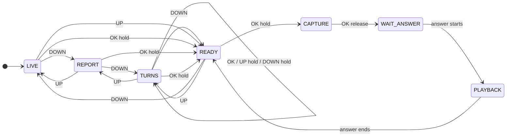
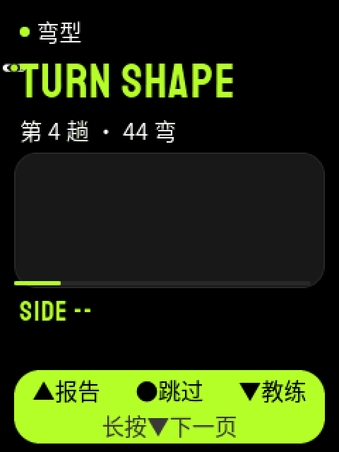

<p align="right">
  <strong>简体中文</strong> · <a href="README.md">English</a>
</p>

# Heygo AI Passport

这是 Heygo AI Passport 的项目仓库。
设备有四个平级页面：实时数据、本趟报告、弯型、AI 教练。短按 UP/DOWN 翻页，任何页面长按 OK 打开教练页。
手机还可以随时在设备上弹窗，按任意键关闭。
设备通过蓝牙连接手机。手机负责语音识别、语音合成、滑行数据和 AI 教练。设备负责按键、麦克风、喇叭和屏幕。

## 设备做什么

| 增量 | 功能 | 状态 |
| --- | --- | --- |
| 增量 1：教练语音 | 在任何页面长按 OK 打开教练页，再按住 OK 向 AI 教练提问，设备播放回答。 | 代码已完成。设备测试未运行。 |
| 增量 2：滑行数据与报告 | 滑行时显示速度、落差、距离、转弯和时间。每趟结束后显示 Heygo IQ（0 至 200）、核心问题和一条小建议。手机开始滑行时，设备打开实时数据页（D-32）。 | 代码已完成。开始滑行：主机测试通过。设备测试未运行。 |
| 增量 3：弯型 | 每趟结束后画出这一趟的线路，一次 8 个弯。OK 选中下一弯，长按 UP 选中上一弯，长按 DOWN 跳到下一页。 | 代码已完成。设备测试未运行。 |
| 增量 4：手机弹窗（D-31） | 手机立即弹出摔倒提醒、语音播报、问题报告或成就报告。设备播放弹窗语音，然后倒计时 10 秒。按任意键关闭。 | 代码已完成。主机测试通过。设备测试未运行。 |

蓝牙协议为 0.2 版，手机应用团队已确认。
固件门禁 `./tools/validate.sh` 在 `main` 上的结果是退出码 0。

## 交互模拟器

**在浏览器里直接试用：[https://azuresword.github.io/Heygo-AiPassport/](https://azuresword.github.io/Heygo-AiPassport/)**

这个链接通过 GitHub Pages 打开 `assets/sim/coach-flow.html`，可以在网页上直接按设备的按键。
如果打不开，用这个备用入口：[htmlpreview](https://htmlpreview.github.io/?https://github.com/Azuresword/Heygo-AiPassport/blob/main/assets/sim/coach-flow.html)。它运行的是 `main` 分支上的同一个页面。

项目总结（现状、决策、历程、风险）：[https://azuresword.github.io/Heygo-AiPassport/summary/README.zh_CN.html](https://azuresword.github.io/Heygo-AiPassport/summary/README.zh_CN.html)。

[](https://azuresword.github.io/Heygo-AiPassport/)

`assets/sim/coach-flow.html` 是一个单文件网页，也可以下载后在电脑上打开。
它不需要服务器，也不需要联网。

- 左侧是设备屏幕和三个按键。按住 500 ms 算长按。键盘的 ↑、空格、↓ 对应 UP、OK、DOWN。
- "手机端模拟"可以发送回答、断开蓝牙、开始一趟滑行、结束这一趟，或让设备跳到报告页。
- "开始滑行"按钮先发 RUN_START。设备立即打开实时数据页。和教练对话中或弹窗中，等对话结束或弹窗关闭后再打开（D-32）。
- "手机端模拟"还可以发送每种弹窗，可选带不带语音。一个进度条显示弹窗的 10 秒倒计时。
- 中间是状态流转图和触发矩阵，显示当前状态和每个按键会去哪里。图中有一个区域放三个弹窗状态。
- 右侧是状态机日志和蓝牙消息。

打开方法：

```bash
open assets/sim/coach-flow.html
```

页面由流程图 `Firmware/flows/coach.flow.json` 生成，和固件用同一份状态机。
不要手工修改这个页面。修改流程图后，在 `Firmware` 里运行 `python3 tools/flow/flow_sim.py`。
浏览器用系统字体绘制屏幕。真实像素以 `assets/mockups` 里的图片为准。

## 状态机

GitHub 会根据下面的文本直接画出状态图。每一条转移都可以在交互模拟器里试。



## 弯型页



这段动画由设备的绘制代码生成：`Firmware/tools/host_render/turns_gif.py`。
弯型页先逐点画出前 8 个弯，小精灵再依次重放第 1、2、3 弯。

## 界面效果图

`assets/mockups` 里的 25 张图由 LVGL 在电脑上按设备配置绘制，不是手绘稿。
[contact-sheet.png](assets/mockups/contact-sheet.png) 把它们放在一张图里。

| 图片 | 内容 |
| --- | --- |
| 01–08 | 实时数据页的等待状态，以及教练页的各个状态 |
| 10–12 | 滑行中的数据、数据过期、一趟结束后的报告 |
| 13–15 | 报告页：没有报告、有报告、最长文本 |
| 16–21 | 弯型页：没有弯型、第一页正在画、一个 HEEL SIDE 弯、255 弯的示意弯型、某一页还在路上、只有一页的一趟 |
| 22–26 | 弹窗页：摔倒提醒、语音播报、问题报告、成就报告、最长文本（D-31） |
| `popup-anim.gif` | 四种弹窗的入场动画 |

## 文件夹

| 文件夹 | 内容 |
| --- | --- |
| [需求文件夹](需求文件夹/README.zh_CN.md) | 需求、架构、待办列表、决策、蓝牙协议和 4 小时 Sprint 路线图。 |
| [Firmware](Firmware/docs/heygo-changes.zh_CN.md) | ESP-IDF 固件，基于 FoloToy/ai-passport。请先读 `docs/heygo-changes.zh_CN.md`。 |
| [assets](assets/README.zh_CN.md) | 屏幕文字、字体、界面效果图和交互模拟器。 |

## 获取和检查

```bash
git clone https://github.com/Azuresword/Heygo-AiPassport.git
cd Heygo-AiPassport/Firmware
. ~/esp/esp-idf-v5.5.3/export.sh
./tools/validate.sh
```

最后一行应为 `Firmware build: PASS`。
