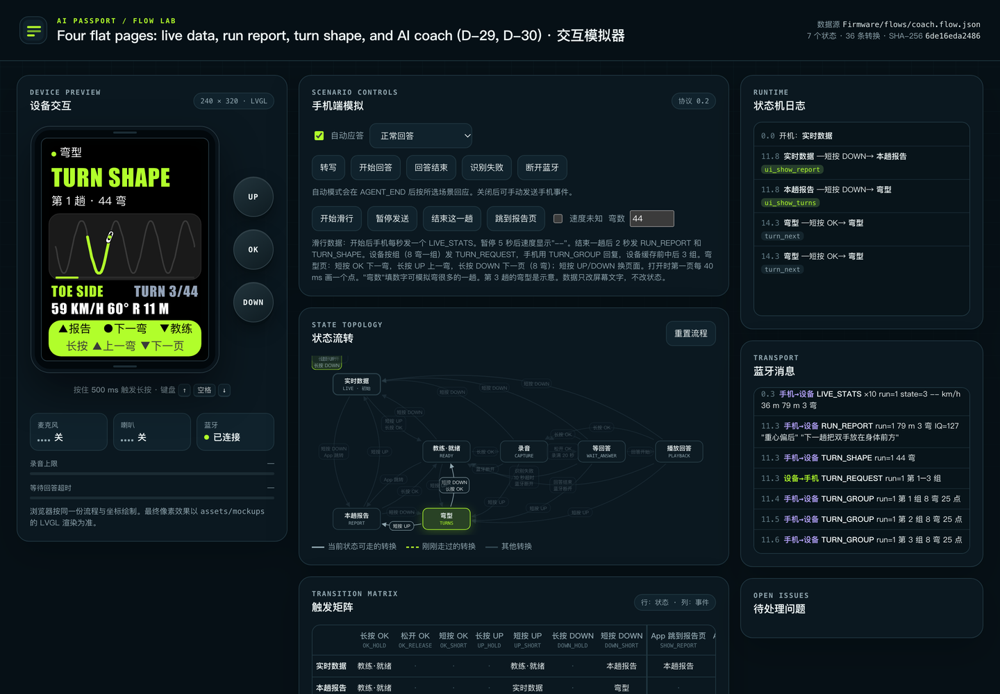

<strong>简体中文</strong> · <a href="index.html">English</a>

Heygo · AI Passport · 项目总结

<h1>休息时，抬手就能问教练</h1>

AI Passport 是滑雪用的手持小设备。用户不掏手机、不摘手套，就能看本趟数据、听 AI 教练的建议。项目的 17 个 Sprint 全部完成。

Sprint

17<small>/17</small>

增量

4<small>/4</small>

决策

33

需求条目

24

界面图

25

模拟器自测

122<small>/122</small>

## 做成了什么

增量 1<h4>教练语音</h4>
长按 OK 进教练页，按住 OK 提问。手机转写、问 AI、合成语音，设备播放回答。

增量 2<h4>滑行数据与报告</h4>
实时显示速度、落差、距离、转弯、时间。每趟结束给出 Heygo IQ（0–200）和一条建议。开始滑行自动跳页。

增量 3<h4>弯型</h4>
每趟画出线路，一页 8 个弯，逐弯看速度、角度、半径。

增量 4<h4>手机弹窗</h4>
摔倒提醒、语音播报、问题报告、成就报告。立即弹出，10 秒倒计时，任意键关闭。

## 一页看懂

| 问题 | 答案 | 详见 |
|---|---|---|
| 设备做什么？ | 只管按键、麦克风、喇叭、屏幕。分析和语音都在手机上 | [架构与协议](architecture.zh_CN.md) |
| 怎么操作？ | 四个页面平级循环。短按 UP/DOWN 翻页，长按 OK 问教练 | [产品与页面](product.zh_CN.md) |
| 长什么样？ | 25 张主机渲染的界面图，加两段动画 | [界面一览](screens.zh_CN.md) |
| 做到哪了？ | Sprint 0–16 全部完成 | [Sprint 完成情况](sprints.zh_CN.md) |
| 花了多久？ | main 上 55 个提交，10-16 18:02 到 10-18 10:48 | [开发历程](history.zh_CN.md) |
| 质量怎么保证？ | 每次提交前跑门禁，主机测试、界面检查、模拟器自测都要通过 | [质量与部署](quality.zh_CN.md) |

## 链接

- 在线模拟器：<https://azuresword.github.io/Heygo-AiPassport/>。可以直接按设备的按键试用。
- 仓库：<https://github.com/Azuresword/Heygo-AiPassport>
- 本书源文件在 `summary-book/`。先运行 `figures.py` 生成图，再运行 `build.sh` 生成 `summary/`。
