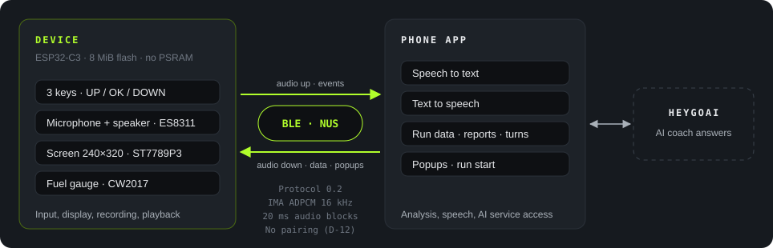
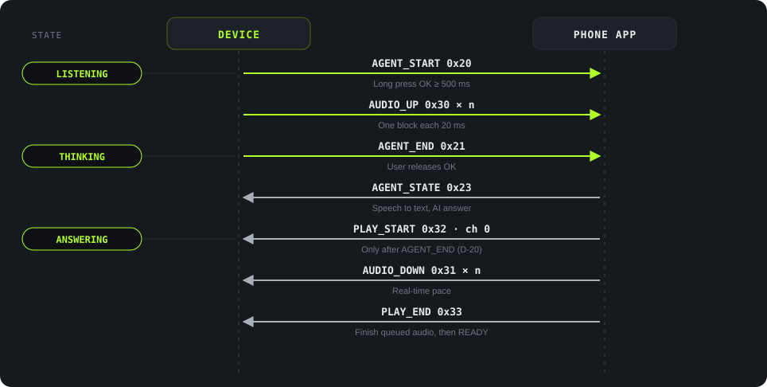

<strong>English</strong> · <a href="architecture.zh_CN.html">简体中文</a>

Architecture

# Architecture and protocol

## Tasks

The device controls only the keys, microphone, speaker, and screen (D-14). The phone does speech recognition, speech synthesis, run data, and the AI coach. The link is BLE only. The device does not use Wi-Fi (D-08).

<figure>

<figcaption>Figure 6. System architecture. Hardware source: <code>Firmware/docs/README.md</code>, hardware section.</figcaption>
</figure>

| Item | Value |
|---|---|
| Controller | ESP32-C3, 8 MB flash, no PSRAM |
| Screen | ST7789P3, 240 × 320, SPI2 |
| Keys | UP, DOWN, and OK on GPIO0 through an ADC divider |
| Audio | ES8311, full-duplex I2S |
| Fuel gauge | CW2017 |
| Software | ESP-IDF 5.5.3, LVGL 9.5.0, NimBLE |
| Audio codec | IMA ADPCM at 16 kHz in 20 ms blocks. Raw PCM is the fallback (D-09). |
| Security | No encryption and no pairing (D-12) |

## Messages for one question

<figure>

<figcaption>Figure 7. One coach question. The left column shows the device state. Compare it with Figure 4 in the <a href="screens.html">Screen gallery</a>.</figcaption>
</figure>

Important rule: the phone sends PLAY_START only after it gets AGENT_END (D-20). The device ignores PLAY_START during a recording.

## Messages in protocol 0.2

Source: `需求文件夹/07-ble-protocol-draft.md`. D is the device. P is the phone.

| Group | Message | Direction | Use |
|---|---|---|---|
| Link | HELLO 0x01 · HELLO_ACK 0x02 | D↔P | Handshake: versions, codec, and MTU |
| | PHONE_STATUS 0x03 · DEVICE_STATUS 0x04 | Both | Network, battery, page, and free heap |
| | ERROR 0x0F | Both | Rejects a packet |
| Context | CONTEXT 0x10 | D→P | Page change |
| Coach | AGENT_START 0x20 · AGENT_END 0x21 · AGENT_CANCEL 0x22 | D→P | Start, end, or cancel one question |
| | AGENT_STATE 0x23 | P→D | States such as thinking or failed |
| Audio | AUDIO_UP 0x30 | D→P | Recording blocks |
| | AUDIO_DOWN 0x31 · PLAY_START 0x32 · PLAY_END 0x33 | P→D | Playback. Channel 0 is the coach. Channel 2 is a popup. |
| Run | LIVE_STATS 0x60 · RUN_REPORT 0x61 · RUN_START 0x68 | P→D | Live data, report, and run start |
| | SHOW_PAGE 0x62 | P→D | Shows the report page |
| Turns | TURN_SHAPE 0x63 · TURN_GROUP 0x64 | P→D | Turn summary and groups |
| | TURN_REQUEST 0x65 | D→P | Asks for a missing group |
| Popup | POPUP 0x66 | P→D | Opens a popup at once |
| | POPUP_END 0x67 | D→P | The popup closed, with a reason |

The protocol also defines team talk (0x50 to 0x55 and PLAY_STOP 0x34). Team talk is P1. It is not in the scope of this delivery.
