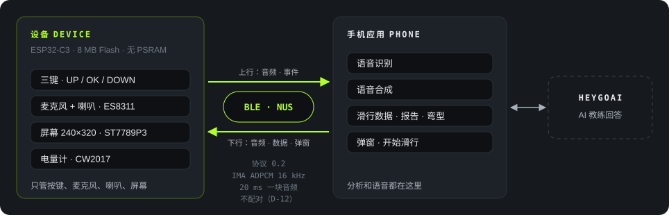
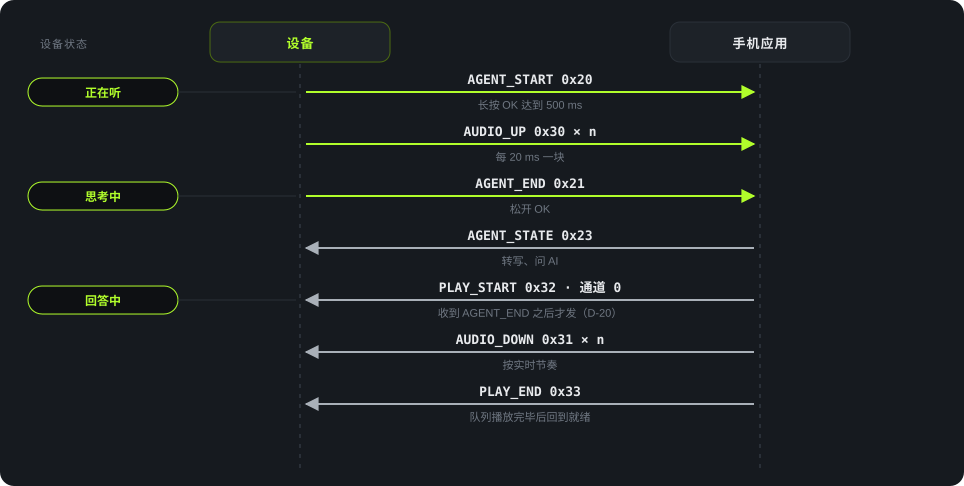

<strong>简体中文</strong> · <a href="architecture.html">English</a>

Architecture

# 架构与协议

## 分工

设备只管按键、麦克风、喇叭、屏幕（D-14）。语音识别、语音合成、滑行数据和 AI 教练都在手机上。两者只走 BLE，不用 Wi-Fi（D-08）。

<figure>

<figcaption>图 6　系统架构。硬件来源：<code>Firmware/docs/README.zh_CN.md:138-155</code>。</figcaption>
</figure>

| 项 | 值 |
|---|---|
| 主控 | ESP32-C3，8 MB Flash，无 PSRAM |
| 屏幕 | ST7789P3，240×320，SPI2 |
| 按键 | UP/DOWN/OK 共用 GPIO0，ADC 分压 |
| 音频 | ES8311，I2S 全双工 |
| 电量计 | CW2017 |
| 软件 | ESP-IDF 5.5.3，LVGL 9.5.0，NimBLE |
| 音频编码 | IMA ADPCM 16 kHz，20 ms 一块。裸 PCM 做回退（D-09） |
| 安全 | 不加密、不配对（D-12） |

## 一次提问的消息流

<figure>

<figcaption>图 7　一次教练提问。左侧是设备状态，对应 <a href="screens.zh_CN.html">界面一览</a> 图 4。</figcaption>
</figure>

关键约束：手机必须等收到 AGENT_END 才发 PLAY_START（D-20）。设备在录音时会丢掉 PLAY_START。

## 协议 0.2 的消息

来源：`需求文件夹/07-ble-protocol-draft.zh_CN.md`。D 是设备，P 是手机。

| 组 | 消息 | 方向 | 用途 |
|---|---|---|---|
| 链路 | HELLO 0x01 · HELLO_ACK 0x02 | D↔P | 握手，交换版本、编码、MTU |
| | PHONE_STATUS 0x03 · DEVICE_STATUS 0x04 | 双向 | 网络、电量、页面、空闲堆 |
| | ERROR 0x0F | 双向 | 拒绝一个包 |
| 上下文 | CONTEXT 0x10 | D→P | 页面变化 |
| 教练 | AGENT_START 0x20 · AGENT_END 0x21 · AGENT_CANCEL 0x22 | D→P | 一次提问的开始、结束、取消 |
| | AGENT_STATE 0x23 | P→D | 思考中、失败等状态 |
| 音频 | AUDIO_UP 0x30 | D→P | 录音块 |
| | AUDIO_DOWN 0x31 · PLAY_START 0x32 · PLAY_END 0x33 | P→D | 播放。通道 0 教练、2 弹窗 |
| 滑行 | LIVE_STATS 0x60 · RUN_REPORT 0x61 · RUN_START 0x68 | P→D | 实时数据、报告、开始滑行 |
| | SHOW_PAGE 0x62 | P→D | 让设备显示报告页 |
| 弯型 | TURN_SHAPE 0x63 · TURN_GROUP 0x64 | P→D | 弯型摘要和分组 |
| | TURN_REQUEST 0x65 | D→P | 请求缺的组 |
| 弹窗 | POPUP 0x66 | P→D | 立即弹窗 |
| | POPUP_END 0x67 | D→P | 弹窗关闭及原因 |

协议里还定义了队伍对讲（0x50–0x55、PLAY_STOP 0x34），属于 P1，不在这次交付的范围里。
