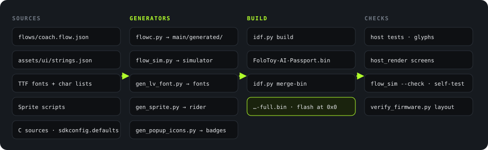

<p class="lang"><strong>English</strong> · <a href="build-flash.zh_CN.html">简体中文</a></p>

<p class="eyebrow">Build</p>

# Firmware build

## From source files to firmware

<figure>

<figcaption>Figure 11. From source files to firmware that you can flash. Sources: <code>tools/validate.sh</code> and <code>main/CMakeLists.txt</code>.</figcaption>
</figure>

Scripts make four kinds of content in the firmware. Nobody writes these files manually.

| Output | Input | Script | Files |
|---|---|---|---|
| State machine and screens | `flows/coach.flow.json` | `tools/flow/flowc.py` | Four `.c/.h` pairs in `main/generated/` |
| Simulator | The same flow graph | `tools/flow/flow_sim.py` | `assets/sim/coach-flow.html` |
| Fonts | Noto Sans SC and Staatliches (OFL 1.1), with character lists | `assets/tools/gen_lv_font.py` | `assets/fonts/heygo_*.c` |
| Sprites | Drawing definitions in the scripts | `gen_sprite.py`, `gen_popup_icons.py` | `assets/sprites/*.c` |

The state machine and the simulator come from the same graph. Thus, the behavior in the simulator is the behavior of the device. `flowc.py --check` and `flow_sim.py --check` fail when a generated file is old.

### Fonts

| Font | Glyphs | Use |
|---|---|---|
| `heygo_sc_16` | 3,871 | Body text. It includes GB2312 level 1 (3,755 characters), because it shows transcripts and answers from the phone. |
| `heygo_sc_28` | 202 | Large state words. Only the screen vocabulary. |
| `heygo_display_20/34/48` | 95 each | The Staatliches brand face, for numbers and English labels. |

Sources: `assets/fonts/*.chars.txt` and the file header of `assets/tools/gen_lv_font.py`.

## Build

1. Install ESP-IDF 5.5.3.
2. Activate the environment: `. $IDF_PATH/export.sh`.
3. In `Firmware/`, run the gate: `./tools/validate.sh`.

The gate builds in a temporary directory, so the work tree stays clean. The build steps (`tools/validate.sh:145-175`):

```bash
SDKCONFIG_DEFAULTS=sdkconfig.defaults idf.py -B <temp dir> build
idf.py -B <temp dir> merge-bin -o FoloToy-AI-Passport-full.bin
python3 tools/verify_firmware.py <temp dir>        # partitions and image offsets
python3 tools/host_render/render.py ...             # screen images
python3 tools/archive_firmware.py create ...        # debug archive
```

Outputs:

| File | Content | Use |
|---|---|---|
| `build/FoloToy-AI-Passport-full.bin` | Bootloader, partition table, and application in one file | Flash at `0x0` for a new device or a full refresh. |
| `build/FoloToy-AI-Passport.bin` | Application only | It has no bootloader and no partition table. Do not upload it alone. |

## Build results for this book

On 2026-10-18, we ran the full gate at `main` commit `284ab00`. The exit code was 0.

<div class="tiles">
<div class="tile accent"><div class="k">Gate</div><div class="v" style="font-size:24px">PASS</div></div>
<div class="tile"><div class="k">App image</div><div class="v">1.86<small>MiB</small></div></div>
<div class="tile"><div class="k">Merged image</div><div class="v">1.92<small>MiB</small></div></div>
<div class="tile"><div class="k">Build steps</div><div class="v">1,995</div></div>
</div>

| Item | Result |
|---|---|
| Host tests | All PASS: protocol, ADPCM, playback rules, keys, link core, and screen parts |
| Simulator | `--check` PASS, self-test 128/128 |
| Glyphs | PASS, 72 vocabulary strings and 47 flow texts |
| Layout | Application 1,948,640 of 8,323,072 bytes, in `factory` at `0x10000` |
| Merged image | 2,014,176 bytes, flash at `0x0` |

Compiler settings: `-Og` (debug optimization), with assertions. The flash uses DIO mode at 80 MHz (generated `sdkconfig`).

## Flashing

Source: `Firmware/docs/development/engineering/firmware-layout.md`, section "Flashing and stored data".

| Case | Method | Caution |
|---|---|---|
| New device or full refresh | Write `…-full.bin` at `0x0`. | The merged file fills the gaps between images. It can reset the NVS and PHY data. |
| Daily development | Segmented flash: `idf.py -p <port> flash` | It keeps the NVS, if the partition layout is compatible. |
| Erase the full chip | `idf.py erase-flash` | It erases all user data. Do not use it as a routine step. |

- Logs and flashing use the built-in USB Serial/JTAG of the ESP32-C3. GPIO18 and GPIO19 are for USB (`Firmware/docs/README.md`).
- You do not need a backup of the old firmware before you flash. The new firmware keeps no rollback copy.
