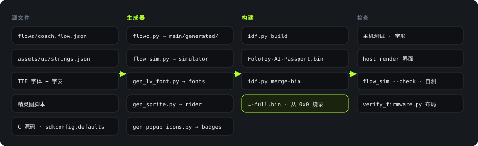

<p class="lang"><strong>简体中文</strong> · <a href="build-flash.html">English</a></p>

<p class="eyebrow">Build</p>

# 制作方法

## 从源文件到固件

<figure>

<figcaption>图 11　从源文件到可烧录的固件。来源：<code>tools/validate.sh</code>、<code>main/CMakeLists.txt</code>。</figcaption>
</figure>

固件里有四类内容是脚本生成的，不手写：

| 生成物 | 输入 | 生成脚本 | 输出 |
|---|---|---|---|
| 状态机和界面 | `flows/coach.flow.json` | `tools/flow/flowc.py` | `main/generated/` 四组 `.c/.h` |
| 交互模拟器 | 同一个流程图 | `tools/flow/flow_sim.py` | `assets/sim/coach-flow.html` |
| 字体 | Noto Sans SC、Staatliches（OFL 1.1）+ 字表 | `assets/tools/gen_lv_font.py` | `assets/fonts/heygo_*.c` |
| 精灵图 | 脚本内的绘制定义 | `gen_sprite.py`、`gen_popup_icons.py` | `assets/sprites/*.c` |

状态机和模拟器来自同一个流程图，所以模拟器里试到的行为就是设备的行为。`flowc.py --check` 和 `flow_sim.py --check` 会在生成物过期时报错。

### 字体

| 字体 | 字形数 | 用途 |
|---|---|---|
| `heygo_sc_16` | 3,871 | 正文。含 GB2312 一级字（3,755 个），因为要显示手机发来的转写和回答 |
| `heygo_sc_28` | 202 | 大号状态词，只含界面词汇 |
| `heygo_display_20/34/48` | 各 95 | 品牌字体 Staatliches，数字和英文标签 |

来源：`assets/fonts/*.chars.txt`；`assets/tools/gen_lv_font.py` 文件头。

## 构建

1. 安装 ESP-IDF 5.5.3。
2. 激活环境：`. $IDF_PATH/export.sh`。
3. 在 `Firmware/` 里运行门禁：`./tools/validate.sh`。

门禁会在一个临时目录里构建，所以不会污染工作区。构建步骤（`tools/validate.sh:145-175`）：

```bash
SDKCONFIG_DEFAULTS=sdkconfig.defaults idf.py -B <临时目录> build
idf.py -B <临时目录> merge-bin -o FoloToy-AI-Passport-full.bin
python3 tools/verify_firmware.py <临时目录>        # 检查分区和镜像位置
python3 tools/host_render/render.py ...             # 渲染界面图
python3 tools/archive_firmware.py create ...        # 归档调试文件
```

产物：

| 文件 | 内容 | 用途 |
|---|---|---|
| `build/FoloToy-AI-Passport-full.bin` | bootloader + 分区表 + 应用，合并成一个文件 | 从 `0x0` 烧录，用于新设备或完整刷新 |
| `build/FoloToy-AI-Passport.bin` | 只有应用 | 不含 bootloader 和分区表，不要单独上传 |

## 本书写作时的构建结果

2026-10-18 在提交 `df81cc8` 上（`Firmware/` 与 `c865ba8` 相同）运行完整门禁，退出码 0：

<div class="tiles">
<div class="tile accent"><div class="k">门禁</div><div class="v" style="font-size:24px">PASS</div></div>
<div class="tile"><div class="k">应用镜像</div><div class="v">1.86<small>MiB</small></div></div>
<div class="tile"><div class="k">合并镜像</div><div class="v">1.92<small>MiB</small></div></div>
<div class="tile"><div class="k">构建步骤</div><div class="v">1,995</div></div>
</div>

| 检查 | 结果 |
|---|---|
| 主机测试 | 全部 PASS，含协议、ADPCM、播放规则、按键、链路核心、界面组件 |
| 模拟器 | `--check` PASS，自测 122/122 |
| 字形 | PASS，71 条界面词汇，43 条流程文字 |
| 布局 | 应用 1,945,536 / 8,323,072 字节，在 `factory` 的 `0x10000` |
| 合并镜像 | 2,011,072 字节，从 `0x0` 烧录 |

编译选项：`-Og`（调试优化），断言开启。Flash 用 DIO 模式、80 MHz（生成的 `sdkconfig`）。

## 烧录

来源：`Firmware/docs/development/engineering/firmware-layout.md` "Flashing and stored data" 一节。

| 场景 | 方法 | 注意 |
|---|---|---|
| 新设备或完整刷新 | 把 `…-full.bin` 写到 `0x0` | 合并文件会填满镜像之间的空隙，可能清掉 NVS 和 PHY 数据 |
| 日常开发 | 分段烧录：`idf.py -p <端口> flash` | 能保留 NVS。前提是分区布局兼容 |
| 擦除整片 | `idf.py erase-flash` | 会清掉所有用户数据。不要当成例行步骤 |

- 日志和烧录走 ESP32-C3 自带的 USB Serial/JTAG。GPIO18/19 留给 USB（`Firmware/docs/README.md`）。
- 烧录新固件之前不需要备份旧固件，但新固件不保留回滚副本。
