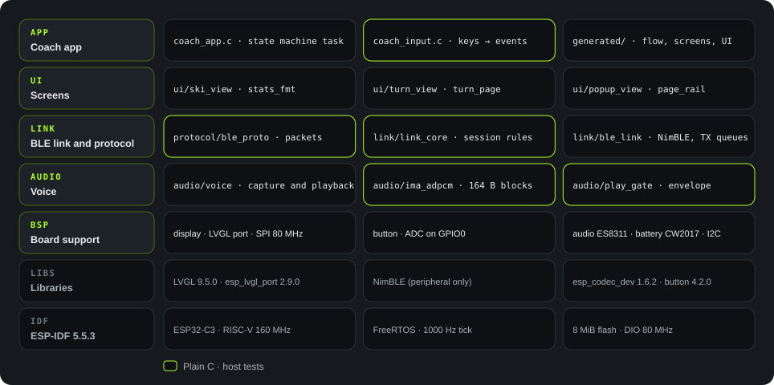
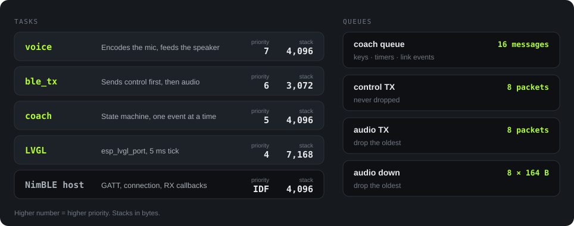

<strong>English</strong> · <a href="firmware.zh_CN.html">简体中文</a>

Firmware

# Firmware architecture

The firmware runs on ESP32-C3 with ESP-IDF 5.5.3 and FreeRTOS. Application code resides in `Firmware/main/`. Board support resides in `Firmware/components/bsp/`. The figures below describe the `284ab00` snapshot.

States

10

Transitions

83

App tasks

3

C code

8.6<small>k lines</small>

Host test files

33

## Layers

<figure>

<figcaption>Figure 9. Firmware layers. Green frames mark plain C modules that run in host tests without LVGL or ESP-IDF.</figcaption>
</figure>

The design separates two concerns:

1. **Logic remains independent of hardware.** The state machine, key mapping, protocol codec, session rules, and ADPCM use plain C.
2. **The build compiles the flow graph.** `flowc.py` converts `coach.flow.json` into C transition tables. The device executes these tables without a graph parser or interpreter.

Paths below are relative to `Firmware/`. Line counts include BSP reference programs.

| Module | Path | Lines | Task |
|---|---|---|---|
| Application | `main/main.c`, `coach_app.c`, `coach_input.c` | 927 | Initializes the app, serializes state transitions, and converts keys into events. |
| Generated code | `main/generated/` | 1,486 | Transition table, screen builders, data bindings, and screen effects. Do not edit generated files. |
| Screens | `main/ui/` | 746 | Live data, Turns, popup, page rail, and other screen components. |
| Link and protocol | `main/link/`, `main/protocol/` | 1,824 | Packet encoding, handshake, session rules, and NimBLE GATT. |
| Voice | `main/audio/` | 450 | Recording, playback control, volume envelope, and ADPCM. |
| BSP | `components/bsp/src/` | 1,646 | Display, LVGL integration, key ADC, ES8311, fuel gauge, and I2C. |
| BSP reference | `main/demo_*.c` and related files | 1,521 | Upstream demo programs. The linker removes unused functions. |

## Startup order

01

Read the wake cause

After a key wake, suppress key actions until release or the 10 s timeout.

02

Initialize I2C, display, and LVGL

A display or LVGL failure stops application startup and logs the SPI pins. Successful initialization sets the backlight to 100%.

03

Initialize audio and fuel gauge

Initialize ES8311 and CW2017. Record failures without stopping application startup.

04

Start the Coach app

Create queues and timers. Start voice, BLE, and the coach task. Voice or BLE failure leaves the screens and keys available.

05

Enable key input

Queue key events only after the app is ready.

## Tasks and queues

<figure>

<figcaption>Figure 10. Task priorities, stack sizes, and queues.</figcaption>
</figure>

The priorities favor audio and transport:

- **voice: 7.** It processes 20 ms audio blocks. Late delivery can cause gaps in playback.
- **ble_tx: 6.** It prioritizes the control queue. `AGENT_END` uses the audio queue and follows the last `AUDIO_UP` packet.
- **coach: 5.** It handles keys, timers, and link events through one queue. State transitions execute sequentially.
- **LVGL: 4.** Drawing has lower priority than audio and transport.

Sequential state transitions do not remove every concurrency requirement. Other tasks must hold `bsp_lvgl_lock()` before they access LVGL. Link callbacks also require the link mutex.

Each queue uses a fixed capacity. Control TX and audio TX each hold eight packets. Audio overflow discards the oldest packet. Control overflow discards the incoming packet and logs a warning.

## State machine

`flowc.py` generates 10 states and 83 transitions from `coach.flow.json` into `main/generated/coach_flow.c`.

| Group | States | Description |
|---|---|---|
| Pages | `LIVE`, `REPORT`, `TURNS` | Live data, report, and Turns. Short UP and DOWN presses navigate the page loop. |
| Coach | `READY`, `CAPTURE`, `WAIT_ANSWER`, `PLAYBACK` | Ready, recording, waiting for an answer, and playback. |
| Popup | `POPUP_WAIT`, `POPUP_PLAY`, `POPUP_HOLD` | Waiting for audio, playing audio, and the 10 s countdown. |

Two timers control recording and response progress:

- After 20 s in `CAPTURE`, the timer sends `CAPTURE_LIMIT` and ends recording.
- After 10 s without progress in `WAIT_ANSWER`, the timer sends `AGENT_TIMEOUT`. Each non-failure `AGENT_STATE` message restarts this timer.

Only one application page remains allocated at a time. A page change loads a persistent blank screen, removes the old page, then builds the new page. This sequence limits peak LVGL allocation.

The page rail remains on the LVGL top layer across page changes. One object draws its four stops and thumb.

## Audio path

Up · recording<h4>Microphone to phone</h4>
ES8311 supplies 16 kHz, 16-bit mono samples. The voice task encodes one 164-byte ADPCM block each 20 ms. The audio TX queue holds eight packets and discards the oldest packet on overflow. The ble_tx task sends each packet as a NimBLE notification.

Down · playback<h4>Phone to speaker</h4>
NimBLE receives the packet. link_core checks the exchange identifier, xid, and accepts only the current stream. The down queue holds eight blocks and discards the oldest block on overflow. play_gate controls playback start. The voice task decodes each block and sends PCM through I2S and ES8311 to the speaker.

A 20 s recording at 16 kHz, 16-bit mono needs 640,000 bytes of raw PCM. The device streams blocks during recording, so it does not retain the complete recording in RAM.
