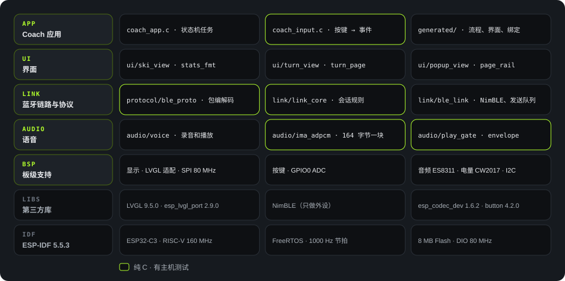
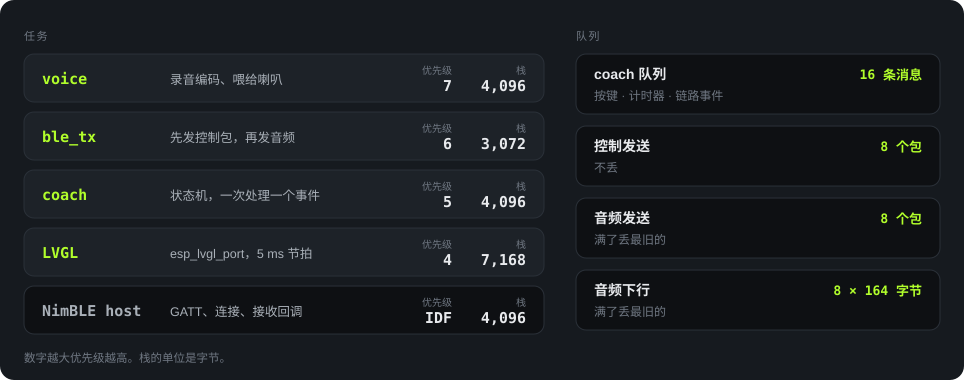

<strong>简体中文</strong> · <a href="firmware.html">English</a>

Firmware

# 固件架构

固件跑在 ESP32-C3 上，基于 ESP-IDF 5.5.3 和 FreeRTOS。代码在 `Firmware/` 下：应用在 `main/`，板级支持在 `components/bsp/`。

状态

10

转移

83

自建任务

3

C 代码

8.6<small>k 行</small>

主机测试

33

来源：`Firmware/flows/coach.flow.json`（状态和转移），`wc -l`（行数，含 BSP），`Firmware/tests/`。

## 分层

<figure>

<figcaption>图 9　固件分层。绿框的模块是纯 C，不依赖 LVGL 和 ESP-IDF，在主机上测试。</figcaption>
</figure>

设计原则有两条：

1. **逻辑和硬件分开。** 状态机、按键映射、协议编解码、会话规则、ADPCM 都写成纯 C，在电脑上就能测。
2. **画布在构建时编译成 C。** 状态机画在 `coach.flow.json` 里，`flowc.py` 把它翻译成 C 转移表。设备上没有图解释器，运行时开销为零（`tools/flow/flowc.py` 文件头）。

| 模块 | 路径 | 行数 | 职责 |
|---|---|---|---|
| 应用 | `main/main.c`、`coach_app.c`、`coach_input.c` | 927 | 启动。在一个任务里跑状态机。把按键转成事件 |
| 生成代码 | `main/generated/` | 1,486 | 转移表、界面构建、数据绑定、界面效果。不要手改 |
| 界面 | `main/ui/` | 746 | 实时数据、弯型、弹窗、页面导轨（D-33）等界面组件 |
| 链路与协议 | `main/link/`、`main/protocol/` | 1,824 | 07 号协议的包、握手和会话规则、NimBLE GATT |
| 语音 | `main/audio/` | 450 | 录音编码、播放启动规则、音量包络、ADPCM |
| BSP | `components/bsp/src/` | 1,646 | 屏幕、LVGL 适配、按键 ADC、ES8311、电量计、I2C |
| BSP 参考 | `main/demo_*.c` 等 | 1,521 | 上游演示程序。保留作参考，链接时被去掉 |

## 启动顺序

来源：`main/main.c`

01

查看唤醒原因

如果是按键唤醒，先屏蔽按键，等那颗键松手（最多 10 秒），避免唤醒键被当成一次操作。

02

I2C、屏幕、LVGL

初始化失败时打印 SPI 引脚号后退出。背光开到 100%。

03

音频和电量计

ES8311 和 CW2017。失败不阻止启动，只记录状态。

04

启动 Coach 应用

建队列，起 coach、voice、ble_tx 三个任务，开始蓝牙广播。

05

最后才打开按键

按键事件只在应用就绪后才送进队列。

## 任务和队列

<figure>

<figcaption>图 10　任务优先级、栈大小和队列。来源：<code>main/audio/voice.c:20-23</code>、<code>main/link/ble_link.c:27-32</code>、<code>main/coach_app.c:50-52</code>、esp_lvgl_port 默认配置、<code>sdkconfig</code>。</figcaption>
</figure>

优先级这样排的原因：

- **voice 最高（7）。** 音频每 20 ms 一块，晚了就会断音（`voice.c:23` 注释）。
- **ble_tx 其次（6）。** 先发控制包，再发音频包。
- **coach 是 5。** 按键、计时器、链路事件都进同一个队列，所以状态机一次只处理一个事件，没有并发问题。
- **LVGL 是 4。** 画屏可以让路给音频和蓝牙。

每个队列大小固定，溢出规则写死。链路慢的时候不扩大队列（`需求文件夹/02-architecture.zh_CN.md` 第 5 节）。

## 状态机

10 个状态，83 条转移，全部由 `flowc.py` 从 `coach.flow.json` 生成到 `main/generated/coach_flow.c`。

| 组 | 状态 | 说明 |
|---|---|---|
| 页面 | `LIVE`、`REPORT`、`TURNS` | 实时数据、报告、弯型。短按 UP/DOWN 循环 |
| 教练 | `READY`、`CAPTURE`、`WAIT_ANSWER`、`PLAYBACK` | 就绪、录音、等回答、播放 |
| 弹窗 | `POPUP_WAIT`、`POPUP_PLAY`、`POPUP_HOLD` | 等语音、播语音、10 秒倒计时 |

两个计时器（`docs/heygo-changes.zh_CN.md` 第 6 节）：

- `CAPTURE` 状态 20 秒后产生 `CAPTURE_LIMIT`，录音最长 20 秒。
- `WAIT_ANSWER` 状态 10 秒后产生 `AGENT_TIMEOUT`。

同一时间只存在一个界面。切换时先载入空白界面，删掉旧界面，再建新界面，因为几个界面同时存在会超出 LVGL 内存池。

页面导轨是例外：它是 LVGL 顶层上的一个对象，自己画出四个格子和滑块，换界面时不删除。所以导轨在每个页面上只占内存池里的一个对象（`main/ui/page_rail.h`、`coach_app.c:749`）。

## 音频通路

上行 · 录音<h4>麦克风 → 手机</h4>
ES8311 以 16 kHz、16 bit 采样 → voice 任务每 20 ms 编码成一块 164 字节的 ADPCM → 音频发送队列（8 包，满了丢最旧的）→ ble_tx → NimBLE 通知。

下行 · 播放<h4>手机 → 喇叭</h4>
NimBLE 收包 → link_core 检查 xid，只收当前流 → 下行队列（8 块）→ play_gate 判断何时起播 → 解码 → I2S → ES8311 → 喇叭。

一个 20 秒的问题如果存成裸 PCM，需要 640,000 字节。设备没有 PSRAM，所以录音边录边发，不存整段（`02-architecture.zh_CN.md` 第 5 节）。
