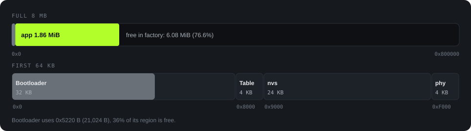

<strong>English</strong> · <a href="memory.zh_CN.html">简体中文</a>

Memory

# Memory map

The numbers on this page come from a build on 2026-10-18 at `main` commit `284ab00`. The tools were `idf.py size`, `idf.py size-components`, and `idf.py size-files`. The LVGL pool numbers come from host measurements (`Firmware/docs/heygo-changes.md`).

App / factory

23.4<small>%</small>

Static DRAM

47.2<small>%</small>

LVGL pool peak

76.6<small>%</small>

PSRAM

0

## Flash: the 8 MB layout

<figure>

<figcaption>Figure 12. Flash map. The top bar is the full 8 MB. The bottom bar shows the first 64 KB. Sources: <code>Firmware/partitions.csv</code> and the build log.</figcaption>
</figure>

| Region | Start | Size | Content |
|---|---|---|---|
| Bootloader | `0x0` | 32 KB | 21,024 bytes used |
| Partition table | `0x8000` | 4 KB | |
| `nvs` | `0x9000` | 24 KB | Key-value storage |
| `phy_init` | `0xF000` | 4 KB | Radio calibration data |
| `factory` | `0x10000` | 8,323,072 bytes | The only application partition. It uses all remaining flash. There are no OTA partitions. |

The application image is 1,948,640 bytes. The `factory` partition has 6,374,432 bytes (76.6%) free.

## Flash: the content of the application image

Read-only data is 1,015,232 bytes. Code is 825,880 bytes. The total is 1,841,112 bytes. By source:



**Table view**

| Source | Bytes | Basis |
|---|---|---|
| Chinese font 16 px | 516,932 | `heygo_sc_16.c.obj`, 3,871 glyphs |
| Other ESP-IDF parts | 439,142 | The total minus the other rows |
| LVGL | 332,036 | Code and read-only data of `liblvgl__lvgl.a` |
| Popup badges | 201,152 | `heygo_popup_icons.c.obj`, 4 kinds × 4 frames, 56×56 ARGB8888 |
| BLE controller and NimBLE | 168,668 | `libbtdm_app.a` and `libbt.a` |
| Other fonts and rider sprite | 127,789 | `heygo_sc_28`, `heygo_display_20/34/48`, and `heygo_board_sprite` |
| Heygo app code | 55,393 | `libmain.a` without fonts and images |

<b>Result: fonts and images use almost half of the flash content.</b>
Fonts and sprites use 845,873 bytes, 45.9% of the flash content. The 16 px Chinese font is the largest. It must show any answer from the phone, so it has GB2312 level 1. The Heygo app code is only approximately 54 KB.

## RAM: the 320 KB layout

The ESP32-C3 has 321,296 bytes of internal RAM for this use. It has no PSRAM. The chart shows the static allocation:



**Table view**

| Section | Bytes | Description |
|---|---|---|
| IRAM code | 96,852 | Code that must run from RAM, for example interrupts, flash operations, and FreeRTOS |
| `.bss` | 44,200 | LVGL 29,180 (with the 28 KiB pool) and the app 9,156 |
| `.data` | 10,524 | Global variables with initial values |
| Free at runtime | 169,720 | Heap for task stacks, the BLE stack, the LVGL draw buffer, and queues |

### Heap use at runtime

| Use | Bytes | Source |
|---|---|---|
| LVGL draw buffer | 19,200 | 240 × 40 lines × 2 bytes (RGB565), `bsp_display_lvgl.c:12` |
| Own task stacks | 11,264 | voice 4,096, coach 4,096, and ble_tx 3,072 |
| LVGL task stack | 7,168 | esp_lvgl_port default |
| NimBLE host task stack | 4,096 | `CONFIG_BT_NIMBLE_HOST_TASK_STACK_SIZE` |
| BLE packet queues | 3,440 | Document 07, section 10 |
| Audio down queue | 1,312 | 8 × 164 bytes |

The BLE controller and stack also allocate heap memory at runtime. A device measurement is necessary for that part. This page does not show it.

## LVGL pool: 28 KiB

`CONFIG_LV_MEM_SIZE_KILOBYTES=28` (`sdkconfig.defaults`). After the management overhead, 25,752 bytes are available.

<b>Why the pool changed from 24 KiB to 28 KiB.</b>
With the page rail (D-33), the 24 KiB pool stopped the live data page when it drew the speed digits. The largest free block was then only 1,936 bytes. The pool is now 28 KiB, and it uses 4 KiB more system RAM (<code>需求文件夹/02-architecture.md:334</code> and <code>05-decision-amendments.md</code>). The build agrees: the LVGL <code>.bss</code> changed from 25,084 to 29,180 bytes, exactly 4,096 bytes more.

| Item | Value | Source |
|---|---|---|
| Available pool | 25,752 bytes | `02-architecture.md:334` |
| Peak of a full run | **19,728 / 25,752 (76.6%)** | Same, host render |
| Largest free block | At least 6,032 bytes | Same |
| Rail cost | 1 LVGL object on each page | `main/ui/page_rail.h` |
| Peak at 24 KiB (before the rail) | 18,760 / 21,656 (86.6%) | `heygo-changes.md`, section 12, commit `5658911` |

These numbers come from a 64-bit host. A host pointer has 8 bytes. An ESP32-C3 pointer has 4 bytes. Thus, the device uses less pool memory. The pool is small, so the firmware keeps only one screen at a time.

At each page change, the device logs the pool use, the largest free block, and the free system heap. The device memory test reads these lines (`02-architecture.md:335`).
