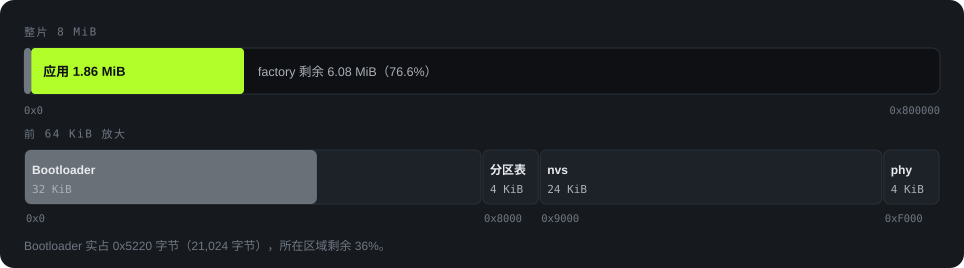

<strong>简体中文</strong> · <a href="memory.html">English</a>

Memory

# 内存分布

本页数字来自 2026-10-18 在提交 `5100fd2` 上（`Firmware/` 与 `19dafd9` 相同）的构建：`idf.py size`、`idf.py size-components`、`idf.py size-files`。LVGL 内存池的数字来自主机实测（`Firmware/docs/heygo-changes.zh_CN.md`）。

应用 / factory 分区

23.4<small>%</small>

静态 DRAM

47.2<small>%</small>

LVGL 内存池峰值

76.6<small>%</small>

PSRAM

0

## Flash：8 MB 怎么分

<figure>

<figcaption>图 12　Flash 分布。上面是整片 8 MB，下面放大前 64 KB。来源：<code>Firmware/partitions.csv</code>、构建日志。</figcaption>
</figure>

| 区域 | 起始 | 大小 | 内容 |
|---|---|---|---|
| Bootloader | `0x0` | 32 KB | 实占 21,024 字节 |
| 分区表 | `0x8000` | 4 KB | |
| `nvs` | `0x9000` | 24 KB | 键值存储 |
| `phy_init` | `0xF000` | 4 KB | 射频校准数据 |
| `factory` | `0x10000` | 8,323,072 字节 | 唯一的应用分区，占满剩余 Flash。没有 OTA 分区 |

应用镜像 1,948,816 字节，`factory` 还剩 6,374,256 字节（76.6%）。

## Flash：应用镜像里装了什么

只读数据 1,015,232 字节，代码 826,046 字节，合计 1,841,278 字节。按来源分：



**表格视图**

| 来源 | 字节 | 依据 |
|---|---|---|
| 中文字体 16 px | 516,932 | `heygo_sc_16.c.obj`，3,871 个字形 |
| ESP-IDF 其他部分 | 439,142 | 总数减去其他各项 |
| LVGL | 332,036 | `liblvgl__lvgl.a` 代码 + 只读数据 |
| 弹窗徽章 | 201,152 | `heygo_popup_icons.c.obj`，4 种 × 4 帧，56×56 ARGB8888 |
| 蓝牙控制器 + NimBLE | 168,668 | `libbtdm_app.a` + `libbt.a` |
| 其他字体和滑雪小人 | 127,789 | `heygo_sc_28`、`heygo_display_20/34/48`、`heygo_board_sprite` |
| Heygo 应用代码 | 55,559 | `libmain.a` 去掉字体和图片之后 |

<b>结论：字体和图片占了一半。</b>字体和精灵图合计 845,873 字节，占 Flash 内容的 45.9%。其中 16 px 中文字体最大，因为它要显示手机发来的任意回答，所以带了 GB2312 一级字。Heygo 自己的应用代码只有约 54 KB。

## RAM：320 KB 怎么分

ESP32-C3 可用的内部 RAM 是 321,296 字节，没有 PSRAM。下图是静态分配的部分：



**表格视图**

| 段 | 字节 | 说明 |
|---|---|---|
| IRAM 代码 | 96,852 | 中断、Flash 操作、FreeRTOS 等必须在 RAM 里跑的代码 |
| `.bss` | 44,200 | 其中 LVGL 29,180（含 28 KiB 内存池），应用 9,156 |
| `.data` | 10,532 | 有初值的全局变量 |
| 留给运行时 | 169,712 | 堆：任务栈、蓝牙协议栈、LVGL 绘制缓冲、队列 |

### 运行时从堆里拿走的

| 用途 | 字节 | 来源 |
|---|---|---|
| LVGL 绘制缓冲 | 19,200 | 240 × 40 行 × 2 字节（RGB565），`bsp_display_lvgl.c:12` |
| 自建任务栈 | 11,264 | voice 4,096 + coach 4,096 + ble_tx 3,072 |
| LVGL 任务栈 | 7,168 | esp_lvgl_port 默认值 |
| NimBLE host 任务栈 | 4,096 | `CONFIG_BT_NIMBLE_HOST_TASK_STACK_SIZE` |
| 蓝牙包队列 | 3,440 | 07 号协议第 10 节 |
| 音频下行队列 | 1,312 | 8 × 164 字节 |

蓝牙控制器和协议栈运行时还会从堆里分配内存。这部分要在设备上测量，本页没有给出。

## LVGL 内存池：28 KiB

`CONFIG_LV_MEM_SIZE_KILOBYTES=28`（`sdkconfig.defaults`）。扣掉管理开销后可用 25,752 字节。

<b>为什么从 24 KiB 加到 28 KiB。</b>加上页面导轨（D-33）后，24 KiB 的内存池让实时数据页在画速度数字时卡死，当时最大空闲块只有 1,936 字节。内存池改为 28 KiB，多占 4 KiB 系统 RAM（<code>需求文件夹/02-architecture.zh_CN.md:334</code>、<code>05-decision-amendments.zh_CN.md:484</code>）。构建结果对得上：LVGL 的 <code>.bss</code> 从 25,084 字节变成 29,180 字节，正好多 4,096 字节。

| 项 | 数值 | 来源 |
|---|---|---|
| 可用内存池 | 25,752 字节 | `02-architecture.zh_CN.md:334` |
| 全程峰值 | **19,728 / 25,752（76.6%）** | 同上，主机渲染 |
| 最大空闲块 | 至少 6,032 字节 | 同上 |
| 导轨占用 | 每页 1 个 LVGL 对象 | `main/ui/page_rail.h` |
| 24 KiB 时的峰值（加导轨之前） | 18,760 / 21,656（86.6%） | `heygo-changes.zh_CN.md` 第 12 节，提交 `5658911` |

这些是 64 位主机上的数字。主机指针 8 字节，ESP32-C3 指针 4 字节，所以设备上的占用会更低。内存池紧，所以固件一次只保留一个界面。

设备每次翻页都会在日志里记下内存池用量、最大空闲块和系统剩余堆。设备上的内存测试读的就是这几行（`02-architecture.zh_CN.md:335`）。
