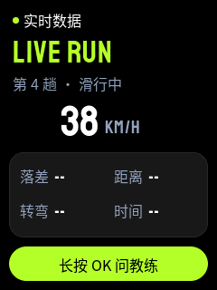

<strong>简体中文</strong> · <a href="product.html">English</a>

Product

# 产品与页面

## 谁在用，什么时候用

一趟滑完后，坐缆车或休息时用。手机留在口袋里，开着蓝牙。用户不摘手套，只按三个实体键：UP、OK、DOWN。

来源：`需求文件夹/01-product-requirements.zh_CN.md:12-26`

## 四个页面，一个循环

四个页面平级。短按 DOWN 去下一页，短按 UP 回上一页，到头会绕回来（D-29、D-30）。任何页面长按 OK 都进教练页。

<figure>

实时数据

LIVE RUN

<b>▶</b>DOWN

本趟报告

RUN REPORT

<b>▶</b>DOWN

弯型

TURN SHAPE

<b>▶</b>DOWN

AI 教练

AI COACH

◀ 短按 DOWN 从教练页绕回实时数据页 · 短按 UP 反向

<figcaption>图 1　四页循环。截图由 LVGL 在主机上渲染，来自 <code>assets/mockups/</code>。</figcaption>
</figure>

| 页面 | 显示什么 | 决策 |
|---|---|---|
| 实时数据 | 速度、落差、距离、转弯、时间。手机每 1 秒发一帧 | D-23 |
| 本趟报告 | Heygo IQ（0–200）、核心问题、一条小建议。每趟一份 | D-26、D-27 |
| 弯型 | 这一趟的线路，一页 8 个弯，逐弯显示速度、角度、半径 | D-30 |
| AI 教练 | 按住 OK 说话，松开发送，设备播放回答 | D-17 |

## 弯型页怎么看

弯型页用三个键逐弯浏览：OK 选下一弯，长按 UP 选上一弯，长按 DOWN 去下一页。设备存 3 组弯，不够时用 TURN_REQUEST 向手机要。

<figure>

逐弯浏览

turns-demo.gif

<figcaption>图 2　弯型页动画，来自 <code>assets/sim/turns-demo.gif</code>。</figcaption>
</figure>

## 手机能主动做的两件事

D-31 · POPUP 0x66<h4>弹窗</h4>
立即打断任何状态。先播语音，再倒计时 10 秒。任意键关闭，回到弹窗前的页面。新弹窗替换旧弹窗。

D-32 · RUN_START 0x68<h4>开始滑行</h4>
手机判定开始滑行，设备打开实时数据页。对话中或弹窗中，等结束后再打开。不取消任何操作。

D-33<h4>页面导轨</h4>
屏幕右侧一条导轨，显示自己在循环中的位置。荧光绿滑块是当前页，▲▼ 标出 UP、DOWN 会去哪。

<figure>

弹窗入场

popup-anim.gif

摔倒提醒

FALL ALERT

成就报告

ACHIEVED

<figcaption>图 3　手机弹窗。每类弹窗有自己的颜色和动画徽章。</figcaption>
</figure>

来源：`需求文件夹/04-validation-and-decisions.zh_CN.md` D-29 至 D-33 行
