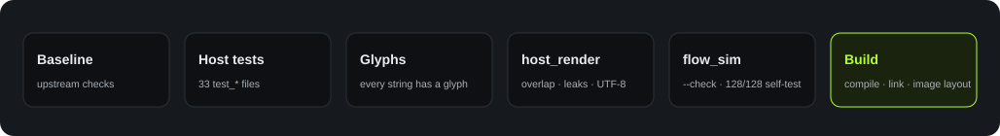

<strong>English</strong> · <a href="quality.zh_CN.html">简体中文</a>

Quality

# Quality and deployment

## Gate

At the end of each sprint, `./tools/validate.sh` must exit with code 0 (`需求文件夹/08-sprint-roadmap.md`, section 1).

<figure>

<figcaption>Figure 8. The six steps of the gate. Source: <code>Firmware/docs/heygo-changes.md</code>, section 3.</figcaption>
</figure>

| Step | What it finds |
|---|---|
| Host tests | 33 `test_*` files in `Firmware/tests/`, for example link core, Turns page, popup page, and ADPCM codec |
| Glyph check | Screen text that the font cannot show |
| `host_render` | Screen overlap, memory pool leaks, and cut UTF-8 text. It also makes the screens in `assets/mockups/`. |
| `flow_sim` | Differences between the simulator and the state machine. The self-test runs in headless Chrome. |

## Results that we examined for this book

On 2026-10-18, we ran the full gate `./tools/validate.sh` at commit `5100fd2`. The exit code was 0. `Firmware/` is the same as at `19dafd9`.

Full gate

PASS

Simulator self-test

128<small>/128</small>

Glyphs

72<small>+47</small>

Merged image

1.92<small>MiB</small>

For each result, see [Firmware build](build-flash.md).

## Device verification

The team did the board flashing, the phone app tests (TC-01 to TC-24), and the U1 usability test (5 testers) on physical devices. The records of these tests are not in this repository.

## Deployment

| Content | Address |
|---|---|
| Simulator | <https://azuresword.github.io/Heygo-AiPassport/> |
| This book | <https://azuresword.github.io/Heygo-AiPassport/summary/> |

- GitHub Pages publishes the root of `main`. The root has a `.nojekyll` file.
- `index.html` opens `assets/sim/coach-flow.html`. A script makes this page from `Firmware/flows/coach.flow.json`. Do not edit it manually.
- The book source is in `summary-book/`. The output is in `summary/`.

<b>CI note.</b> The workflows are in <code>Firmware/.github/workflows/</code>. GitHub reads workflows only from <code>.github/workflows/</code> at the repository root. Thus, these workflows possibly do not run. This is an inference. We did not examine the Actions page.

