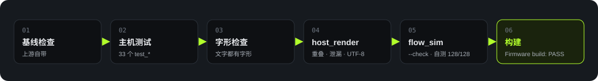

<strong>简体中文</strong> · <a href="quality.html">English</a>

Quality

# 质量与部署

## 验证流程

每个 Sprint 结束时，在 `Firmware/` 运行 `./tools/validate.sh`。完整门禁必须以退出码 0 结束。

<figure>

<figcaption>图 8　固件验证项目。</figcaption>
</figure>

| 检查 | 覆盖范围 |
|---|---|
| 主机测试 | 33 个测试文件，覆盖链路核心、按键、弯型、弹窗和 ADPCM 等模块 |
| 字形检查 | 检查界面文字是否有对应字形 |
| `host_render` | 检查界面重叠、内存池泄漏和 UTF-8 截断，生成界面样例 |
| `flow_sim` | 检查生成物是否与流程图同步，在无界面 Chrome 中运行交互自测 |
| 固件构建 | 检查编译、链接、分区布局和合并镜像 |

## 基线测试结果

版本 `284ab00` 在 2026-10-18 的完整门禁退出码为 0。

完整门禁

PASS

模拟器自测

128<small>/128</small>

字形检查文本

72<small>+47</small>

合并镜像

1.92<small>MiB</small>

字形检查覆盖 72 条界面文字和 47 条流程文字。镜像布局与构建参数见 [构建与烧录](build-flash.zh_CN.md)。

## 设备验收

项目负责人确认开发板烧录、手机应用联调和 U1 可用性测试（5 名测试者）已完成。仓库未收录这些测试的详细记录，因此本报告不将其列为可复核的设备测试 PASS。

主机测试覆盖逻辑与渲染。真实 BLE 时序、音频质量、板端内存和户外可用性仍需通过设备测试记录核验。

## 网站部署

| 内容 | 地址 |
|---|---|
| 交互模拟器 | <https://azuresword.github.io/Heygo-AiPassport/> |
| 技术报告 | <https://azuresword.github.io/Heygo-AiPassport/summary/README.zh_CN.html> |

GitHub Pages 发布 `main` 分支的仓库根目录。根目录的 `.nojekyll` 使静态文件直接发布。模拟器入口跳转到 `assets/sim/coach-flow.html`，报告位于 `summary/`。

## 自动化范围

GitHub Actions 当前只有 Pages 发布流程。固件 workflow 位于 `Firmware/.github/workflows/`，不属于 GitHub 自动发现的根目录 `.github/workflows/`。固件门禁需在开发环境执行，Pages 发布成功不代表固件验证通过。
