
<strong>English</strong> · <a href="screens.zh_CN.html">简体中文</a>

Screens

# Screen gallery

These 25 examples use the firmware LVGL screen code on the host. They cover normal, boundary, and error states. Screen color, refresh behavior, and display quality require device checks.

## Coach talk: the four states of one question

<figure>

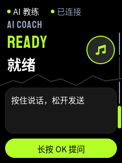
Ready

READY

<b>▶</b>hold OK

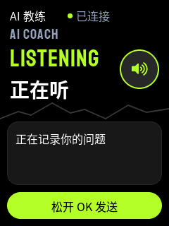
Listening

LISTENING

<b>▶</b>release

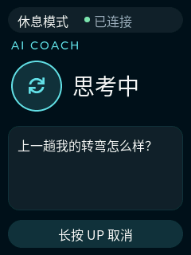
Thinking

THINKING

<b>▶</b>answer

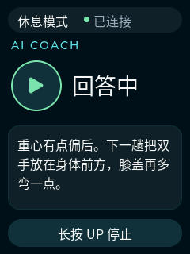
Answering

ANSWERING

<figcaption>Figure 4. One coach question. For the BLE messages, see Figure 7 in <a href="architecture.html">Architecture and protocol</a>.</figcaption>
</figure>

After a recognition error, the user can retry with a long press of OK. A lost phone connection must recover first.

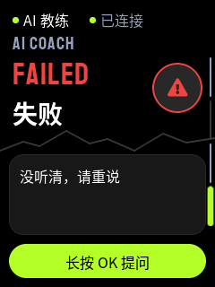
Not heard

FAILED

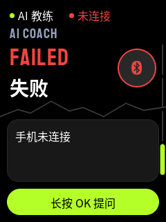
No phone

LINK LOST

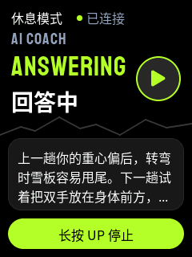
Long answer

4 lines, full voice

## Run data and report

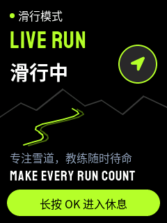
Waiting

No run yet

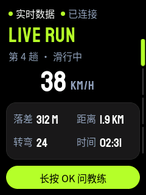
Running

Run 4 · 38 km/h

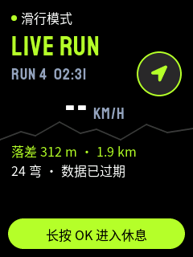
Old data

No frame for 5 s

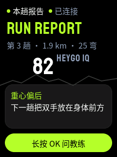
Report

Heygo IQ 82

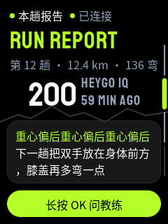
Limits

IQ 200 · 136 turns

## Turns

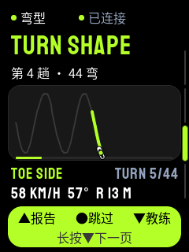
Drawing

TOE SIDE

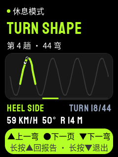
Heel side

HEEL SIDE

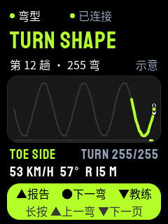
Schematic

255 turns

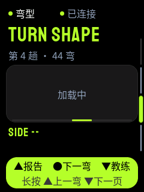
Loading

Waits for TURN_GROUP

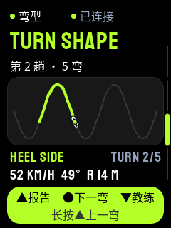
Short run

5 turns

## Phone popups

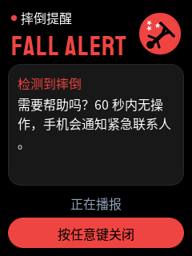
Fall alert

Red

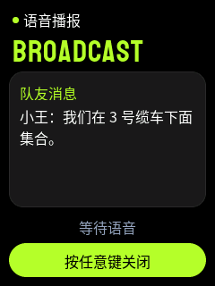
Voice notice

Green

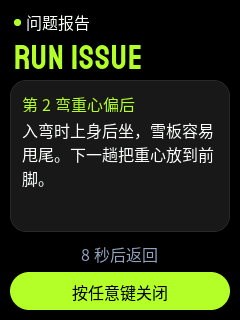
Issue report

Orange

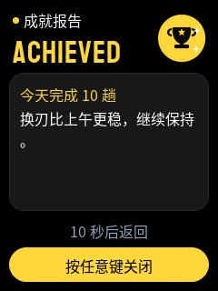
Achievement

Yellow

## All screens

<figure>

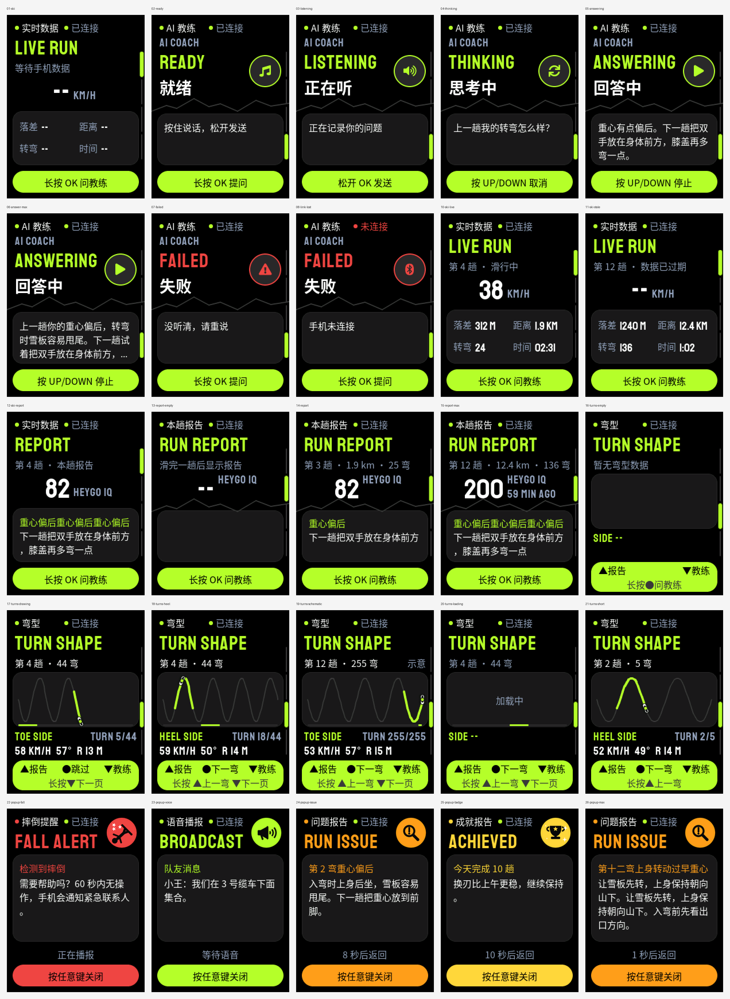

<figcaption>Figure 5. Overview of 25 screen states.</figcaption>
</figure>
