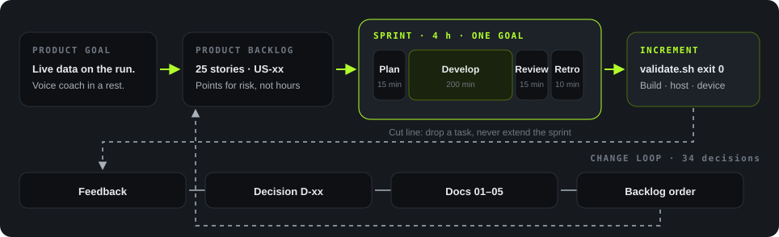
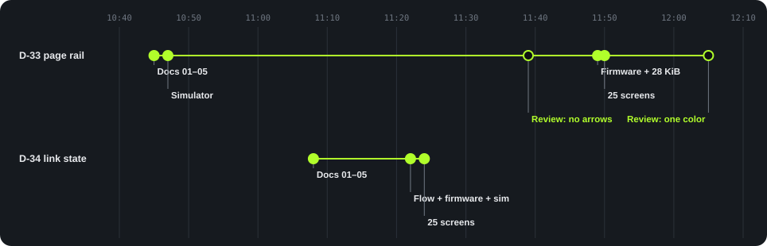

<p class="lang"><strong>English</strong> · <a href="scrum.zh_CN.html">简体中文</a></p>

<p class="eyebrow">Scrum</p>

# Delivery method

The project uses a four-hour Sprint plan with one goal per Sprint. Host development and device acceptance have separate results.
Actual Sprint durations were not recorded.

<div class="tiles">
<div class="tile accent"><div class="k">Sprints</div><div class="v">18</div></div>
<div class="tile"><div class="k">Planned duration</div><div class="v">4<small>h</small></div></div>
<div class="tile"><div class="k">User stories</div><div class="v">25</div></div>
<div class="tile"><div class="k">Requirements</div><div class="v">25</div></div>
<div class="tile"><div class="k">Decisions</div><div class="v">34</div></div>
</div>

## Delivery and change control

<figure>

<figcaption>Figure 13. Delivery path above, change loop below.</figcaption>
</figure>

The product goal defines the backlog. Each Sprint selects a delivery slice and reports its result.
Feedback changes the requirements through numbered decisions. The backlog order and estimates then change as needed.

The product goal is to show live data during skiing and provide voice coaching during rest.
The skier keeps the phone in a pocket and the gloves on.

| Level | ID | Page rail example |
|---|---|---|
| Requirement | REQ-xx | REQ-24: show the current position in the page loop. |
| User story | US-xx | US-24: page rail, 2–3 story points. |
| Acceptance test | TC-xx | TC-24: 40 page changes, with the thumb at its stop within 200 ms each time. |
| Sprint | 0–17 | Sprint 16: simulator, firmware, and acceptance. |

Story points compare effort and uncertainty. They do not represent hours.
The plan assumes no velocity. Five P0 stories still need new estimates after the scope reduction.

## Sprint structure

<div class="figure-panel">
<div class="timebox"><div class="f15">Plan 15</div><div class="f200 dev">Develop 200 min</div><div class="f15">Review 15</div><div class="f10">Retro</div></div>
</div>

| Event | Time | Output |
|---|---|---|
| Planning | 15 min | Sprint goal, tasks, and prerequisite check. |
| Development | 200 min | An increment that passes the Sprint checks. |
| Review | 15 min | Demonstration and separate build, host, and device results. |
| Retrospective | 10 min | One improvement for the next Sprint. |

The plan applies four controls:

1. Start only when the required inputs exist.
2. Return tasks to the backlog when the cut line applies.
3. Keep the time limit if the team misses the goal. The product owner decides the next step.
4. Require the repository gate to exit with code 0.

### Sprint 0 example

| Task | Budget | Exit check |
|---|---|---|
| Mode and audio state machine | 60 min | A host test for each transition. |
| P0 packet layer | 75 min | Packing, parsing, `xid`, and error codes. |
| IMA ADPCM codec | 60 min | Block size, round trip, lost blocks, and full-scale input. |
| Gate and build | 45 min | Passing gate and build, with static RAM recorded. |

The initial Sprint 0 plan allocated 240 minutes to development. The later Sprint template allocated 200 minutes within a 240-minute total.
Neither allocation proves the actual duration.

The cut line removed the codec task if the first two tasks exceeded 150 minutes. The planned raw PCM fallback kept protocol testing possible.
The gate and build task remained mandatory.
All four tasks completed without use of the cut line. Sprint 0 closed no user story because device and phone app acceptance remained.

## Acceptance and verification

Each delivery slice must meet its applicable conditions:

- The user completes the action on the device, with the real phone app where required.
- Host tests, repository checks, and the firmware build pass.
- Device tests cover Chinese text, keys, state changes, cancellation, and timing under recorded conditions.
- English and Chinese documents describe the same behavior.
- The report lists every remaining gap.

A simulator or stub cannot satisfy a device test or a real-service test.
The review format separates these results:

```text
Sprint: N
Sprint Goal: met / not met
Build: PASS / FAIL / NOT RUN
Host tests: PASS / FAIL / NOT RUN
Device tests: PASS / FAIL / PARTIAL / NOT RUN
Phone endpoint: real app / phone_sim
Unverified: remaining items
```

| Test condition | Scope |
|---|---|
| N1: indoor reference link | One device, one phone, and the real app. Proposed limits: round trip p95 of 150 ms, jitter p95 of 30 ms, and 1% loss. |
| N2: faults | Separate cases for 30 s link loss, app background operation, permission failure, MTU below 172, and five-minute clock offset. |
| U1: usability | Five adults perform the same tasks with bare hands and gloves, without assistance. |

### Separate code and acceptance sprints

| Story | Code sprint | Acceptance sprint |
|---|---|---|
| US-06 capture, US-07 playback | 0–1 | 6 |
| US-08 Coach exchange | 1 | 8 |
| US-15 gloves and Chinese text | 1 | 9 |
| US-02 data sync | 2 | 7 |
| US-21 live data | 3 | 7, 9 |
| US-03 run report | 4 | 7 |
| US-05 turns | 11 | 12 |
| US-22 phone popups | 13 | 14 |

This split let host development proceed before the board was available.
Acceptance needs the relevant board, protocol 0.2 app, real service, or test users.
Sprints 15–17 combine implementation and acceptance in one plan.

## Change implementation

The change process records feedback, updates backlog priority, revises estimates, and assigns a decision ID.
The 34 decisions include six replacements. D-29 replaced five earlier interaction decisions. D-30 then extended its page loop to four pages.

<figure>

<figcaption>Figure 14. Decision, implementation, and review sequence. Empty circles mark review changes.</figcaption>
</figure>

D-33 and D-34 followed the same sequence:

1. Update the paired requirement documents.
2. Implement the simulator, flow graph, and firmware behavior.
3. Apply review changes and render the 25 screens again.

D-33 first appeared in the simulator at 10:47. The 11:39 review removed the arrows before firmware implementation at 11:49.
The 12:05 review gave all rail stops the same color.
D-34 updated the flow graph, firmware, and simulator together at 11:22.

| Decision | First document change | Firmware change | Elapsed interval |
|---|---|---|---|
| D-33 page rail | 10:45 | 11:49 | 64 min, including one review round |
| D-34 link state | 11:08 | 11:22 | 14 min |

These intervals use commit timestamps. They do not measure work time.

## Engineering support

<div class="cards">
<div class="card"><span class="tag">Shared model</span><h4>One flow graph</h4><p><code>coach.flow.json</code> defines the firmware transition table and browser simulator behavior.</p></div>
<div class="card"><span class="tag">Review</span><h4>Online simulator</h4><p>GitHub Pages supports review of keys, states, and appearance without a board.</p></div>
<div class="card"><span class="tag">Verification</span><h4>Automatic gate</h4><p>The gate runs host tests, glyph and screen checks, simulator self-tests, and the firmware build.</p></div>
<div class="card"><span class="tag">Integration</span><h4>Feature branches</h4><p>Reports, turns, popups, and run start use separate development branches before integration into main.</p></div>
<div class="card"><span class="tag">Documents</span><h4>Paired languages</h4><p>D-06 requires English and Chinese documents. English text uses the asd-ste100 writing guidance.</p></div>
<div class="card"><span class="tag">Tests</span><h4>Host coverage</h4><p>The state machine, protocol, and ADPCM codec use plain C. The snapshot contains 33 test files.</p></div>
</div>

Simulator self-test coverage increased with the interface scope:



## Process gaps

| Gap | Required improvement |
|---|---|
| No actual duration records | Record Sprint start and end times before assessing the four-hour plan. |
| No written retrospective actions | Assign one action to the next Sprint. |
| Earlier statuses remain in the roadmap | Reconcile development and acceptance entries after each review. |
| No named Scrum roles | Assign ownership for backlog priority and acceptance. The user currently makes scope decisions. |
| Five P0 stories need estimates | Revise the estimates at planning. |

The staffing plan assumed one firmware developer and a separate phone app team.
Formal assignments for Product Owner, Scrum Master, and Developers remained empty.
