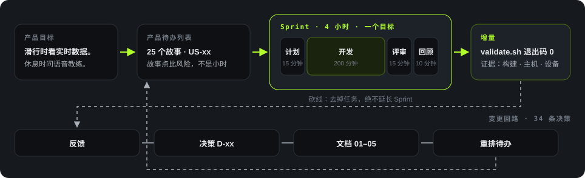
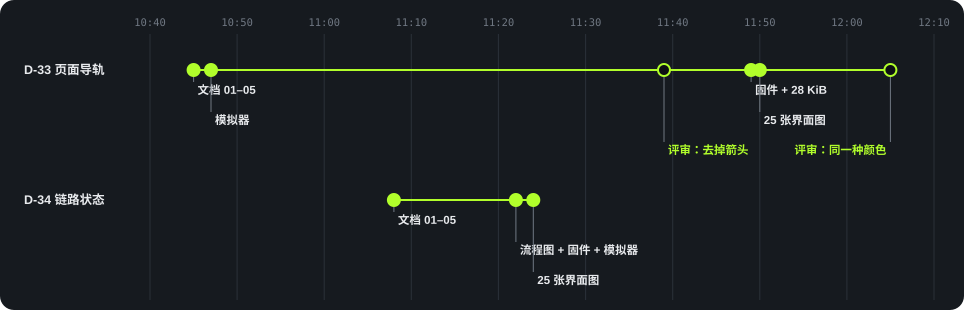

<p class="lang"><strong>简体中文</strong> · <a href="scrum.html">English</a></p>

<p class="eyebrow">Scrum</p>

# 交付方法

项目采用每个 Sprint 四小时、单一目标的计划。主机开发与设备验收分别记录结果。
实际 Sprint 用时未记录。

<div class="tiles">
<div class="tile accent"><div class="k">Sprint</div><div class="v">18</div></div>
<div class="tile"><div class="k">计划时长</div><div class="v">4<small>小时</small></div></div>
<div class="tile"><div class="k">用户故事</div><div class="v">25</div></div>
<div class="tile"><div class="k">需求条目</div><div class="v">25</div></div>
<div class="tile"><div class="k">决策</div><div class="v">34</div></div>
</div>

## 交付与变更管理

<figure>

<figcaption>图 13　上方为交付主线，下方为变更回路。</figcaption>
</figure>

产品目标确定待办列表，每个 Sprint 选择一个交付切片并报告结果。
反馈通过编号决策进入需求，再按需调整待办优先级与估算。

产品目标是在滑行中显示实时数据，在休息时提供语音教练服务。
滑雪者无需拿出手机或摘下手套。

| 层级 | 编号 | 页面导轨示例 |
|---|---|---|
| 需求 | REQ-xx | REQ-24：显示用户在页面循环中的位置 |
| 用户故事 | US-xx | US-24：页面导轨，2–3 故事点 |
| 验收用例 | TC-xx | TC-24：40 次翻页，滑块每次在 200 ms 内到位 |
| Sprint | 0–17 | Sprint 16：模拟器、固件和验收 |

故事点比较工作量和不确定性，不代表小时数。
计划不假定团队速度。P0 范围收窄后，5 个故事仍需重新估算。

## Sprint 结构

<div class="figure-panel">
<div class="timebox"><div class="f15">计划 15</div><div class="f200 dev">开发 200 分钟</div><div class="f15">评审 15</div><div class="f10">回顾</div></div>
</div>

| 事件 | 时长 | 产出 |
|---|---|---|
| 计划 | 15 分钟 | Sprint 目标、任务和前提条件检查 |
| 开发 | 200 分钟 | 通过 Sprint 检查的增量 |
| 评审 | 15 分钟 | 演示结果，分别报告构建、主机和设备测试 |
| 回顾 | 10 分钟 | 下一 Sprint 的一项改进 |

计划包含四项控制：

1. 所需输入齐备后才开始。
2. 达到任务裁剪线时，将指定任务退回待办列表。
3. 未达成目标时仍保持时间限制，由产品负责人决定下一步。
4. 仓库门禁的退出码必须为 0。

### Sprint 0 示例

| 任务 | 预算 | 完成检查 |
|---|---|---|
| 模式与音频状态机 | 60 分钟 | 每条转移有主机测试 |
| P0 消息包层 | 75 分钟 | 组包、解析、`xid` 和错误码 |
| IMA ADPCM 编解码 | 60 分钟 | 块大小、往返、丢块和满幅输入 |
| 门禁与构建 | 45 分钟 | 门禁和构建通过，记录静态 RAM |

初期 Sprint 0 计划将 240 分钟全部分配给开发，后续模板则在 240 分钟总时长内分配 200 分钟开发。
两者均为预算，不代表实际用时。

任务裁剪线规定：前两项任务合计超过 150 分钟时，移除编解码任务。计划中的裸 PCM 回退可继续支持协议测试。
门禁与构建必须保留。
四项任务均已完成，未触发裁剪线。Sprint 0 当时未关闭用户故事，仍需设备与手机应用验收。

## 验收与验证

每个交付切片需满足适用的条件：

- 用户在设备上完成操作，需要时使用真实手机应用。
- 主机测试、仓库检查和固件构建通过。
- 设备测试在记录的条件下覆盖中文、按键、状态变化、取消和时延。
- 中英文档描述相同行为。
- 报告列出所有剩余缺口。

模拟器或桩程序不能替代设备测试或真实服务测试。
评审格式分别列出结果：

```text
Sprint: N
Sprint Goal: 达成 / 未达成
Build: PASS / FAIL / NOT RUN
Host tests: PASS / FAIL / NOT RUN
Device tests: PASS / FAIL / PARTIAL / NOT RUN
Phone endpoint: 真实应用 / phone_sim
Unverified: 剩余事项
```

| 测试条件 | 范围 |
|---|---|
| N1：室内参考链路 | 一台设备、一部手机及真实应用。建议上限：往返时延 p95 为 150 ms、抖动 p95 为 30 ms、丢包率为 1% |
| N2：故障 | 分别测试链路中断 30 秒、应用后台运行、权限失败、MTU 低于 172、时钟偏移 5 分钟 |
| U1：可用性 | 5 名成年人分别徒手和戴手套完成相同任务，过程中无辅助 |

### 代码与验收分开安排

| 用户故事 | 代码 Sprint | 验收 Sprint |
|---|---|---|
| US-06 采集、US-07 播放 | 0–1 | 6 |
| US-08 教练交流 | 1 | 8 |
| US-15 手套与中文 | 1 | 9 |
| US-02 数据同步 | 2 | 7 |
| US-21 实时数据 | 3 | 7、9 |
| US-03 每趟报告 | 4 | 7 |
| US-05 弯型 | 11 | 12 |
| US-22 手机弹窗 | 13 | 14 |

这项安排让主机开发在开发板到位前继续进行。
验收按内容需要开发板、协议 0.2 应用、真实服务或测试者。
Sprint 15–17 则在同一计划中包含实现与验收。

## 变更实现

变更流程记录反馈、调整待办优先级、修订估算，并分配决策编号。
34 项决策中有 6 项被替代。D-29 替代了 5 项早期交互决策，D-30 再将页面循环扩展为四页。

<figure>

<figcaption>图 14　决策、实现与评审顺序。空心圆标记评审修改。</figcaption>
</figure>

D-33 与 D-34 均按以下顺序实现：

1. 更新中英成对的需求文档。
2. 实现模拟器、流程图和固件行为。
3. 应用评审修改，重新渲染 25 张界面图。

D-33 于 10:47 先进入模拟器。11:39 的评审移除了箭头，固件于 11:49 实现。
12:05 的评审统一了导轨格子的颜色。
D-34 于 11:22 同步更新流程图、固件和模拟器。

| 决策 | 首次文档变更 | 固件变更 | 时间间隔 |
|---|---|---|---|
| D-33 页面导轨 | 10:45 | 11:49 | 64 分钟，含一轮评审 |
| D-34 连接状态 | 11:08 | 11:22 | 14 分钟 |

上述间隔按提交时间计算，不代表工作用时。

## 工程支撑

<div class="cards">
<div class="card"><span class="tag">共享模型</span><h4>单一流程图</h4><p><code>coach.flow.json</code> 定义固件转移表与浏览器模拟器行为。</p></div>
<div class="card"><span class="tag">评审</span><h4>在线模拟器</h4><p>GitHub Pages 支持无开发板条件下的按键、状态和外观评审。</p></div>
<div class="card"><span class="tag">验证</span><h4>自动门禁</h4><p>门禁执行主机测试、字形与界面检查、模拟器自测和固件构建。</p></div>
<div class="card"><span class="tag">集成</span><h4>功能分支</h4><p>报告、弯型、弹窗和开始滑行分别使用开发分支，再集成至 main。</p></div>
<div class="card"><span class="tag">文档</span><h4>中英文配对</h4><p>D-06 要求中英文档成对，英文采用 asd-ste100 写作指导。</p></div>
<div class="card"><span class="tag">测试</span><h4>主机覆盖</h4><p>状态机、协议和 ADPCM 编解码使用纯 C，快照包含 33 个测试文件。</p></div>
</div>

模拟器自测覆盖随界面范围扩大而增加：



## 流程缺口

| 缺口 | 改进要求 |
|---|---|
| 未记录实际用时 | 记录 Sprint 起止时间，再评估四小时计划 |
| 未书面记录回顾行动 | 为下一 Sprint 指定一项行动 |
| 路线图保留早期状态 | 每次评审后同步开发和验收条目 |
| Scrum 角色未具名 | 明确待办排序和验收责任人，目前范围决策由用户做出 |
| 5 个 P0 故事待估算 | 在计划阶段重新估算 |

人员计划为一名固件开发人员，以及独立的手机应用团队。
产品负责人、Scrum Master 和开发人员的正式指派仍为空。
