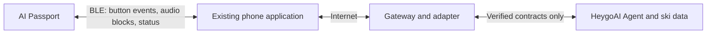
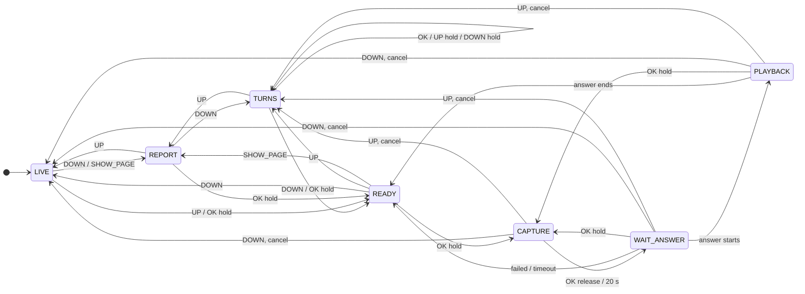
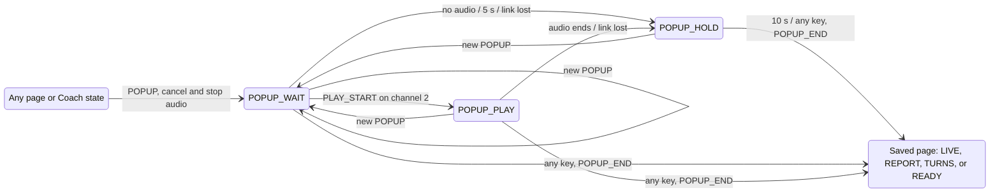
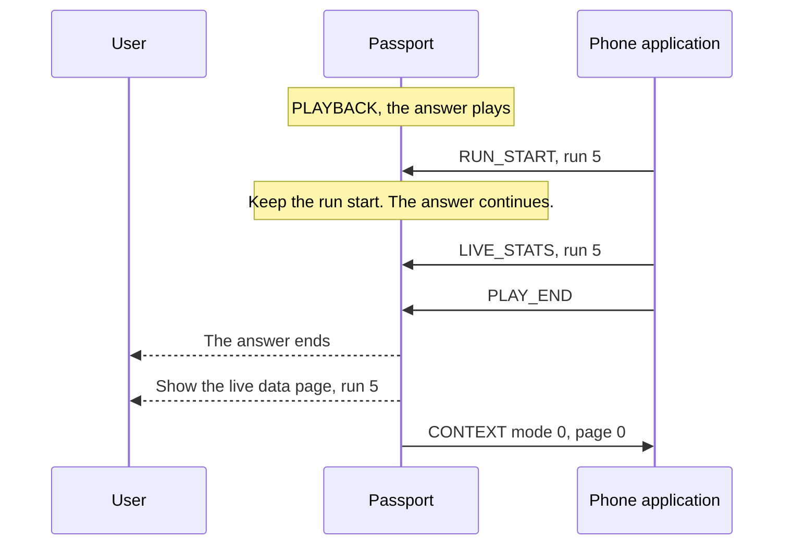
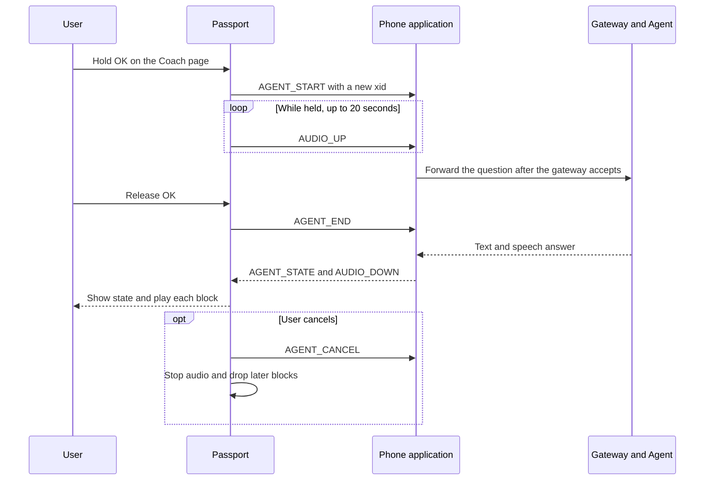
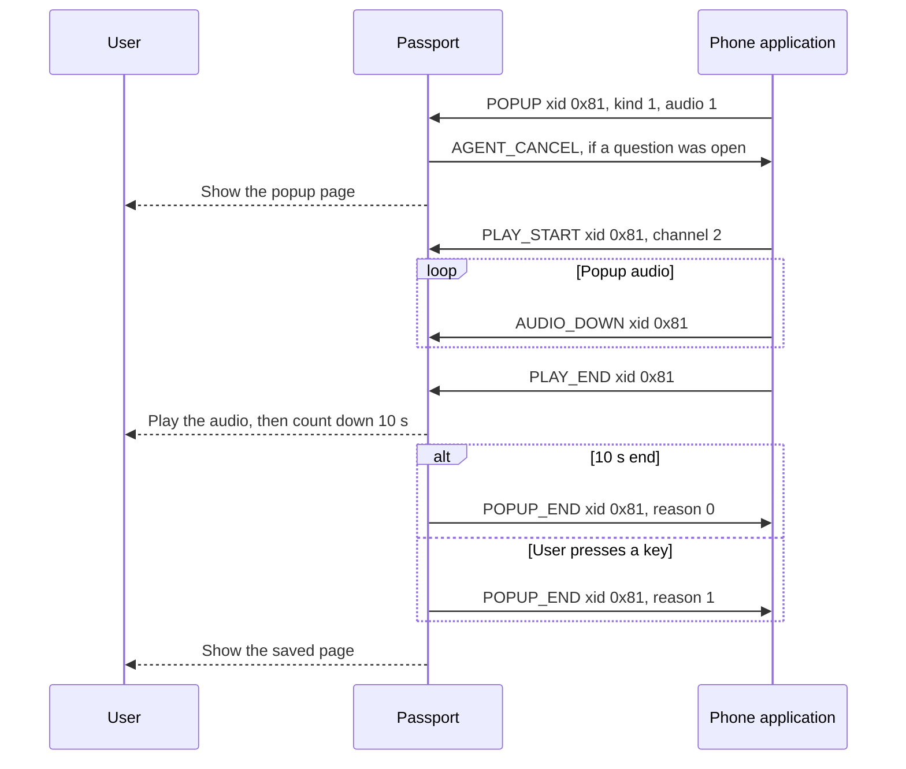

[简体中文](02-architecture.zh_CN.md) · **English**

# HeygoAI × AI Passport: architecture

Version: 0.11. Date: 2026-10-18. Status: Draft for engineering review.

This document proposes a design for Increments 1 to 4 in [product requirements](01-product-requirements.md).
It does not describe a working integration.
[Decision amendments](05-decision-amendments.md) gives the reason behind each decision.
The [BLE protocol draft](07-ble-protocol-draft.md) defines the packets.

## 1. Evidence and limits

| State | Evidence | Design consequence |
|---|---|---|
| Product data | ESP32-C3, 8 MB Flash, no PSRAM | Limit memory and message sizes. |
| Product data | 240 × 320 screen, RGB565 | Use compact pages and buttons. |
| BSP source | UP, DOWN, and OK share one ADC input | Never require two buttons at once. |
| BSP source | Default hold threshold of 500 ms | Use 500 ms for every hold. |
| BSP source | ES8311 microphone and speaker at 16 kHz, 16-bit, mono | Test voice under real conditions. |
| Product data | 500 mAh battery | D-18 defers power management. Claim no runtime. |
| Conditional | The battery gauge can be absent or return `-1` | Show an unknown state, not a false percentage. |
| Measured build | A build without Wi-Fi left 180,840 bytes of static D/IRAM free | Use this figure as the starting budget. |
| Team statement | A phone application exists. Another team develops it. | Doc 07 proposes the link. Q-13 tracks the review. |
| Unverified | HeygoAI APIs and coaching tools | The phone application owns the integration. |
| Unverified | IMU, GNSS, barometer, touch | Use button controls and phone data. |
| Unverified | Water, cold, wind, gloves, sunlight, range, runtime | Keep these items in pilot tests. |

Concurrent microphone and speaker APIs do not prove echo cancellation.

Source baseline: `/Users/dylan/AI-passport`, commit `3d685a90bdb96dd8526d84edde1e63fec25b460e`.
That baseline is a separate repository.

## 2. System boundary

D-08 selects a BLE phone bridge. The device acts as a BLE peripheral. The phone application acts as the central.
The device does not join Wi-Fi. It needs no provisioning screen.

D-12 keeps the first-version link open. The link uses no encryption, no passkey, and no binding check.
Any nearby BLE client can connect. The first version accepts that risk.
The device accepts one phone at a time.

### Responsibility map

D-14 limits the device to four tasks:

1. Tell the phone about button events.
2. Stream microphone blocks to the phone.
3. Play the audio blocks that the phone streams.
4. Show the status, the short text, and the ski data that the phone supplies.

| Component | Owns | Does not claim |
|---|---|---|
| HeygoAI | Ski analysis and coaching after contract checks | Undocumented APIs |
| Phone application | Device connection, account, speech recognition, speech synthesis, the ski session context, the ski data calculation, gateway requests, and retries | Guaranteed background execution |
| Gateway and adapter | Contract conversion and session routing | New ski measurements |
| Passport application | The four device tasks, the modes, button state, and audio ownership | Local speech recognition or a local language model |
| Passport BSP | Screen, buttons, audio format, volume, and buses | Product pages or coaching logic |

## 3. Pages, buttons, and screen

### Pages (D-29, D-30)

The device has no Ski mode and no Rest mode. Four pages sit at one level and form a loop:

| Order | Page | States | Content |
|---|---|---|---|
| 1 | Live data page | LIVE | The page after start. Ski data, or the report summary after a run. |
| 2 | Report page | REPORT | The full report of the last run. |
| 3 | Turns page | TURNS | The shape of the last run, 8 turns at a time (D-30). |
| 4 | Coach page | READY, CAPTURE, WAIT_ANSWER, PLAYBACK | Questions to the AI coach. Voice works only on this page. |

The device cannot check whether the user stopped moving. So an OK hold on another page only opens the Coach page, and never starts capture.
Capture needs one more OK hold on the Coach page.
A rail on the right edge shows the current page and the targets of the short UP and DOWN presses (D-33). The page rail layout section gives its design.

### Popups (D-31)

The phone can send a popup (POPUP) at any time. The popup page is not in the page loop. Three states belong to it:

| State | Screen | Meaning |
|---|---|---|
| POPUP_WAIT | Popup page | The popup shows. Its audio did not start yet. |
| POPUP_PLAY | Popup page | The popup audio plays. |
| POPUP_HOLD | Popup page | The 10-second countdown runs. |

- A POPUP moves every state to POPUP_WAIT at once. In CAPTURE, the device stops capture and sends AGENT_CANCEL. In WAIT_ANSWER, it sends AGENT_CANCEL. In PLAYBACK, it stops the speaker and sends AGENT_CANCEL.
- Before the first popup, the device saves the page: LIVE, REPORT, or TURNS. The Coach page states save READY.
- A popup with no audio goes to POPUP_HOLD in the same step. A popup with audio waits 5 seconds for PLAY_START on channel 2.
- In POPUP_HOLD, a timer runs for 10 seconds. A link loss in POPUP_WAIT or POPUP_PLAY also starts the countdown.
- Each key event closes the popup: a short press or a hold of UP, DOWN, or OK. The device sends POPUP_END with reason 0 (timeout) or 1 (key), and goes to the saved page in the same step.
- The OK release has no transition in the popup states. So the release of an OK hold that started before the popup does not close it.
- A new POPUP replaces the old one. The link core sends POPUP_END with reason 2 (replaced) for the old one. The saved page does not change.
- Each popup timer event carries the popup number. The device drops the timer event of a replaced popup.
- During a popup, CONTEXT and DEVICE_STATUS send mode 0 and page 6.

### Run start (D-32)

When the phone detects the start of a run, it sends RUN_START with the run number.
The link core puts the run in the live data at once: run state skiing, and each value unknown. Then the Coach task gets the RUN_START event.

| State when RUN_START arrives | Device action |
|---|---|
| LIVE | No page change. The data refresh shows "第 N 趟 · 滑行中" and "--" for each value. |
| REPORT, TURNS, READY | Go to LIVE at once. |
| CAPTURE, WAIT_ANSWER, PLAYBACK | Stay in the state. Keep the run start (`run_after_coach`). Cancel nothing. |
| POPUP_WAIT, POPUP_PLAY, POPUP_HOLD | Stay in the state. Change the saved page to LIVE (`popup_back_live`). |

- The talk with the coach ends when the state goes to READY. The answer ends, the question fails, a timeout comes, or the link goes down. In the same step, the device sends the RUN_START event again and goes to LIVE.
- If the user leaves the talk with a short UP or DOWN press, the device cancels the question as before. Then it goes to LIVE, also after a short UP press.
- A new OK hold in WAIT_ANSWER or PLAYBACK starts a new question. The device keeps the run start.
- A popup that interrupts a talk with a kept run start saves LIVE as the page before the popup. The kept run start then ends.
- A RUN_START for the run that shows already, and that did not end, keeps the data.
- RUN_START uses `xid` 0. The device sends no acknowledgment. Before HELLO_ACK, it ignores the packet.

The interactive simulator gives the full state diagram from `flows/coach.flow.json`. See `assets/sim/coach-flow.html`.

### Buttons

| Where | Input | Behavior |
|---|---|---|
| Any page | Short DOWN press | Go to the next page. After the Coach page comes the live data page. |
| Any page | Short UP press | Go to the previous page. Before the live data page comes the Coach page. |
| Live data page, Report page, Turns page | Hold OK for 500 ms | Open the Coach page. This press never starts capture. |
| Coach page, idle | Hold OK for 500 ms | Start capture. Stream each block to the phone. |
| Coach page, capture runs | Release OK | Stop capture within 100 ms. Tell the phone that the question ended. |
| Coach page, capture runs | Reach 20 seconds | Stop capture. Show the limit. |
| Coach page, wait or playback runs | Hold OK for 500 ms | Stop playback and cancel the last exchange. Then start capture. |
| Coach page, capture, wait, or playback runs | Short UP or DOWN press | Cancel the question and stop the audio first. Then change the page. |
| Turns page | Short OK press | Select the next turn. The page of 8 turns follows it. While the first page draws, show it at once (D-30). |
| Turns page | Hold UP for 500 ms | Select the previous turn. |
| Turns page | Hold DOWN for 500 ms | Go to turn 1 of the next page of 8 turns. After the last page, go to page 1. |
| Other pages | Short OK press, UP hold, or DOWN hold | No action. |
| Popup page | Any short press or hold | Close the popup and go back to the saved page (D-31). No page change and no capture. |
| Any page or state | RUN_START from the phone | Open the live data page (D-32). During a talk with the coach, open it after the talk ends. During a popup, open it after the popup closes. |

The three buttons share one ADC input. So while the user holds OK, the device cannot read UP or DOWN. To change the page during capture, the user releases OK first.
A hold never also triggers a short press.
The cancel command comes with the short UP or DOWN press. Playback stops within 200 ms of that command. Capture stops within 100 ms of that command.

Button callbacks queue an event and return at once. A task handles the link and the audio.

### Coach page layout

Coordinates use screen pixels from the top-left corner.
The screen has a corner mask with a 30-pixel radius. Key text stays out of the mask.

| Area | Range | Content |
|---|---|---|
| Status bar | `x=32..207, y=0..35` | Page name, link state, battery |
| Destination | `x=12..227, y=36..67` | The words "AI coach" |
| State | `x=12..227, y=68..187` | Ready, listening, thinking, answering, or failed, with an icon |
| Text | `x=12..227, y=188..283` | A short transcript, a short answer, or a retry message |
| Button hints | `x=32..207, y=284..319` | The current hold actions |

The page uses a new design. It does not reuse the demo menu or its frame.
Check the glyph coverage of every Chinese string. A successful build does not prove that Chinese text shows.

### Live data page layout

D-21 replaces the live data page body with ski data. The status bar and the button hints use the same areas as on the Coach page.
The positions come from `flows/coach.flow.json`, and the host screen check passes. `main/ui/ski_view.c` makes the texts.

| Widget | Position | Font | Content |
|---|---|---|---|
| `dest` | `x=14, y=36` | 34 px brand font | "LIVE RUN". After the run ends, "RUN ENDED". After the report arrives, "REPORT" |
| `sub` | `x=14, y=80` | 16 px Chinese | "第 4 趟 · 滑行中", or the stopped, out-of-date, report-on-the-way, or run-report text. With no data, "等待手机数据" |
| `big` | `x=14..110, y=104`, right-aligned | 48 px brand font | The speed. After the report arrives, the Heygo IQ |
| `unit` | `x=116, y=128` | 20 px brand font | "KM/H". After the report arrives, "HEYGO IQ" |
| `body_panel` | `x=10..230, y=168..262` | None | The background of the data panel |
| `k_drop` + `drop` | `x=22` and `x=60`, `y=182` | Name in 16 px Chinese, value in 20 px brand font | Vertical drop |
| `k_dist` + `dist` | `x=126` and `x=164`, `y=182` | As above | Distance |
| `k_turns` + `turns` | `x=22` and `x=60`, `y=220` | As above | Turn count |
| `k_time` + `time` | `x=126` and `x=164`, `y=220` | As above | Run time |
| `problem`, `tip` | `x=22`, `y=180` and `y=204` | 16 px Chinese | Hidden until the report arrives. Then they replace the four cells |

- Each value sits 2 pixels below its name, so that the two baselines align.
- The live data page has no state icon and no ridge line. With both, it had 23 widgets, the host render used all of the LVGL pool, and the drawing hung. Without them, the peak is 18,752 of 21,656 bytes (86%).
- The 48-pixel font is Staatliches from brand version B. It holds all ASCII characters. It stays in Flash, with a bitmap of 26,115 bytes.
- No color marks a fast or slow speed.

### Report page layout

| Widget | Position | Font | Content |
|---|---|---|---|
| `dest` | `x=14, y=36` | 34 px brand font | "RUN REPORT" |
| `title` | `x=14, y=80` | 16 px Chinese | "第 3 趟 · 1.9 km · 25 弯". With no report, "滑完一趟后显示报告" |
| `iq` | `x=14..110, y=105`, right-aligned | 48 px brand font | The Heygo IQ |
| `iq_name` | `x=116, y=106` | 20 px brand font | "HEYGO IQ" |
| `age` | `x=116, y=131` | 20 px brand font | "3 MIN AGO", from 60 seconds after the report arrives |
| `problem` | `x=22, y=182` | 16 px Chinese | The core problem, at most 12 Chinese characters, on one line |
| `tip` | `x=22, y=206`, height 50 | 16 px Chinese, at most two lines | The tip, at most 20 Chinese characters |

D-28: when the phone sends SHOW_PAGE 3, the state machine goes to REPORT from LIVE and READY only.
CAPTURE, WAIT_ANSWER, and PLAYBACK have no such transition. They ignore it, so the user is never stopped.

### Turns page layout

| Widget | Position | Font | Content |
|---|---|---|---|
| `dest` | `x=14, y=36` | 34 px brand font | "TURN SHAPE" |
| `title` | `x=14, y=80` | 16 px Chinese | "第 4 趟 · 8 弯". With no shape, "暂无弯型数据" |
| `source` | `x=170..226, y=80`, right-aligned | 16 px Chinese | "示意" for a schematic shape. Else empty |
| `shape_panel` | `x=10, y=108`, 220 × 96 | None | The box of the shape |
| `path` | In the box | Line, 2 px | The whole run, from left to right |
| `turn` | In the box | Line, 4 px, accent color | The selected turn |
| `rider` | In the box | 20 px sprite, 16 frames | While the first page draws, it sits at the head of the line. Then it moves along the selected turn in 1.6 s. It faces along the line |
| `msg` | In the box, centered | 16 px Chinese | "加载中" while the page is not here. "蓝牙断开" when it cannot come |
| `track`, `thumb` | `x=20, y=199`, 200 × 3 | None | With more than one page: the whole run, and this page on it |
| `side` | `x=14, y=208` | 20 px brand font | "TOE SIDE" or "HEEL SIDE" |
| `counter` | `x=112..226, y=208`, right-aligned | 20 px brand font | "TURN 18/44". It counts in the whole run |
| `metrics` | `x=14, y=233` | 20 px brand font | "54 KM/H  55°  R 12 M". An unknown value shows "--" |
| `key_up`, `key_ok`, `key_down` | `y=264`, left, middle, right | 16 px Chinese, on the accent bar | The short presses: "▲报告", "●下一弯" or "●跳过", "▼教练" |
| `key_hold` | `y=289`, second row of the accent bar | 16 px Chinese, dark gray | The holds that work now: "长按 ▲上一弯 ▼下一页" (hold UP for the previous turn, hold DOWN for the next page), or one of them. With no hold, "长按●问教练" (hold OK for the coach) |

Short UP and DOWN presses change the page, as on every page. Inside the page, OK and the two holds move a cursor on the run, one turn at a time. The page shows the 8 turns around the cursor.
The page of 8 turns is one group of doc 07. The device asks the phone for the groups next to it.
When the Turns page opens, the device draws the first page, one point each 40 ms. Later pages show at once.
Each page maps 0 to 255 on each axis to the full box. The phone therefore sets the scale of each page.
It rounds the corners of the line twice (Chaikin), so 33 points become 132 points on the screen.
The key hints sit left to right in the order of the keys from top to bottom: UP, OK, DOWN.
The rider is a sprite sheet of 16 frames, one frame for each 22.5 degrees. The device picks a frame. It does not rotate an image.

### Page rail layout (D-33)

The rail sits on the right edge of the four pages. The popup page hides it.

| Part | Position | Look |
|---|---|---|
| Rail | `x=231..238, y=64..251` | No background |
| 4 stops | `x=234..235`, 2 × 44 px, `y=64 + 48 × i`, 4 px gap | Dark gray `#3A3A3A`. Order: live data, report, turns, coach |
| Target stops | The stops of the short UP and DOWN targets | Light gray `#94A3B8` |
| `▲`, `▼` | 6 × 4 px triangles, in the 4 px gap above the UP target and below the DOWN target | Light gray `#94A3B8` |
| Thumb | `x=232..237`, 6 × 44 px, corner radius 3 | Accent lime `#B1FE2B`, with a 6 px glow |

The rail reads the targets from the flow graph `flows/coach.flow.json`. It does not keep a second copy of the page order. So a change of the loop also changes the targets.
The thumb slides to the new stop in 180 ms, with an ease-out curve.
Two page changes wrap: UP from live data to coach, and DOWN from coach to live data. In a wrap, the thumb uses 90 ms to slide out past one end. Then it jumps to the other end and uses 90 ms to slide in.
The rail starts at `y=64`. So it stays below the corner mask and the status bar, and above the key hints.
The text, the boxes, and the key hints of every page stay at `x≤230`. Only the decorative ridge line of the Coach page and the Report page goes under the rail, at `y=146..174`.

The simulator `assets/sim/coach-flow.html` shows the rail. Its self-test checks the stops, the targets, and the wrap on three pages.
The firmware part is the next step. Only one screen exists at a time, so the rail must live on the top layer of LVGL. Then the thumb can move while the task deletes the old screen and builds the new screen.
The rail adds at most 7 objects. Measure the pool use before the merge. The gate on `5658911` shows a pool peak of 18,760 of 21,656 bytes.

### Popup page layout

| Widget | Position | Font | Content |
|---|---|---|---|
| `mode_dot`, `mode` | `x=14..136, y=10` | 16 px Chinese | The kind: "摔倒提醒", "语音播报", "问题报告", or "成就报告" |
| `dest` | `x=14, y=36`, width 152 | 34 px brand font | "FALL ALERT", "BROADCAST", "RUN ISSUE", or "ACHIEVED" |
| `icon` | `x=172, y=14`, 56 × 56 | Image | The badge of the kind. Its 4 frames play in a loop, 160 ms each |
| `body_panel` | `x=10, y=80`, 220 × 152 | None | The box of the texts |
| `title` | `x=22, y=92`, height 20 | 16 px Chinese, one line | The title from the phone, at most 12 Chinese characters. With no title, a default title for the kind |
| `body` | `x=22, y=118`, height 104 | 16 px Chinese, more than one line | The body from the phone, at most 40 Chinese characters |
| `foot` | `y=242`, centered | 16 px Chinese | "等待语音" (waiting for audio), "正在播报" (playing), or "N 秒后返回" (back in N seconds) |
| `hint_panel`, `hint` | `x=10, y=272`, 220 × 38 | 16 px Chinese, on the colored bar | "按任意键关闭" (any key closes) |

Each kind has a color for the dot, `dest`, `title`, the bar, and the badge:

| Kind | Color | Badge |
|---|---|---|
| Fall alert | Danger, red `#EF4444` | A rider on the back with the board up. Three stars turn above. |
| Voice message | Accent, lime `#B1FE2B` | A megaphone. The sound waves come out one by one. |
| Problem report | Warn, orange `#FF9F1C` | A magnifier with "!". It swings from side to side. |
| Achievement | Gold `#FFD43B` | A cup. Small stars flash around it. |

`assets/tools/gen_popup_icons.py` draws the badges: 16 images of 56 × 56 px, ARGB8888, 200,704 bytes of Flash.
When a popup comes, `main/ui/popup_anim.c` moves the parts in:

1. The badge falls from 80 px above and bounces (520 ms). A fall alert then shakes the badge (380 ms).
2. `dest` slides in from 40 px to the left (300 ms, from 60 ms).
3. The text box rises from 48 px below, with a small overshoot (360 ms, from 120 ms).
4. The footer and the bar rise from below (300 ms, from 240 ms).

All movement ends within 900 ms. The animations change only position offsets, so LVGL needs no extra layer memory.
Each animation belongs to its widget, so the screen delete also stops it. A new popup starts the animation again.
`assets/mockups/popup-anim.gif` shows the animation, drawn by the host renderer with a fake clock.
The countdown text changes each second with the data tick. It rounds up, so the first second shows "10".
`main/ui/popup_view.c` makes all texts. The host test `tests/test_popup_view.c` checks them.

Only one screen exists at a time. On a page change, the task deletes the old screen first and then builds the new screen.
Images 10 to 26 in `assets/mockups` come from the host renderer. Images 22 to 26 show the popup page (D-31). Image 9 no longer exists, because D-29 deleted the exit question. They include the longest texts.

## 4. Audio state

In P0 the audio owner has three values: None, AgentCapture, and AgentPlayback.
An owner holds one audio direction. Capture and playback never run together.
A mode change cancels the current owner.

D-11 makes the device a streaming microphone and speaker for the phone.
The device holds a few blocks at most. It never holds a whole question or a whole answer.
D-09 sets the block format: IMA ADPCM at 16 kHz, mono, in 20 ms blocks.

The phone holds the question until the gateway accepts it. This rule keeps the first words.
The phone runs speech recognition and speech synthesis.
A cancel ends the exchange. The device drops every later block of that exchange.
A reconnect cancels the open exchange.

### Popup audio (D-31)

The popup audio uses the same downlink path as the answer, on channel 2 (BP_CHANNEL_POPUP).

- The device accepts PLAY_START on channel 2 only for the current popup xid, and only if the popup audio flag is 1.
- AUDIO_DOWN and PLAY_END must have the xid of the open stream. The stream is the answer or the popup audio, never both.
- When a popup interrupts PLAYBACK, the device stops the speaker with `audio_play_cut`. Unlike `audio_play_stop`, it keeps the queued blocks. The popup audio can already be in the queue before the Coach task stops the old answer.
- A key press or a new popup closes the popup audio stream. The device drops its later blocks.

## 5. Resources

### Memory budget

PCM at 16 kHz, mono, and 16 bits uses 32,000 bytes per second. A 20-second question uses 640,000 bytes.
The device has no PSRAM. Streaming makes a full recording unnecessary.

| Allocation | Design | Evidence or limit |
|---|---|---|
| LVGL draw buffer | One 40-line RGB565 buffer | Current source uses 19,200 bytes. |
| LVGL pool | 24 KiB | Current `sdkconfig.defaults` value. |
| BLE packet queues | 3,440 bytes | Doc 07, section 10. |
| The last LIVE_STATS and RUN_REPORT | 128 bytes | Doc 07, section 10. The struct sizes measured on the host. |
| The last TURN_SHAPE, 3 cached groups, and the Turns page | About 4.0 KB | Doc 07, section 10. The symbol table of the firmware build. |
| The current popup and the popup page texts | About 0.7 KB | D-31. Estimated from the struct sizes: three copies of the popup and one set of page texts. Not measured. |
| Page rail | At most 7 LVGL objects in the pool | D-33. Not measured. The pool peak on `5658911` is 18,760 of 21,656 bytes. |
| Rider sprite | 25.6 KB in Flash, not in RAM | `assets/sprites`, made by `assets/tools/gen_sprite.py`. |
| 48-pixel digit font | In Flash, not in RAM | Measure the size in Sprint 3. |
| ADPCM codec state | A few bytes in each direction | D-09. |
| BLE stack, task stacks, fonts, firmware | Measure on hardware | Do not claim that the rest is enough. |

Each queue has a fixed size and an overflow rule. A slow link never grows a queue.

### Power

D-18 defers power management. The first version uses no sleep mode. It requests the best-performance BLE link settings in doc 07, section 4.
The screen still shows the battery level, or an unknown state.

### Audio blocks

| Format | Bytes per second | Device cost |
|---|---|---|
| Raw PCM | 32,000 | No codec work. Four times the ADPCM load. |
| IMA ADPCM | 8,000 | A few integer steps per sample. |
| Opus | About 3,000 | A new library. An Opus reference on this board used a 24 KB encoder task stack. |

One 20 ms ADPCM block uses 164 bytes. Doc 07 defines the layout.
Raw PCM stays a fallback for diagnostics. Opus waits until ADPCM works and the team measures its cost.

## 6. Failure behavior

| Failure | Device behavior | Phone behavior |
|---|---|---|
| Link loss | Stop audio. Show the link state. | Drop the open exchange. |
| Phone silent for 15 seconds | Show that the phone application does not respond. | None. |
| Agent timeout | End the exchange. Show a timeout. | Drop late output. |
| Recognition failure | Ask the user to repeat the question. | Report the failure. |
| Audio queue overflow | Drop the oldest block. | Keep real-time pace. |
| Low memory | Stop audio before an allocation fails. Show an error. | Stop streaming. |
| Unknown battery | Show an unknown battery state. | None. |
| No LIVE_STATS for 5 seconds | Show the speed as "--". Keep the other numbers with an out-of-date mark. | Send again. |
| LIVE_STATS with a wrong length | Send ERROR code 2. Keep the old packet. | Send a packet of the right length. |
| The phone cannot calculate a field | Show "--" for that field. | Send the unknown value, never 0. |
| Link loss during a popup | Keep the popup. Stop its audio. Start the 10-second countdown. Send no POPUP_END. | A new connection resets every xid. Treat the popup as closed. |
| No PLAY_START within 5 seconds of a popup with audio | Start the countdown. | Send the audio sooner, or send the popup with audio flag 0. |
| POPUP with a bad field | Send ERROR code 7, 4, or 2. Show nothing. | Send a packet with valid fields. |
| RUN_START with run number 0 or 0xFF | Send ERROR code 7. Keep the page and the data. | Send a run number from 1 to 254. |

D-12 and D-13 exclude security and privacy work. The device stores no account data and no token.

## 7. P1 and Deferred items

D-17 moved these items out of P0. Each item needs its own design work before it returns.

- **Live data and the Report page (Increment 2).** Section 3 gives the page design. Doc 07 gives LIVE_STATS. The device keeps only the last packet, in RAM.
- **Charts and the offline cache (P1, after Increment 2).** Charts need many data points over time. The offline cache writes the last data to Flash. Neither item has a design yet.
- **Human intercom (P1).** The Team page waits for a start message from the phone before capture. It reuses the Coach audio path. Each speech path crosses two BLE links. The 500 ms audio target lacks a measurement.
- **Turn shape (Increment 3, D-30).** Section 3 gives the page design. Doc 07 gives TURN_SHAPE, TURN_GROUP, and TURN_REQUEST. The device keeps at most 3 groups of the last shape, in RAM. Until Q-02 gives a measured track, the phone sends schematic shapes, and the page shows "示意".
- **Phone popups (Increment 4, D-31).** Section 3 gives the states and the page. Section 4 gives the popup audio. Doc 07 gives POPUP and POPUP_END. The device keeps only the current popup, in RAM. The phone owns the escalation of a fall alert.

Commit `970bb8e` holds the version 0.3 design for these items.

## 8. Review gates

1. Select a transport. D-08 closed this gate.
2. Agree the BLE protocol with the phone application team. Doc 07 holds the device draft.
3. Accept the three-page pilot on real hardware.
4. The phone application team accepts the LIVE_STATS fields of protocol 0.2 (Q-16).

Open items: the review of doc 07, the phone platform, the HeygoAI coaching tools, the run detection rules, and the cold limits.
D-18 defers every power and battery-life item.
Do not treat a diagram or a successful build as hardware validation.
