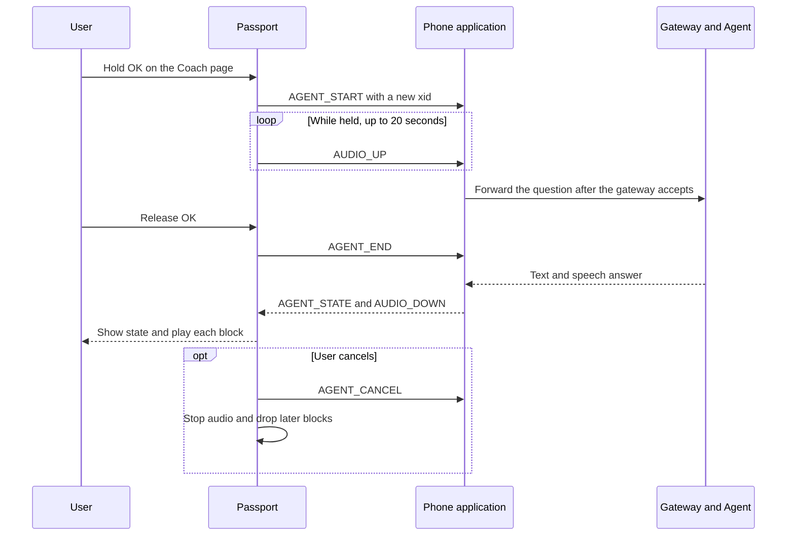

[简体中文](02-architecture.zh_CN.md) · **English**

# HeygoAI × AI Passport: architecture

Version: 0.5. Date: 2026-10-16. Status: Draft for engineering review.

This document proposes a design for the P0 scope in [product requirements](01-product-requirements.md).
It does not describe a working integration.
[Decision amendments](05-decision-amendments.md) gives the reason behind each decision.
The [BLE protocol draft](07-ble-protocol-draft.md) defines the packets.

## 1. Evidence and limits

| State | Evidence | Design consequence |
|---|---|---|
| Product data | ESP32-C3, 8 MB Flash, no PSRAM | Limit memory and message sizes. |
| Product data | 240 × 320 screen, RGB565 | Use compact pages and buttons. |
| BSP source | UP, DOWN, and OK share one ADC input | Never require two buttons at once. |
| BSP source | Default hold threshold of 500 ms | Use 500 ms for every hold. |
| BSP source | ES8311 microphone and speaker at 16 kHz, 16-bit, mono | Test voice under real conditions. |
| Product data | 500 mAh battery | D-18 defers power management. Claim no runtime. |
| Conditional | The battery gauge can be absent or return `-1` | Show an unknown state, not a false percentage. |
| Measured build | A build without Wi-Fi left 180,840 bytes of static D/IRAM free | Use this figure as the starting budget. |
| Team statement | A phone application exists. Another team develops it. | Doc 07 proposes the link. Q-13 tracks the review. |
| Unverified | HeygoAI APIs and coaching tools | The phone application owns the integration. |
| Unverified | IMU, GNSS, barometer, touch | Use button controls and phone data. |
| Unverified | Water, cold, wind, gloves, sunlight, range, runtime | Keep these items in pilot tests. |

Concurrent microphone and speaker APIs do not prove echo cancellation.

Source baseline: `/Users/dylan/AI-passport`, commit `3d685a90bdb96dd8526d84edde1e63fec25b460e`.
That baseline is a separate repository.

## 2. System boundary

D-08 selects a BLE phone bridge. The device acts as a BLE peripheral. The phone application acts as the central.
The device does not join Wi-Fi. It needs no provisioning screen.

D-12 keeps the first-version link open. The link uses no encryption, no passkey, and no binding check.
Any nearby BLE client can connect. The first version accepts that risk.
The device accepts one phone at a time.

### Responsibility map

D-14 limits the device to four tasks:

1. Tell the phone about button events.
2. Stream microphone blocks to the phone.
3. Play the audio blocks that the phone streams.
4. Show the status and the short text that the phone supplies.

| Component | Owns | Does not claim |
|---|---|---|
| HeygoAI | Ski analysis and coaching after contract checks | Undocumented APIs |
| Phone application | Device connection, account, speech recognition, speech synthesis, the ski session context, gateway requests, and retries | Guaranteed background execution |
| Gateway and adapter | Contract conversion and session routing | New ski measurements |
| Passport application | The four device tasks, the modes, button state, and audio ownership | Local speech recognition or a local language model |
| Passport BSP | Screen, buttons, audio format, volume, and buses | Product pages or coaching logic |

## 3. Modes, buttons, and screen

### Modes

D-15 sets two modes.

- **Ski mode.** The device starts here. It shows the link state, the battery, and the time. Voice stays off.
- **Rest mode.** The user enters it on purpose. It opens on the Coach page. Voice works only here.

The device cannot check whether the user stopped moving.
A hold enters Rest mode, because a gloved hand can press a button by accident while skiing.

The press that enters Rest mode never starts capture.
Capture needs a new OK press that starts in Rest mode.

### Buttons

| Where | Input | Behavior |
|---|---|---|
| Ski mode | Hold OK for 500 ms | Enter Rest mode on the Coach page. |
| Coach page | Hold OK for 500 ms | Start capture. Stream each block to the phone. |
| Coach page, capture runs | Release OK | Stop capture within 100 ms. Tell the phone that the question ended. |
| Coach page, capture runs | Reach 20 seconds | Stop capture. Show the limit. |
| Coach page, playback runs | Hold OK for 500 ms | Stop playback. Then start capture. |
| Any page | Hold UP for 500 ms | Cancel the active capture or playback. Do nothing when neither runs. |
| Coach page | Hold DOWN for 500 ms | Open the exit question. A short OK returns to Ski mode. Any other input closes the question. |
| Any page | Short press | No action in P0, except OK in the exit question. |

A hold never also triggers a short press.
The cancel command appears when the UP hold reaches 500 ms.
Playback stops within 200 ms of that command. Capture stops within 100 ms of that command.
The total target is 700 ms from the first UP press to silence.

Button callbacks queue an event and return at once. A task handles the link and the audio.

### Coach page layout

Coordinates use screen pixels from the top-left corner.
The screen has a corner mask with a 30-pixel radius. Key text stays out of the mask.

| Area | Range | Content |
|---|---|---|
| Status bar | `x=32..207, y=0..35` | Mode, link state, battery |
| Destination | `x=12..227, y=36..67` | The words "AI coach" |
| State | `x=12..227, y=68..187` | Ready, listening, thinking, answering, or failed, with an icon |
| Text | `x=12..227, y=188..283` | A short transcript, a short answer, or a retry message |
| Button hints | `x=32..207, y=284..319` | The current hold actions |

The page uses a new design. It does not reuse the demo menu or its frame.
Check the glyph coverage of every Chinese string. A successful build does not prove that Chinese text shows.

## 4. Audio state

In P0 the audio owner has three values: None, AgentCapture, and AgentPlayback.
An owner holds one audio direction. Capture and playback never run together.
A mode change cancels the current owner.

D-11 makes the device a streaming microphone and speaker for the phone.
The device holds a few blocks at most. It never holds a whole question or a whole answer.
D-09 sets the block format: IMA ADPCM at 16 kHz, mono, in 20 ms blocks.

The phone holds the question until the gateway accepts it. This rule keeps the first words.
The phone runs speech recognition and speech synthesis.
A cancel ends the exchange. The device drops every later block of that exchange.
A reconnect cancels the open exchange.

## 5. Resources

### Memory budget

PCM at 16 kHz, mono, and 16 bits uses 32,000 bytes per second. A 20-second question uses 640,000 bytes.
The device has no PSRAM. Streaming makes a full recording unnecessary.

| Allocation | Design | Evidence or limit |
|---|---|---|
| LVGL draw buffer | One 40-line RGB565 buffer | Current source uses 19,200 bytes. |
| LVGL pool | 24 KiB | Current `sdkconfig.defaults` value. |
| BLE packet queues | 3,440 bytes | Doc 07, section 10. |
| ADPCM codec state | A few bytes in each direction | D-09. |
| BLE stack, task stacks, fonts, firmware | Measure on hardware | Do not claim that the rest is enough. |

Each queue has a fixed size and an overflow rule. A slow link never grows a queue.

### Power

D-18 defers power management. The first version uses no sleep mode. It requests the best-performance BLE link settings in doc 07, section 4.
The screen still shows the battery level, or an unknown state.

### Audio blocks

| Format | Bytes per second | Device cost |
|---|---|---|
| Raw PCM | 32,000 | No codec work. Four times the ADPCM load. |
| IMA ADPCM | 8,000 | A few integer steps per sample. |
| Opus | About 3,000 | A new library. An Opus reference on this board used a 24 KB encoder task stack. |

One 20 ms ADPCM block uses 164 bytes. Doc 07 defines the layout.
Raw PCM stays a fallback for diagnostics. Opus waits until ADPCM works and the team measures its cost.

## 6. Failure behavior

| Failure | Device behavior | Phone behavior |
|---|---|---|
| Link loss | Stop audio. Show the link state. | Drop the open exchange. |
| Phone silent for 15 seconds | Show that the phone application does not respond. | None. |
| Agent timeout | End the exchange. Show a timeout. | Drop late output. |
| Recognition failure | Ask the user to repeat the question. | Report the failure. |
| Audio queue overflow | Drop the oldest block. | Keep real-time pace. |
| Low memory | Stop audio before an allocation fails. Show an error. | Stop streaming. |
| Unknown battery | Show an unknown battery state. | None. |

D-12 and D-13 exclude security and privacy work. The device stores no account data and no token.

## 7. P1 and Deferred items

D-17 moved these items out of P0. Each item needs its own design work before it returns.

- **Reports, charts, and the offline cache (P1).** The phone sends report pages through doc 07. The device parses one page of at most 8 KiB in a fixed buffer. The cache keeps at most 64 KiB.
- **Human intercom (P1).** The Team page waits for a start message from the phone before capture. It reuses the Coach audio path. Each speech path crosses two BLE links. The 500 ms audio target lacks a measurement.
- **Turn visualization (Deferred).** It returns only if Q-02 shows trajectory data with a coordinate frame.

Commit `970bb8e` holds the version 0.3 design for these items.

## 8. Review gates

1. Select a transport. D-08 closed this gate.
2. Agree the BLE protocol with the phone application team. Doc 07 holds the device draft.
3. Accept the Rest mode pilot on real hardware.

Open items: the review of doc 07, the phone platform, the HeygoAI coaching tools, and the cold limits.
D-18 defers every power and battery-life item.
Do not treat a diagram or a successful build as hardware validation.
