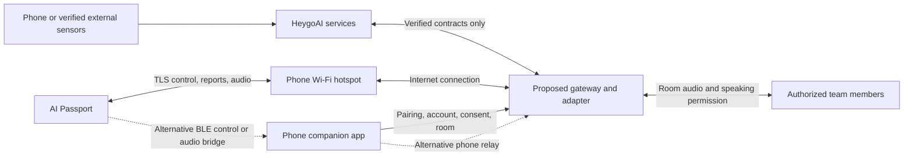
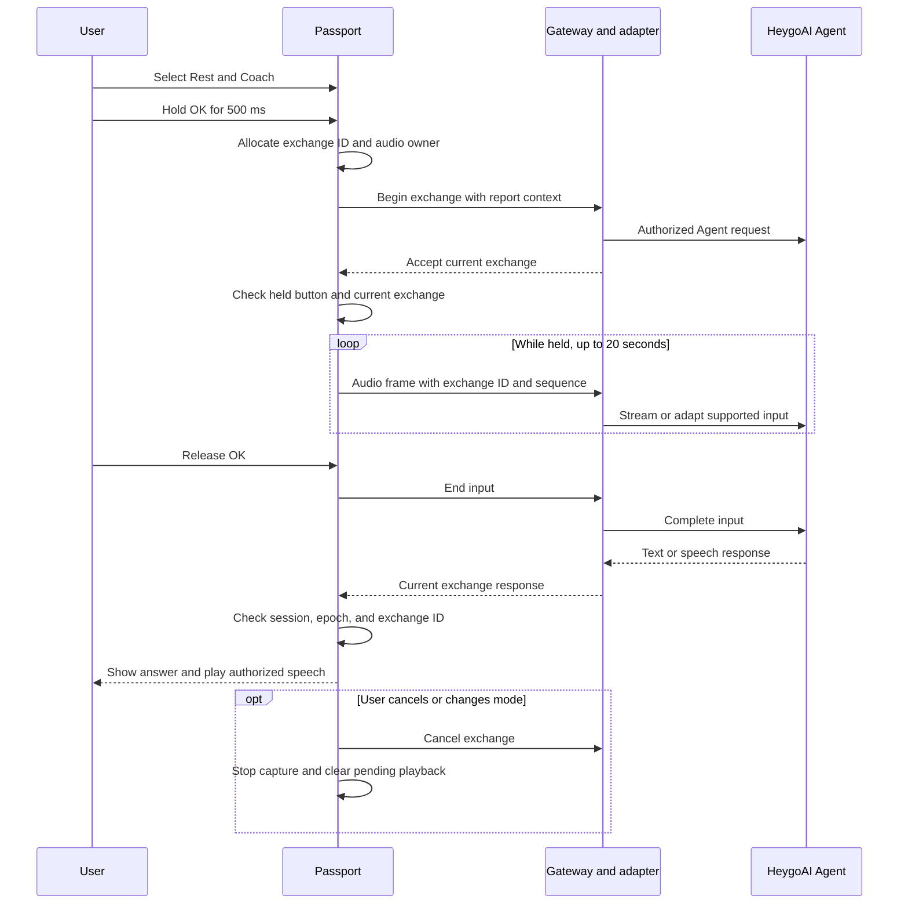
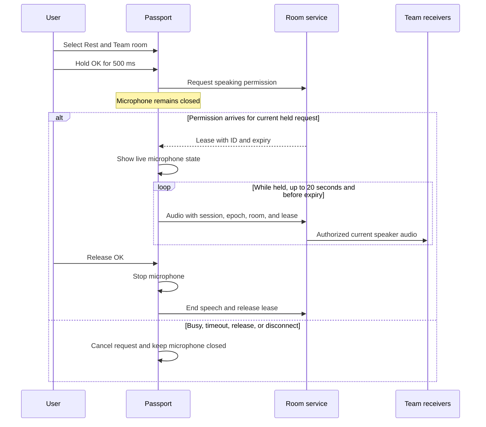

[简体中文](02-architecture.zh_CN.md) · **English**

# HeygoAI × AI Passport: proposed architecture

Version: 0.1

Date: 2026-10-16

Status: Draft for engineering review

This document proposes a design. It does not describe an implemented integration.
Requirement IDs refer to [product requirements](01-product-requirements.md).
Delivery order appears in the [Scrum backlog](03-scrum-backlog.md).
Open decisions and checks appear in [validation and decisions](04-validation-and-decisions.md).

## 1. Evidence and limits

| State | Evidence or proposal | Design consequence |
|---|---|---|
| Product source evidence | ESP32-C3, 8 MB Flash, no PSRAM | Limit memory and message sizes. |
| Product source evidence | 240 × 320 screen, RGB565 | Use buttons and compact pages. |
| BSP source evidence | UP, DOWN, and OK share an ADC input | Do not require simultaneous button combinations. |
| BSP source evidence | Default hold threshold: 500 ms | Use 500 ms as the initial interaction threshold. |
| BSP source evidence | ES8311 microphone and speaker APIs support mono PCM at 16 kHz and 16 bits | Test voice under actual snow conditions. |
| Product source evidence | Battery capacity: 500 mAh | Measure runtime. Do not derive runtime from capacity alone. |
| Conditional | A battery gauge may be absent or return `-1` | Show an unknown state instead of a false percentage. |
| Baseline behavior evidence | Wi-Fi scanning and BLE advertising | Connection, provisioning, and application protocols need further work. |
| Local reference only | Uncommitted BLE intercom work exists | Review this work before reuse. Test this work before reuse. |
| Unverified | HeygoAI APIs, report fields, permissions, and voice contracts | Use an adapter. Keep integration blocked until contracts exist. |
| Unverified | IMU, GNSS, barometer, motion sensing, or touch interface on the inspected board | Use verified sources and button controls. |
| Unverified | Water resistance, cold limits, wind audio, gloves, sunlight, radio range, and runtime | Keep these items in pilot acceptance tests. |

The passive NTAG213 tag has no verified MCU access API.
Do not use it as a live sensor or a device communication channel.
Concurrent microphone and speaker APIs do not prove acoustic echo cancellation.

Source baseline: `/Users/dylan/AI-passport`, commit `3d685a90bdb96dd8526d84edde1e63fec25b460e`, plus inspected working files.
Working files can differ from the commit.
The local intercom work does not prove a released feature, a phone application, or device test success.

Primary evidence paths:

- `docs/hardware-design/specifications.md`
- `components/bsp/include/bsp_pins.h`
- `components/bsp/include/bsp_display.h`
- `components/bsp/src/bsp_display_lvgl.c`
- `components/bsp/include/bsp_audio.h`
- `components/bsp/src/bsp_audio.c`
- `sdkconfig.defaults`
- `docs/development/engineering/passport-intercom.md` in the current local working copy

These paths belong to `/Users/dylan/AI-passport`. They are not files in this new repository.

## 2. System boundary



Solid lines show the first transport candidate. They do not show existing services.
Dotted lines show the BLE alternative.
The hotspot supplies network access. The phone application does not automatically receive hotspot traffic.

Start the design investigation with a Wi-Fi hotspot.
Establish an outbound TLS connection from Passport to the gateway.
Use a 2.4 GHz hotspot for the hardware investigation.
This candidate avoids dependence on continuous phone relay execution.
This candidate still depends on these conditions:

- A stable hotspot.
- Internet access.
- Provisioning.
- Memory for TLS.
- Battery use.
- Server support.

A gateway adapts HeygoAI contracts and controls device sessions.
The gateway can also host the team room service.
The gateway becomes optional only if verified HeygoAI services provide every required contract and security control.

The BLE candidate uses a phone application as a relay.
Test phone permissions, audio routing, background limits, and reconnection before selecting this candidate.
The local intercom reference makes BLE a reuse candidate. It does not replace these tests.
Do not switch transports automatically during an audio exchange.

Team PTT means network voice between authorized people.
Team PTT requires these conditions:

- An available transport.
- A reachable room service.
- Valid room membership.

It is not an offline radio walkie-talkie.

### Responsibility map

| Component | Owns | Does not claim |
|---|---|---|
| HeygoAI | Existing account, ski analysis, reports, and coaching capabilities after contract checks | Undocumented APIs or available raw sensor data |
| Phone companion | Account consent, device binding, hotspot guidance, room selection, and optional sensor capture | Guaranteed background execution or automatic hotspot control |
| Gateway and adapter | Contract conversion, scoped tokens, device session routing, room permissions, expiry, and telemetry | New ski measurements without a verified source |
| Passport application | New UI, button state, bounded cache, audio ownership, report rendering, and connection state | Local speech recognition, local language models, or verified motion sensing |
| Passport BSP | Screen, buttons, audio format, volume, buses, and other board operations | Product pages or coaching logic |
| External data source | Timestamped samples and declared measurement quality | Trust without source identity and validation |

Keep HeygoAI-specific fields inside the adapter.
Passport uses only normalized messages.
Test the adapter with synthetic fixtures before a real account connection.

## 3. Modes, buttons, and screen layout

### Explicit modes

The user manually selects Ski or Rest mode.
The pilot permits report browsing and voice interactions only in Rest mode.
Ski mode shows a small status page with no detailed chart or voice interaction.
The device cannot check whether the user stopped moving.

Rest mode offers Reports, Coach, and Team pages.
The Coach page sends voice to the AI Agent.
The Team page sends voice to people in the selected room.
Show the destination before microphone capture and throughout each exchange.
Use text and icons. Do not use color alone.

| Input | Proposed behavior |
|---|---|
| Short UP or DOWN | Move focus, change pages, or select a report. |
| Short OK | Select the focused item. |
| Hold OK for at least 500 ms in Rest → Coach | Request microphone ownership. Start a new Agent exchange. |
| Hold OK for at least 500 ms in Rest → Team | Request exclusive speaking permission. Do not capture audio before permission. |
| Release OK after capture | Stop capture. End transmission after any bounded final frame. |
| Continue a capture for 20 seconds | Stop capture. Show the limit. |
| Hold UP for at least 500 ms | Cancel the current exchange or return to the preceding page. |
| Hold OK on other pages | Do not capture audio. |

This proposal uses these timings as initial acceptance values.
A long OK press must suppress the short OK event on release.
A long UP event must suppress the short UP event.
The application recognizes cancellation when the UP hold reaches 500 ms.

The 200 ms playback stop budget starts at that threshold.
The total target from UP press to playback stop is at most 700 ms.
Capture must stop within 100 ms after recognized cancellation.
For a regular OK release, the 100 ms capture stop budget starts at release.

Button callbacks emit events and return immediately.
A task handles networking, storage, and audio work.

### Proposed 240 × 320 report page

This page uses a new application design. It does not reuse the demo menu or its visual shell.
Coordinates use screen pixels, with origin at the upper-left corner.
The current screen implementation masks corners with a 30-pixel radius.
Keep essential text outside the masked corners.

| Region | Bounds | Content |
|---|---|---|
| Status | `x=32..207, y=0..35` | Rest label, connection state, and battery state |
| Report identity | `x=12..227, y=36..67` | Ski session date, report title, and cached status |
| Metric row | `x=12..227, y=68..103` | Two or three available metrics with units |
| Main visual | `x=12..227, y=104..247` | One chart or one turn view |
| Context | `x=12..227, y=248..283` | Selected turn, source quality, or missing-data notice |
| Button hints | `x=32..207, y=284..319` | UP/DOWN action and short OK action |

Use separate pages for the ski session summary, trend chart, and selected turn.
Do not place every metric on one page.
Use the same visual scale when users compare two turns.
If the scale changes, show the change.

The Coach page shows the Agent destination and capture, wait, playback, or failure state.
The Team page shows the room, current speaker, speaking permission, and microphone state.
An active microphone indicator remains visible during capture.
A disconnected Team page disables capture.

Check Chinese glyph coverage for every UI string.
Select the intended Chinese font on each widget.
UTF-8 input and a successful build do not prove intended rendering.
Test button use with gloves and text readability outdoors.

## 4. Data origin and visual meaning

Every report carries a source, schema version, report revision, capture period, and generation time.
Every metric carries a unit and quality state.
Use `null` for unknown values. Do not substitute zero.
Show unsupported fields as unavailable.

| Data | Allowed source | Required visual rule |
|---|---|---|
| Ski session summary | Verified HeygoAI report contract | Show report date and cached status. |
| Speed, distance, or altitude | A named phone or external sensor source | Show units and missing intervals. |
| Coaching text | HeygoAI response through the adapter | Identify advice as AI advice. |
| Turn direction or phase | A documented HeygoAI algorithm or verified source | Preserve the algorithm version and confidence meaning. |
| Turn trajectory | Verified position samples in a declared coordinate frame | Identify the view as measured or estimated. |
| Turn schematic | Synthetic points or a shape template | Show “Schematic”. Do not show meter units. |
| Demo content | Synthetic fixture | Show “Demo data” on every relevant page. |

The system must not manufacture a ski score, edge angle, turn radius, or posture measurement.
A new derived metric needs a documented formula, inputs, limits, and tests.
A confidence value is not a probability unless the provider defines it as a probability.

### Time, gaps, and charts

Use UTC timestamps for transport and storage.
The phone supplies the user's preferred timezone.
Preserve source timestamps separately from receive timestamps.
Record clock uncertainty when sources lack a shared clock.

Use labeled axes, units, and a visible time period.
Do not connect a chart line across an unknown interval.
Downsample charts with a method that preserves important extrema and gaps.
Keep exact values available for the selected sample.
Show cached reports with their generation time and elapsed age.
If the clock cannot establish age, show that age is unknown.

### Turn coordinates and direction

A measured turn uses a local slope plane only when its source defines that plane.
Its origin is the first valid sample of the selected turn.
The positive `y` axis follows the reference downhill direction.
The positive `x` axis points right when the skier faces that reference direction.
Distances use meters.

Define heading as `atan2(dx, dy)` in degrees.
Positive heading rotates clockwise from the reference downhill direction.
A positive unwrapped heading change indicates a right turn.
A negative unwrapped heading change indicates a left turn.
Use the skier's change of travel direction. Do not infer direction from the graph's left or right side.

The adapter preserves the provider's turn label only when its definition matches this contract.
Otherwise, the adapter marks direction as unknown or applies a reviewed conversion.
A diagram alone cannot prove ski carving, edge angle, or body posture.

A schematic uses dimensionless `u` and `v` coordinates from 0 to 1.
It must not imply measured distance, radius, or position.
A missing coordinate frame blocks a measured trajectory view.
The UI can still show a labeled schematic or available turn metrics.

Each turn includes its start, end, direction, source, and quality state.
Measured points contain `x_m`, `y_m`, and `t_ms`.
Schematic points contain `u`, `v`, and `t_ms`.
`t_ms` means elapsed milliseconds from the turn start.
Use `null` when source timing is unknown.
Known point times must increase within each segment.

Reject conflicting time order. Do not invent sample times.
Without source timing, show a static shape or labeled schematic steps.
Do not claim real-time replay when sample timing is absent.

Missing intervals break the path into segments.
Do not interpolate through a sensor outage.
Mark clipping, sparse samples, and uncertain direction.

## 5. Proposed normalized contracts

These names describe a proposal. They are not verified HeygoAI endpoints.
The adapter must map actual contracts after the discovery work.

### Message envelope

| Field | Meaning |
|---|---|
| `schema_version` | Major and minor contract version, initially `1.0` |
| `type` | Report, control, Agent event, audio frame, or room event |
| `message_id` | Unique message identifier for duplicate detection |
| `session_id` | Authorized device session |
| `epoch` | New connection generation after each reconnect |
| `exchange_id` | Agent exchange identifier when applicable |
| `room_id` | Authorized Team room when applicable |
| `lease_id` | Current speaking permission when applicable |
| `sequence` | Monotonic number within the current stream |
| `created_at` / `expires_at` | UTC validity interval |
| `payload` | Bounded content for the declared type |

The receiver authenticates the device session before it accepts content.
Do not trust a message's room or account fields without server authorization.
Reject expired content. Reject content from an old device session or epoch.
A sequence gap produces a visible quality state or an audio loss event.

Add optional fields in a minor version.
Use a new major version when field meaning or required fields change.
Negotiate supported versions before the first report or audio frame.
Ignore unknown optional fields. Reject unsupported major versions.
Document enum expansion rules and required fields in the schema.

`schema_version` identifies the contract version.
`report_revision` identifies one report revision.
The provider or adapter assigns increasing revisions within each `report_id`.
The proposed `generated_at` field records the report revision's generation time.
Its mapping to HeygoAI data remains unverified.

Apply each report revision only once. Ignore an older revision.

Reject different content with the same report identifier and revision.
An identical duplicate must not reset the current page or audio context.

Agent context includes the selected `report_id`, `report_revision`, and optional `selected_turn_id`.
`selected_turn_id` identifies a ski turn. `exchange_id` identifies an Agent exchange.
Keep this context constant throughout one Agent exchange.
A newer report must not silently change the context of an active exchange.

### Synthetic report example

This example describes a schematic. It contains no measured ski trajectory.
All identifiers and values are synthetic.

```json
{
  "schema_version": "1.0",
  "type": "report.snapshot",
  "message_id": "demo-message-001",
  "session_id": "demo-device-session-001",
  "epoch": 1,
  "sequence": 1,
  "created_at": "2026-10-16T03:00:00Z",
  "expires_at": "2026-10-16T04:00:00Z",
  "payload": {
    "synthetic": true,
    "report_id": "demo-report-001",
    "report_revision": 1,
    "generated_at": "2026-10-16T03:00:00Z",
    "activity_id": "demo-ski-session-001",
    "source": {
      "provider": "synthetic_fixture",
      "algorithm_version": "fixture-1",
      "captured_from": "2026-10-16T02:50:00Z",
      "captured_to": "2026-10-16T02:50:04Z"
    },
    "metrics": [
      {"key": "speed_mean", "value": null, "unit": "m/s", "quality": "unavailable"}
    ],
    "turns": [
      {
        "turn_id": "demo-turn-001",
        "started_at": "2026-10-16T02:50:00Z",
        "ended_at": "2026-10-16T02:50:04Z",
        "direction": "right",
        "quality": "synthetic",
        "confidence": null,
        "path_kind": "schematic",
        "coordinate_frame": "normalized_uv",
        "unit": "1",
        "segments": [
          [{"u": 0.2, "v": 0.1, "t_ms": 0}, {"u": 0.4, "v": 0.5, "t_ms": 2000}, {"u": 0.8, "v": 0.9, "t_ms": 4000}]
        ]
      }
    ]
  }
}
```

`unit: "1"` means dimensionless. The UI shows no physical unit for this schematic.
A cached report stores its content and source time separately from transport expiry.
Transport expiry prevents replay. It does not hide an explicitly labeled historical report.
The cache still follows account access and retention rules.

### Candidate limits

| Item | Initial limit | Failure behavior |
|---|---|---|
| Control message | 1 KiB | Reject excess content with a typed error. |
| Report page | 8 KiB encoded | Request another page. Do not allocate an unbounded document. |
| Reports in cache | 3 summaries and one selected detail page, within 64 KiB total | Delete the oldest authorized content from the cache. |
| Turn path | 128 points per selected turn | Request simplified segments with preserved gaps. |
| Concurrent Agent exchanges | 1 | Cancel or finish the previous exchange first. |
| Concurrent Team transmitters | 1 per room | Reject conflicting speaking requests. |
| Audio capture | 20 seconds per hold | Stop capture. Release audio ownership. |

These limits need heap measurements and real report samples.
Do not split one oversized message into an unbounded reassembly buffer.

## 6. Agent and Team audio state

The application has one audio owner: None, AgentCapture, AgentPlayback, TeamCapture, or TeamPlayback.
An owner holds permission for one audio direction.
Before a mode change, the application cancels the current audio owner.
Capture and playback never run together in the pilot.

### Coach flow



Keep the microphone inactive until the gateway accepts the current exchange.
Show a waiting state until the gateway accepts the current exchange.
Reject late acceptance after release, cancellation, expiry, or a mode change.
The adapter may stream input while the user holds OK.
If HeygoAI requires complete audio, the gateway buffers within a server limit.
Passport must not store a full 20-second PCM clip in RAM.

If speech output does not exist, the design needs a verified speech service.
A text-only mode supports diagnostics only. It does not satisfy REQ-07 or P0 acceptance.
The MVP remains blocked until real speech output passes complete connection tests.

The user can cancel during capture, waiting, or playback.
Cancellation invalidates the exchange ID. It also clears the playback queue.
A late response from an old exchange must not play.
A reconnect creates a new epoch and cancels the previous exchange.
Send only the report context that the user permits.

### Team PTT flow



The server grants one speaker a time-limited lease.
A lease gives exclusive speaking permission. It does not create permanent room access.
The proposed lease expires within 25 seconds of grant.
Stop capture when any of these conditions occurs:

- Capture reaches 20 seconds.
- The user releases OK.
- Cancellation occurs.
- The lease expires.
- The connection fails.

Use a monotonic local deadline that cannot exceed the server expiry.
Reject a lease if clock uncertainty prevents a safe local deadline.
The room service also rejects audio after expiry.

If the user no longer holds OK when permission arrives:

1. Reject that speaking permission.
2. Release that speaking permission.

Use request IDs to reject late grants.
After reconnection, require these items:

- New room authorization.
- A new epoch.
- A new lease.

Never resume an interrupted transmission automatically.
Never queue Team voice for later delivery.
Discard late audio frames. Do not replay old speech.

Team playback requires all these conditions:

- Rest mode is active.
- The Team page is open.
- The audio belongs to the current room.
- Audio ownership is idle.

Do not mix Team voice with Agent input or replies.
Stop capture before room changes or account changes.
A lost release event must not bypass the capture limit or lease expiry.

## 7. Device boundaries and resources

Use the existing BSP for hardware operations.
Keep pages, protocol state, sessions, and application tasks in the application layer.
Code outside the LVGL task must hold `bsp_lvgl_lock()` before it accesses LVGL objects.
Before deleting a page, stop every task, timer, callback, and handler that can access the page.

Change the audio codec, clock, or sample format through BSP APIs.
Do not change codec registers from button handlers or application pages.
Measure audio behavior before changing the existing hardware configuration.

### Initial memory budget

PCM at 16 kHz, mono, and 16 bits uses 32,000 bytes per second.
A 20-second clip uses 640,000 bytes before protocol overhead.
The device has no PSRAM. A complete clip does not belong in RAM.

| Allocation | Initial design | Evidence or limit |
|---|---|---|
| LVGL draw buffer | One 40-line RGB565 buffer | Current source uses 19,200 bytes. |
| LVGL memory pool | 24 KiB | Current `sdkconfig.defaults` value. |
| Audio rings | 8 KiB input plus 8 KiB output | Proposal. Avoid simultaneous active capture and playback. |
| Control queue | 8 entries of at most 1 KiB | Proposal. Reject excess messages. |
| Report parsing | One page of at most 8 KiB | Proposal. Include parser overhead in measurement. |
| Turn points | At most 128 points | Proposal. Use constant bounds for segments and points. |
| TLS, Wi-Fi, stacks, fonts, and firmware | Measure with the selected transport | Do not claim that the remaining memory is sufficient. |

Eight KiB holds about 256 ms of candidate PCM.
Each ring needs a defined overflow policy.
Audio overflow stops the exchange or drops obsolete frames according to the channel contract.
Never grow a queue because the network is slow.

The source uses an SPI clock of 80 MHz.
This value does not establish screen frame rate or available network throughput.
An older guide mentions a 20-line buffer. Use the current implementation for this design.

Start the investigation with PCM or a codec that the tested endpoints support.
The local BLE reference uses 20 ms IMA ADPCM frames and requires ATT MTU of at least 172.
It also describes an eight-frame playback queue and a 1,500 ms request timeout.
These are reference values, not accepted production limits.

Current audio configuration uses six DMA descriptors with 240 frames each.
This capacity does not establish total voice latency.
Check the phone implementation, codec agreement, authentication, and measured loss before reuse.

### Flash and stored data

Keep the default layout minimal: NVS, PHY data, and one factory application.
Check all images against the 8 MB Flash size.
Do not assume that two OTA application slots fit with fonts and firmware.
OTA needs a separate capacity decision and a recovery test.

A persistent report cache needs an explicit storage decision.
Do not add a cache partition as an implicit template requirement.
Limit the cache size.
Define account ownership, retention, and data deletion.
REQ-13 blocks pilot acceptance until the storage design preserves one complete authorized report across network loss and restart.

Commit a new cached snapshot atomically. Preserve the previous complete snapshot if an update fails.
The 64 KiB cache limit does not reserve space in the current partition table.
The selected layout may use a smaller cache if it still satisfies REQ-13.

## 8. Trust, access, and failure behavior

The phone handles account login and user consent.
The gateway keeps HeygoAI credentials and provider keys outside Passport.
Passport receives a short-lived token scoped to one device, account binding, and permitted service.
Room access needs a separate room authorization check.

Check TLS certificates. Do not bypass validation to solve a clock or connection problem.
The provisioning design must establish trustworthy time and device binding.
Do not send account credentials through an unauthenticated BLE characteristic.
A BLE design needs an approved pairing and bonding method with a visible device association step.

Use server-side identity checks for every report, Agent exchange, and room request.
A client-supplied account identifier must not select another user's data.
Bind room events to the current account, room, device session, and epoch.
After revocation, the server rejects new requests.
The device deletes unauthorized cached content after a revocation notice or local access expiry.

An offline device cannot receive immediate remote revocation.
Offline cache access needs a separate expiring grant and a defined retention policy.

Do not retain voice by default after processing or delivery.
An explicit recording feature needs separate consent, a retention period, and deletion controls.
Redact tokens, voice content, and personal ski data from diagnostics.
The user can unlink the device. The user can delete authorized local data from that device.

| Failure | Device behavior | Server behavior |
|---|---|---|
| Network loss | Stop capture. Show offline state and cached report time. | Expire requests and speaking leases. |
| Agent timeout | End the exchange. Offer a new user action. | Reject late or canceled output. |
| Team room busy | Keep the microphone inactive. Show the current speaker. | Keep one valid speaker. |
| Invalid report | Preserve the last valid authorized view. Show unavailable fields. | Return a typed error without private data. |
| Audio queue overflow | Stop or discard obsolete audio within the channel rule. | Report bounded loss without replay. |
| Low memory | Stop audio before allocation failure. Show a recoverable error. | Stop streaming to the failed exchange. |
| Unknown battery | Show an unknown battery state. | Do not derive a percentage. |
| Account or room change | Stop audio. Invalidate the old context. | Reject old tokens and room permissions. |

Offline mode supports only locally available, authorized report content and basic UI.
Offline mode does not imply offline AI inference, speech recognition, or Team PTT.

## 9. Review gates and requirement trace

| Area | Requirements | Evidence required before pilot acceptance |
|---|---|---|
| Reports, charts, and turns | REQ-03, REQ-04, REQ-05 | Real contract samples, source definitions, and synthetic UI review |
| Microphone and speech | REQ-06, REQ-07 | Tested endpoint formats, latency, noise, and resource measurements |
| Coach interaction | REQ-08 | Exchange cancellation and stale-response tests |
| Team PTT | REQ-09 | Phone/server prototype, exclusive lease tests, and reconnect tests |
| Offline and privacy | REQ-13, REQ-14 | Cache design, access boundaries, deletion, and retention tests |
| Buttons and fonts | REQ-15 | Hold/release tests, glyph checks, and glove tests |
| Device resources | REQ-16 | Peak heap, largest free block, stack, Flash, and runtime measurements |
| Explicit modes | REQ-17 | Rest-mode gating and visible recipient tests |
| Diagnostics | REQ-20 | Sanitized events linked to device sessions, without private payloads |

The first architecture gate selects a tested transport.
The second gate approves HeygoAI contracts and report semantics.
The third gate approves the device resource budget and safety limits.
The fourth gate accepts the complete Rest-mode pilot on real hardware.

These decisions remain open:

- Phone platform.
- Provider APIs.
- Gateway ownership.
- Transport.
- Speech services.
- Codec.
- Cache storage.
- Authorized sensor source.

Track decisions in [validation and decisions](04-validation-and-decisions.md).
Do not treat a diagram, a synthetic fixture, or a successful build as hardware validation.
