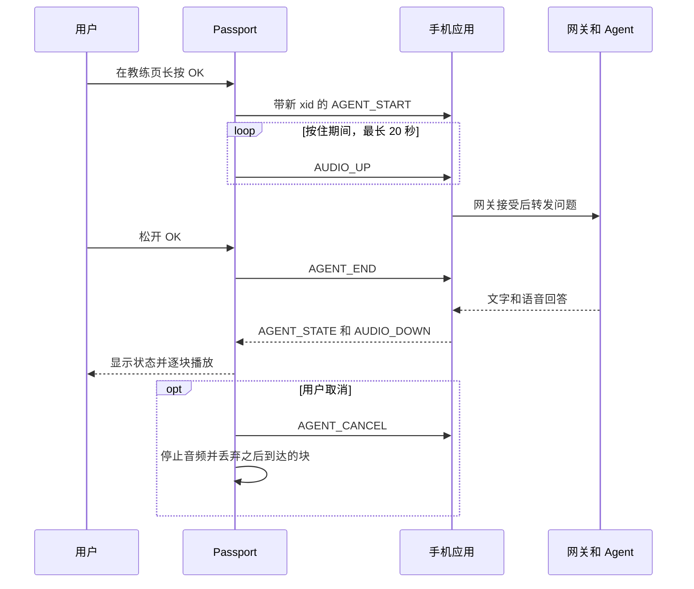

**简体中文** · [English](02-architecture.md)

# HeygoAI × AI Passport：架构方案

版本：0.7。日期：2026-10-17。状态：工程评审草案。

本文针对[产品需求](01-product-requirements.zh_CN.md)中的增量 1 和增量 2 提出设计方案。
本文不代表联动功能已经实现。
每项决策的理由见[决策修订](05-decision-amendments.zh_CN.md)。
具体的包格式见[蓝牙协议草案](07-ble-protocol-draft.zh_CN.md)。

## 1. 证据与限制

| 状态 | 证据 | 设计影响 |
|---|---|---|
| 产品资料 | ESP32-C3、8 MB Flash、无 PSRAM | 限制内存和消息大小。 |
| 产品资料 | 240 × 320 屏幕、RGB565 | 使用紧凑页面和按键。 |
| BSP 源码 | UP、DOWN、OK 共用一个 ADC 输入 | 绝不要求同时按两个键。 |
| BSP 源码 | 默认长按阈值为 500 ms | 所有长按都用 500 ms。 |
| BSP 源码 | ES8311 麦克风和喇叭，16 kHz、16 bit、单声道 | 在真实条件下测试语音。 |
| 产品资料 | 500 mAh 电池 | D-18 把功耗管理推迟。不声称任何续航。 |
| 有条件支持 | 电量计可能不存在，也可能返回 `-1` | 显示未知状态，不显示虚假百分比。 |
| 实测构建 | 去掉 Wi-Fi 后，静态 D/IRAM 剩余 180,840 字节 | 以此作为起始预算。 |
| 团队说明 | 已有手机应用，由另一个团队开发 | 07 号文档提出链路方案。Q-13 跟踪评审。 |
| 未验证 | HeygoAI API 和教练能力 | 由手机应用负责集成。 |
| 未验证 | IMU、GNSS、气压计、触摸 | 使用按键控制和手机数据。 |
| 未验证 | 防水、低温、风噪、手套、日照、距离、续航 | 纳入试用测试。 |

麦克风和喇叭接口可以同时工作，不代表有回声消除。

来源基线：`/Users/dylan/AI-passport`，提交 `3d685a90bdb96dd8526d84edde1e63fec25b460e`。
该基线是另一个仓库。

## 2. 系统边界

D-08 选定 BLE 手机桥接。设备作为 BLE 外设，手机应用作为中心。
设备不连 Wi-Fi，也不需要配网界面。

D-12 让首版链路保持开放：不加密、不用配对码、不做绑定校验。
附近任何蓝牙客户端都能连接。首版接受这项风险。
设备同一时间只接受一部手机。

### 职责分工

D-14 把设备限定为四件事：

1. 把按键事件告诉手机。
2. 把麦克风音频块流式发给手机。
3. 播放手机流式发来的音频块。
4. 显示手机提供的状态、简短文字和滑行数据。

| 组件 | 负责 | 不作出的承诺 |
|---|---|---|
| HeygoAI | 契约验证后的滑雪分析和教练能力 | 未公开的 API |
| 手机应用 | 设备连接、账号、语音识别、语音合成、滑雪会话上下文、滑行数据计算、网关请求和重试 | 保证后台执行 |
| 网关和适配器 | 契约转换和会话路由 | 产生新的滑雪测量值 |
| Passport 应用 | 设备的四件事、模式、按键状态和音频所有权 | 本地语音识别或本地大模型 |
| Passport BSP | 屏幕、按键、音频格式、音量和总线 | 产品页面或教练逻辑 |

## 3. 模式、按键和屏幕

### 模式

D-15 规定两种模式。

- **滑行模式。** 开机后进入此模式。显示链路状态、电量和实时数据。语音关闭。
- **休息模式。** 用户主动进入。打开后停在教练页。只有这里能用语音。

设备无法检查用户是否已经停下。
进入休息模式用长按，因为滑行时戴手套容易误触按键。

进入休息模式的那次按键绝不启动采集。
采集需要一次在休息模式中重新开始的 OK 按键。

### 按键

| 位置 | 输入 | 行为 |
|---|---|---|
| 滑行模式 | 长按 OK 500 ms | 进入休息模式，停在教练页。 |
| 教练页 | 长按 OK 500 ms | 开始采集。把每一块流式发给手机。 |
| 教练页，采集中 | 松开 OK | 100 ms 内停止采集。告诉手机问题已结束。 |
| 教练页，采集中 | 达到 20 秒 | 停止采集。显示时长上限。 |
| 教练页，播放中 | 长按 OK 500 ms | 先停止播放，再开始采集。 |
| 任意页面 | 长按 UP 500 ms | 取消当前的采集或播放。两者都没有时不做任何事。 |
| 教练页，空闲 | 长按 DOWN 500 ms | 弹出退出确认。短按 OK 返回滑行模式。其他任何输入关闭确认。 |
| 教练页，采集、等待回答或播放中 | 长按 DOWN 500 ms | 不做任何事（D-19）。先长按 UP 取消，再长按 DOWN 退出。 |
| 教练页，空闲 | 短按 DOWN | 打开报告页（D-21）。 |
| 报告页 | 短按 UP | 回到教练页。 |
| 报告页 | 长按 DOWN 500 ms | 弹出退出确认，与教练页相同。 |
| 报告页 | 长按 OK 500 ms | 不做任何事。 |
| 任意页面 | 其他短按 | 没有动作，退出确认里的 OK 除外。 |

长按之后不会再触发短按。
UP 长按达到 500 ms 时产生取消命令。
该命令之后 200 ms 内停止播放，100 ms 内停止采集。
从最初按下 UP 到停止出声，总目标为 700 ms。

按键回调只把事件放进队列，然后立即返回。由任务处理链路和音频。

### 教练页布局

坐标单位为屏幕像素，原点在左上角。
屏幕有半径 30 像素的圆角遮罩。关键文字避开遮罩区域。

| 区域 | 范围 | 内容 |
|---|---|---|
| 状态栏 | `x=32..207, y=0..35` | 模式、链路状态、电量 |
| 接收对象 | `x=12..227, y=36..67` | "AI 教练"字样 |
| 状态 | `x=12..227, y=68..187` | 就绪、正在听、思考中、回答中或失败，配图标 |
| 文字 | `x=12..227, y=188..283` | 简短转写、简短回答或重说提示 |
| 按键提示 | `x=32..207, y=284..319` | 当前可用的长按操作 |

页面使用全新设计，不复用演示菜单或其框架。
检查每条中文文案的字形覆盖。编译成功不能证明中文能显示。

### 滑行页布局

D-21 把滑行页正文换成滑行数据。状态栏和按键提示的位置与教练页相同。
坐标来自 `flows/coach.flow.json`，主机界面检查已通过。文字由 `main/ui/ski_view.c` 生成。

| 控件 | 位置 | 字体 | 内容 |
|---|---|---|---|
| `dest` | `x=14, y=36` | 34 px 品牌字体 | "LIVE RUN"；一趟结束后"RUN ENDED"；报告到达后"REPORT" |
| `run` | `x=14, y=80` | 20 px 品牌字体 | "RUN 4  02:31"；报告到达后"RUN 4  1.9 km" |
| `speed` | `x=14..110, y=105`，右对齐 | 48 px 品牌字体 | 速度；报告到达后为 Heygo IQ |
| `unit` | `x=116, y=129` | 20 px 品牌字体 | "KM/H"；报告到达后"HEYGO IQ" |
| `line1` | `x=14, y=176` | 16 px 中文 | "落差 312 m · 1.9 km"；报告到达后为核心问题 |
| `line2` | `x=14, y=200`，高 50 | 16 px 中文，最多两行 | "24 弯"，过期时加" · 数据已过期"，结束后加" · 报告生成中"；报告到达后为小建议 |

- 还没有数据时，`line1` 显示"等待手机数据"，`line2` 显示"专注雪道，教练随时待命"。
- 5 秒没有新包时，速度显示"--"。一趟结束后，手机不再发送，这时不标过期。
- 48 像素字体是品牌 B 版的 Staatliches，包含全部 ASCII 字符。它放在 Flash 里，位图 26,115 字节。
- 速度不用颜色区分快慢。

### 报告页布局

| 控件 | 位置 | 字体 | 内容 |
|---|---|---|---|
| `dest` | `x=14, y=36` | 34 px 品牌字体 | "RUN REPORT" |
| `title` | `x=14, y=80` | 16 px 中文 | "第 3 趟 · 1.9 km · 25 弯"；没有报告时"滑完一趟后显示报告" |
| `iq` | `x=14..110, y=105`，右对齐 | 48 px 品牌字体 | Heygo IQ |
| `iq_name` | `x=116, y=106` | 20 px 品牌字体 | "HEYGO IQ" |
| `age` | `x=116, y=131` | 20 px 品牌字体 | 报告到达 60 秒后显示"3 MIN AGO" |
| `problem` | `x=22, y=182` | 16 px 中文 | 核心问题，最多 12 个汉字，一行 |
| `tip` | `x=22, y=206`，高 50 | 16 px 中文，最多两行 | 小建议，最多 20 个汉字 |

同一时间只存在一个界面。切换页面时，任务先删除旧界面，再构建新界面。
`assets/mockups` 的 10 至 15 号图片是主机渲染的结果，包含最长文本的情况。

## 4. 音频状态

P0 中音频所有者有三个取值：None、AgentCapture 和 AgentPlayback。
每个所有者只控制一个音频方向。采集和播放绝不同时进行。
切换模式时取消当前所有者。

D-11 让设备成为手机的流式麦克风和喇叭。
设备最多保存几块音频，绝不保存整句问题或整段回答。
D-09 规定块格式：16 kHz、单声道的 IMA ADPCM，每块 20 ms。

手机保存问题，直到网关接受。这条规则保留了问题开头的几个字。
语音识别和语音合成由手机完成。
取消会结束本次交流。之后到达的该交流的每一块，设备都丢弃。
重连会取消未完成的交流。

## 5. 资源

### 内存预算

16 kHz、单声道、16 bit 的 PCM 每秒 32,000 字节。一个 20 秒的问题需要 640,000 字节。
设备没有 PSRAM。流式传输让设备不必保存完整录音。

| 分配项 | 设计 | 证据或限制 |
|---|---|---|
| LVGL 绘制缓冲 | 单个 40 行 RGB565 缓冲 | 当前源码使用 19,200 字节。 |
| LVGL 内存池 | 24 KiB | 当前 `sdkconfig.defaults` 配置。 |
| 蓝牙包队列 | 3,440 字节 | 07 号文档第 10 节。 |
| 最后一个 LIVE_STATS 和 RUN_REPORT | 128 字节 | 07 号文档第 10 节。主机实测的结构体大小。 |
| 48 像素数字字体 | 放在 Flash，不占 RAM | 大小在 Sprint 3 实测。 |
| ADPCM 编解码状态 | 每个方向几个字节 | D-09。 |
| 蓝牙协议栈、任务栈、字库、固件 | 在硬件上测量 | 不宣称剩余内存足够。 |

每个队列都有固定大小和溢出规则。链路慢时绝不扩大队列。

### 功耗

D-18 把功耗管理推迟。首版不使用休眠模式，并申请 07 号文档第 4 节中的最佳性能蓝牙链路参数。
屏幕仍显示电量，读不出来时显示未知。

### 音频块

| 格式 | 每秒字节数 | 设备开销 |
|---|---|---|
| 裸 PCM | 32,000 | 无编解码工作。负载是 ADPCM 的 4 倍。 |
| IMA ADPCM | 8,000 | 每个采样几步整数运算。 |
| Opus | 约 3,000 | 需要新增库。这块板上的一个 Opus 参考实现，编码任务栈用了 24 KB。 |

一块 20 ms 的 ADPCM 占 164 字节，具体格式见 07 号文档。
裸 PCM 作为诊断用的回退。Opus 等 ADPCM 跑通、团队量过开销之后再考虑。

## 6. 故障处理

| 故障 | 设备行为 | 手机行为 |
|---|---|---|
| 链路中断 | 停止音频。显示链路状态。 | 丢弃未完成的交流。 |
| 手机 15 秒无消息 | 显示手机应用无响应。 | 无。 |
| Agent 超时 | 结束交流。显示超时。 | 丢弃迟到的输出。 |
| 识别失败 | 请用户重说。 | 报告失败。 |
| 音频队列溢出 | 丢弃最旧的块。 | 保持实时节奏。 |
| 内存不足 | 在分配失败前停止音频。显示错误。 | 停止流式发送。 |
| 电量未知 | 显示未知电量状态。 | 无。 |
| 5 秒没有 LIVE_STATS | 速度显示"--"。其他数字保留，并标明过期。 | 恢复发送。 |
| LIVE_STATS 长度错误 | 回复错误码 2。保留旧包。 | 发送长度正确的包。 |
| 手机算不出某个字段 | 该字段显示"--"。 | 发送未知值，绝不发送 0。 |

D-12 和 D-13 排除了安全和隐私工作。设备不保存账号数据，也不保存令牌。

## 7. P1 与延后项目

D-17 把以下项目移出了 P0。每一项回来之前都需要各自的设计工作。

- **实时数据与报告页（增量 2）。** 第 3 节给出页面设计，07 号文档给出 LIVE_STATS。设备只在内存里保存最后一包。
- **图表和离线缓存（P1，增量 2 之后）。** 图表需要一段时间内的多个数据点。离线缓存要把最后一份数据写入 Flash。两者都还没有设计。
- **真人对讲（P1）。** 队伍页收到手机的开始消息后才开始采集。它复用教练页的音频通路。每条语音路径都要经过两段蓝牙链路，500 ms 音频目标尚无实测。
- **弯型可视化（延后）。** 只有 Q-02 表明存在带坐标系的轨迹数据时才回来。

提交 `970bb8e` 保存了这些项目在 0.3 版中的设计。

## 8. 评审门槛

1. 选定传输方案。D-08 已关闭这道门槛。
2. 与手机应用团队就蓝牙协议达成一致。07 号文档是设备侧草案。
3. 在真实硬件上验收休息模式试用版本。
4. 手机应用团队接受协议 0.2 的 LIVE_STATS 字段（Q-16）。

待定事项：07 号文档的评审、手机平台、HeygoAI 教练能力、一趟的判定规则，以及低温限制。
D-18 把所有功耗和续航相关事项推迟。
架构图和编译成功都不能替代硬件验证。
