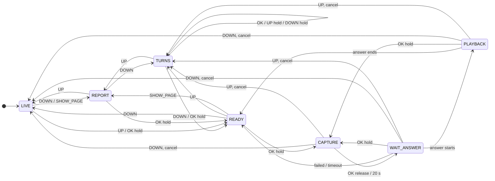
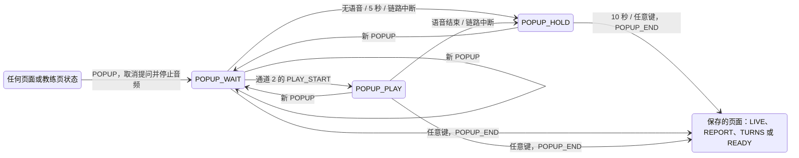
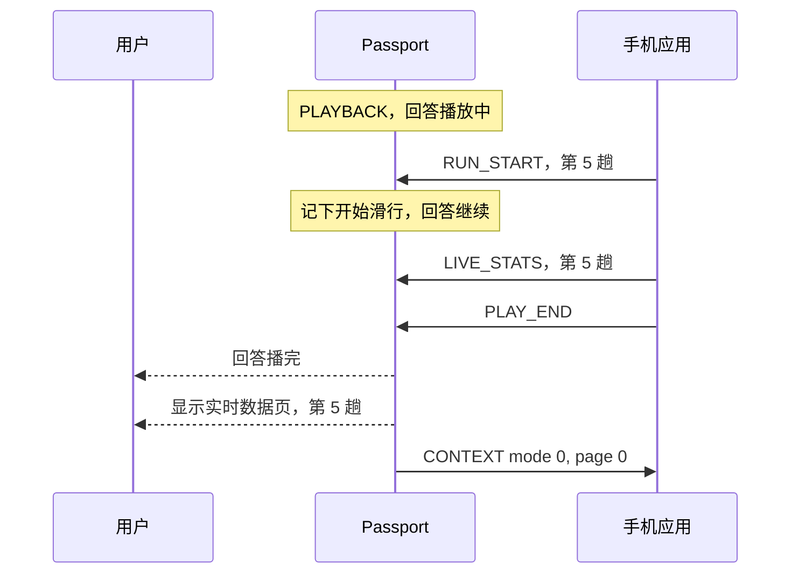
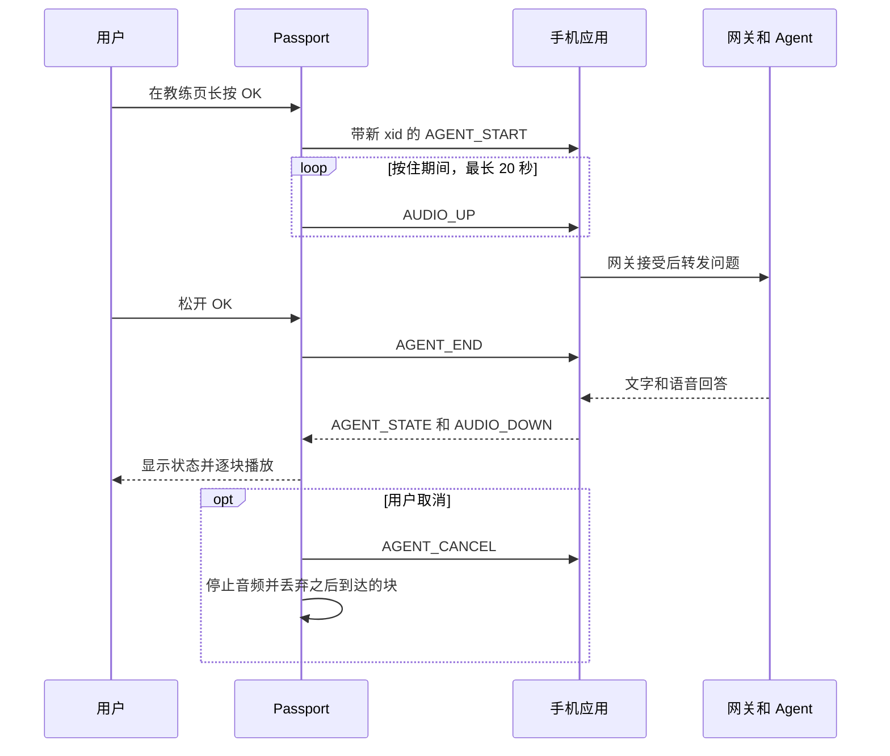
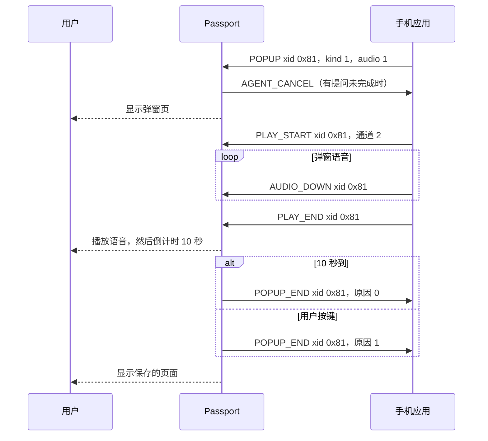

**简体中文** · [English](02-architecture.md)

# HeygoAI × AI Passport：架构方案

版本：0.14。日期：2026-10-18。状态：工程评审草案。

本文针对[产品需求](01-product-requirements.zh_CN.md)中的增量 1 至 4 提出设计方案。
本文不代表联动功能已经实现。
每项决策的理由见[决策修订](05-decision-amendments.zh_CN.md)。
具体的包格式见[蓝牙协议草案](07-ble-protocol-draft.zh_CN.md)。

## 1. 证据与限制

| 状态 | 证据 | 设计影响 |
|---|---|---|
| 产品资料 | ESP32-C3、8 MB Flash、无 PSRAM | 限制内存和消息大小。 |
| 产品资料 | 240 × 320 屏幕、RGB565 | 使用紧凑页面和按键。 |
| BSP 源码 | UP、DOWN、OK 共用一个 ADC 输入 | 绝不要求同时按两个键。 |
| BSP 源码 | 默认长按阈值为 500 ms | 所有长按都用 500 ms。 |
| BSP 源码 | ES8311 麦克风和喇叭，16 kHz、16 bit、单声道 | 在真实条件下测试语音。 |
| 产品资料 | 500 mAh 电池 | D-18 把功耗管理推迟。不声称任何续航。 |
| 有条件支持 | 电量计可能不存在，也可能返回 `-1` | 显示未知状态，不显示虚假百分比。 |
| 实测构建 | 去掉 Wi-Fi 后，静态 D/IRAM 剩余 180,840 字节 | 以此作为起始预算。 |
| 团队说明 | 已有手机应用，由另一个团队开发 | 07 号文档提出链路方案。Q-13 跟踪评审。 |
| 未验证 | HeygoAI API 和教练能力 | 由手机应用负责集成。 |
| 未验证 | IMU、GNSS、气压计、触摸 | 使用按键控制和手机数据。 |
| 未验证 | 防水、低温、风噪、手套、日照、距离、续航 | 纳入试用测试。 |

麦克风和喇叭接口可以同时工作，不代表有回声消除。

来源基线：`/Users/dylan/AI-passport`，提交 `3d685a90bdb96dd8526d84edde1e63fec25b460e`。
该基线是另一个仓库。

## 2. 系统边界

D-08 选定 BLE 手机桥接。设备作为 BLE 外设，手机应用作为中心。
设备不连 Wi-Fi，也不需要配网界面。

D-12 让首版链路保持开放：不加密、不用配对码、不做绑定校验。
附近任何蓝牙客户端都能连接。首版接受这项风险。
设备同一时间只接受一部手机。

### 职责分工

D-14 把设备限定为四件事：

1. 把按键事件告诉手机。
2. 把麦克风音频块流式发给手机。
3. 播放手机流式发来的音频块。
4. 显示手机提供的状态、简短文字和滑行数据。

| 组件 | 负责 | 不作出的承诺 |
|---|---|---|
| HeygoAI | 契约验证后的滑雪分析和教练能力 | 未公开的 API |
| 手机应用 | 设备连接、账号、语音识别、语音合成、滑雪会话上下文、滑行数据计算、网关请求和重试 | 保证后台执行 |
| 网关和适配器 | 契约转换和会话路由 | 产生新的滑雪测量值 |
| Passport 应用 | 设备的四件事、模式、按键状态和音频所有权 | 本地语音识别或本地大模型 |
| Passport BSP | 屏幕、按键、音频格式、音量和总线 | 产品页面或教练逻辑 |

## 3. 页面、按键和屏幕

### 页面（D-29、D-30）

设备没有滑行模式和休息模式。四个页面平级，首尾相连：

| 顺序 | 页面 | 状态 | 内容 |
|---|---|---|---|
| 1 | 实时数据页 | LIVE | 开机后的页面。滑行数据，或一趟结束后的报告摘要。 |
| 2 | 报告页 | REPORT | 最后一趟的完整报告。 |
| 3 | 弯型页 | TURNS | 最后一趟的弯型，一次 8 个弯（D-30）。 |
| 4 | 教练页 | READY、CAPTURE、WAIT_ANSWER、PLAYBACK | 向 AI 教练提问。语音只在这一页可用。 |

设备无法检查用户是否已经停下。所以在其他页面长按 OK 只会打开教练页，不会录音。
屏幕右边的侧边条显示当前页面在页面循环中的位置（D-33）。设计见"侧边条布局"一节。
录音需要在教练页上再按住一次 OK。

### 弹窗（D-31）

手机可以随时发送弹窗（POPUP）。弹窗页不在翻页循环里，它有三个状态：

| 状态 | 界面 | 含义 |
|---|---|---|
| POPUP_WAIT | 弹窗页 | 弹窗已显示，语音还没开始。 |
| POPUP_PLAY | 弹窗页 | 正在播放弹窗语音。 |
| POPUP_HOLD | 弹窗页 | 正在 10 秒倒计时。 |

- 任何状态收到 POPUP 都立即进入 POPUP_WAIT。CAPTURE 中，设备停止录音并发送 AGENT_CANCEL。WAIT_ANSWER 中，发送 AGENT_CANCEL。PLAYBACK 中，停止喇叭并发送 AGENT_CANCEL。
- 第一个弹窗之前，设备保存当前页面：LIVE、REPORT 或 TURNS。教练页的各个状态都保存为 READY。
- 不带语音的弹窗在同一步进入 POPUP_HOLD。带语音的弹窗等待通道 2 的 PLAY_START，最多 5 秒。
- POPUP_HOLD 中有一个 10 秒定时器。POPUP_WAIT 或 POPUP_PLAY 中链路中断，也开始倒计时。
- 每个按键事件都关闭弹窗：UP、DOWN、OK 的短按或长按。设备发送 POPUP_END，原因 0（超时）或 1（按键），并在同一步回到保存的页面。
- 弹窗状态没有 OK 松开的转移。所以弹窗之前就按下的 OK 长按，松开时不关闭弹窗。
- 新 POPUP 替换旧弹窗。链路核心为旧弹窗发送 POPUP_END，原因 2（被替换）。保存的页面不变。
- 弹窗定时器事件带有弹窗序号。被替换的弹窗的定时器事件，设备直接丢弃。
- 弹窗期间，CONTEXT 和 DEVICE_STATUS 发送 mode 0、page 6。

### 开始滑行（D-32）

手机判定开始滑行时，发送 RUN_START，带趟数。
链路核心立即把这一趟写进实时数据：滑行状态为滑行中，所有数值为未知。然后教练任务收到 RUN_START 事件。

| 收到 RUN_START 时的状态 | 设备动作 |
|---|---|
| LIVE | 不换页。数据刷新后显示"第 N 趟 · 滑行中"，每个数值显示"--"。 |
| REPORT、TURNS、READY | 立即进入 LIVE。 |
| CAPTURE、WAIT_ANSWER、PLAYBACK | 状态不变。记下开始滑行（`run_after_coach`），不取消任何操作。 |
| POPUP_WAIT、POPUP_PLAY、POPUP_HOLD | 状态不变。把保存的页面改成 LIVE（`popup_back_live`）。 |

- 状态回到 READY，就算和教练的对话结束：回答播完、提问失败、超时或链路中断。设备在同一步再发一次 RUN_START 事件，进入 LIVE。
- 用户短按 UP 或 DOWN 离开对话时，设备照常取消提问，然后进入 LIVE。短按 UP 也一样。
- 在 WAIT_ANSWER 或 PLAYBACK 中再长按 OK，开始新的提问。开始滑行继续保留。
- 对话中已记下开始滑行，这时弹窗打断对话，弹窗前的页面保存为 LIVE。记下的开始滑行随之清除。
- 屏幕上已经是这一趟且还没结束时，收到 RUN_START，数据保留不动。
- RUN_START 的 `xid` 为 0，设备不回复确认。HELLO_ACK 之前，设备忽略这个包。

状态图由 `flows/coach.flow.json` 生成的交互模拟器给出完整版本，见 `assets/sim/coach-flow.html`。

### 按键

| 位置 | 输入 | 行为 |
|---|---|---|
| 任意页面 | 短按 DOWN | 翻到下一页。教练页之后回到实时数据页。 |
| 任意页面 | 短按 UP | 翻到上一页。实时数据页之前是教练页。 |
| 实时数据页、报告页、弯型页 | 长按 OK 500 ms | 打开教练页。这次按键不录音。 |
| 教练页，空闲 | 长按 OK 500 ms | 开始采集。把每一块流式发给手机。 |
| 教练页，采集中 | 松开 OK | 100 ms 内停止采集。告诉手机问题已结束。 |
| 教练页，采集中 | 达到 20 秒 | 停止采集。显示时长上限。 |
| 教练页，等回答或播放中 | 长按 OK 500 ms | 先停止播放，取消上一个交流，再开始采集。 |
| 教练页，采集、等回答或播放中 | 短按 UP 或 DOWN | 先取消这次提问，停止音频，再翻页。 |
| 弯型页 | 短按 OK | 选中下一弯，8 弯一页的画面跟随它。第一页还在画时，立即画完（D-30）。 |
| 弯型页 | 长按 UP 500 ms | 选中上一弯。 |
| 弯型页 | 长按 DOWN 500 ms | 跳到下一页（8 个弯）的第 1 弯，最后一页之后回到第 1 页。 |
| 其他页面 | 短按 OK、长按 UP 或长按 DOWN | 没有动作。 |
| 开机屏 | 任何短按或长按 | 跳过开机屏，打开第一个页面。这个键松开之前不触发其他动作（D-35）。 |
| 弹窗页 | 任何短按或长按 | 关闭弹窗，回到保存的页面（D-31）。不翻页，也不录音。 |
| 任意页面或状态 | 手机发来 RUN_START | 打开实时数据页（D-32）。和教练对话中，对话结束后再打开。弹窗中，弹窗关闭后再打开。 |

三个按键共用一个 ADC 输入，所以按住 OK 时读不到 UP 或 DOWN。采集中要翻页，需要先松开 OK。
长按之后不会再触发短按。
取消命令在短按 UP 或 DOWN 时产生。该命令之后 200 ms 内停止播放，100 ms 内停止采集。

按键回调只把事件放进队列，然后立即返回。由任务处理链路和音频。

### 开机屏（D-35）

`main/ui/boot_screen.c` 创建开机屏，`coach_app_start()` 在第一个页面之前加载它。状态机同时启动，在有事件之前保持 LIVE 状态。

| 部件 | 位置 | 外观 |
|---|---|---|
| LOGO | `x=20, y=108`，200 × 79 px，6 张 A8 图片 | 白色。滑雪板在最上层，与 Figma 一致 |
| 标语 | 水平居中，顶边 `y=214` | 20 px 品牌字体。"MAKE EVERY RUN"为正文色，"COUNT"为荧光绿 |
| 线 | 水平居中，`y=242`，高 3 px | 荧光绿。展开到标语的宽度 |

每个 LOGO 部件和每个标语标签各用一个 `lv_anim`。动画值从 0 到 256，同时改变偏移和透明度。动画只改位置偏移、`image_opa` 和 `text_opa`，所以 LVGL 不需要图层。
A8 图片只保留透明度，由图片重着色样式给出白色。

- 2,000 ms 时，单次定时器发出 `MSG_BOOT_DONE`。Coach 任务随即删除开机屏，显示当前状态的屏幕。
- 开机屏期间，`show_screen()` 不做任何事。所以这期间来的弹窗或开始滑行，在开机屏结束时显示。
- 在开机屏上按键会立即结束开机屏。Coach 任务丢弃这个键松开之前的所有事件，所以它不触发页面动作。
- 开机屏结束之前，侧边条保持隐藏。

`assets/tools/fetch_figma_logo.py` 从 Figma 文件"Logo"（节点 `665:23`）按屏幕尺寸的 4 倍导出 6 个部件，再缩小。PNG 文件放在 `assets/brand`，所以构建不需要 Figma。
`assets/tools/gen_boot_logo.py` 把它们转成 `assets/sprites/heygo_logo.c`：Flash 中 12,288 字节的 A8 数据。
主机渲染器用假时钟画出 `27-boot-board.png`、`28-boot-logo.png`、`29-boot-tagline.png` 和 `boot-anim.gif`。开机屏的内存池用量峰值为 14,032 字节，低于各页面。
电源键由硬件直接断电，没有 GPIO 能读到它（硬件指南第 3 节）。所以固件没有关机屏，模拟器里只演示关机动画的设计。

### 状态栏（D-34）

五个屏幕使用同一个状态栏：页面循环中的四个页面和弹窗页。

| 控件 | 位置 | 内容 |
|---|---|---|
| `mode_dot` | `x=14, y=19`，7 × 7 | 页面圆点。荧光绿。弹窗页上用弹窗种类的颜色 |
| `mode` | `x=26, y=10`，宽 66 | 页面名称，最多 4 个汉字（64 px） |
| `link_dot` | `x=100, y=19`，7 × 7 | 连接正常时荧光绿。没有连接或无语音时红色 |
| `status` | `x=112, y=10`，宽 60 | 灰色"已连接"、红色"未连接"或红色"无语音"。每个都是 3 个字（48 px） |
| `battery` | `x=176..226, y=11`，右对齐 | 电量文字。只在教练页上。目前没有代码写入它 |

流程图把 `status_text` 和 `link_state` 绑定到五个屏幕各自的 `status` 和 `link_dot`。
为此，`flows/coach.flow.json` 中的绑定增加了 `screens` 列表。没有这个列表时，绑定只驱动第 0 个屏幕，与以前相同。
`flowc.py` 为每个有绑定的屏幕生成一个 attach 函数和一个 teardown 函数，例如 `coach_bindings_attach_ski()` 和 `coach_teardown_ski()`。
`main/coach_app.c` 的 `show_screen()` 在创建屏幕后挂上绑定，在删除屏幕前解除绑定。
实时数据页、报告页和弯型页去掉了空的电量标签。不去掉的话，实时数据页画速度数字时 LVGL 内存池会用满，LVGL 随即卡死。
所以连接变化时只写一次 subject，当前屏幕立即显示。新屏幕挂上绑定时取得当前值。
同一时间只有一个屏幕，所以设备同一时间只有一组观察者。

### 教练页布局

坐标单位为屏幕像素，原点在左上角。
屏幕有半径 30 像素的圆角遮罩。关键文字避开遮罩区域。

| 区域 | 范围 | 内容 |
|---|---|---|
| 状态栏 | `x=14..226, y=0..35` | 页面名称、链路状态、电量。组成见“状态栏”一节。 |
| 接收对象 | `x=12..227, y=36..67` | "AI 教练"字样 |
| 状态 | `x=12..227, y=68..187` | 就绪、正在听、思考中、回答中或失败，配图标 |
| 文字 | `x=12..227, y=188..283` | 简短转写、简短回答或重说提示 |
| 按键提示 | `x=32..207, y=284..319` | 当前可用的长按操作 |

页面使用全新设计，不复用演示菜单或其框架。
检查每条中文文案的字形覆盖。编译成功不能证明中文能显示。

### 实时数据页布局

D-21 把实时数据页正文换成滑行数据。状态栏和按键提示的位置与教练页相同。
坐标来自 `flows/coach.flow.json`，主机界面检查已通过。文字由 `main/ui/ski_view.c` 生成。

| 控件 | 位置 | 字体 | 内容 |
|---|---|---|---|
| `dest` | `x=14, y=36` | 34 px 品牌字体 | "LIVE RUN"；一趟结束后"RUN ENDED"；报告到达后"REPORT" |
| `sub` | `x=14, y=80` | 16 px 中文 | "第 4 趟 · 滑行中"，或"静止""数据已过期""报告生成中""本趟报告"；没有数据时"等待手机数据" |
| `big` | `x=14..110, y=104`，右对齐 | 48 px 品牌字体 | 速度；报告到达后为 Heygo IQ |
| `unit` | `x=116, y=128` | 20 px 品牌字体 | "KM/H"；报告到达后"HEYGO IQ" |
| `body_panel` | `x=10..230, y=168..262` | 无 | 数据面板的底色 |
| `k_drop` + `drop` | `x=22` 和 `x=60`，`y=182` | 名称 16 px 中文，数值 20 px 品牌字体 | 落差 |
| `k_dist` + `dist` | `x=126` 和 `x=164`，`y=182` | 同上 | 距离 |
| `k_turns` + `turns` | `x=22` 和 `x=60`，`y=220` | 同上 | 转弯 |
| `k_time` + `time` | `x=126` 和 `x=164`，`y=220` | 同上 | 时间 |
| `problem`、`tip` | `x=22, y=180` 和 `y=204` | 16 px 中文 | 报告到达后代替四格显示，平时隐藏 |

- 数值比名称低 2 像素，两者的基线对齐。
- 实时数据页没有状态图标和山脊线。带这两项时有 23 个控件，主机渲染时内存池耗尽，绘制卡死。去掉后峰值为 18,752 / 21,656 字节（86%）。
- 48 像素字体是品牌 B 版的 Staatliches，包含全部 ASCII 字符。它放在 Flash 里，位图 26,115 字节。
- 速度不用颜色区分快慢。

### 报告页布局

| 控件 | 位置 | 字体 | 内容 |
|---|---|---|---|
| `dest` | `x=14, y=36` | 34 px 品牌字体 | "RUN REPORT" |
| `title` | `x=14, y=80` | 16 px 中文 | "第 3 趟 · 1.9 km · 25 弯"；没有报告时"滑完一趟后显示报告" |
| `iq` | `x=14..110, y=105`，右对齐 | 48 px 品牌字体 | Heygo IQ |
| `iq_name` | `x=116, y=106` | 20 px 品牌字体 | "HEYGO IQ" |
| `age` | `x=116, y=131` | 20 px 品牌字体 | 报告到达 60 秒后显示"3 MIN AGO" |
| `problem` | `x=22, y=182` | 16 px 中文 | 核心问题，最多 12 个汉字，一行 |
| `tip` | `x=22, y=206`，高 50 | 16 px 中文，最多两行 | 小建议，最多 20 个汉字 |

D-28：手机发送 SHOW_PAGE 3 时，状态机只在 LIVE 和 READY 转到 REPORT。
CAPTURE、WAIT_ANSWER 和 PLAYBACK 没有这条转移，所以忽略它，不打断用户。

### 弯型页布局

| 控件 | 位置 | 字体 | 内容 |
|---|---|---|---|
| `dest` | `x=14, y=36` | 34 px 品牌字体 | "TURN SHAPE" |
| `title` | `x=14, y=80` | 16 px 中文 | "第 4 趟 · 8 弯"。没有弯型时显示"暂无弯型数据" |
| `source` | `x=170..226, y=80`，右对齐 | 16 px 中文 | 示意弯型显示"示意"，否则为空 |
| `shape_panel` | `x=10, y=108`，220 × 96 | 无 | 弯型的底框 |
| `path` | 框内 | 线，2 px | 整趟线路，从左到右 |
| `turn` | 框内 | 线，4 px，强调色 | 当前弯 |
| `rider` | 框内 | 20 px 精灵图，16 帧 | 第一页还在画时停在线头。之后 1.6 秒内沿当前弯走一遍。朝向跟随线的方向 |
| `msg` | 框内，居中 | 16 px 中文 | 这一页还没到时显示"加载中"，到不了时显示"蓝牙断开" |
| `track`、`thumb` | `x=20, y=199`，200 × 3 | 无 | 多于一页时：整趟，以及这一页在其中的位置 |
| `side` | `x=14, y=208` | 20 px 品牌字体 | "TOE SIDE"或"HEEL SIDE" |
| `counter` | `x=112..226, y=208`，右对齐 | 20 px 品牌字体 | "TURN 18/44"，按整趟计数 |
| `metrics` | `x=14, y=233` | 20 px 品牌字体 | "54 KM/H  55°  R 12 M"。未知值显示"--" |
| `key_up`、`key_ok`、`key_down` | `y=264`，左、中、右 | 16 px 中文，在强调色提示条上 | 短按："▲报告"、"●下一弯"或"●跳过"、"▼教练" |
| `key_hold` | `y=289`，提示条第二行 | 16 px 中文，深灰色 | 当前有效的长按："长按 ▲上一弯 ▼下一页"，或其中一个。没有有效的长按时显示"长按●问教练" |

短按 UP 和 DOWN 换页面，与其他页面相同。在页面内，OK 和两个长按在这一趟上移动光标，每次一个弯。页面显示光标所在的 8 个弯。
8 弯一页就是 07 号文档里的一组。设备向手机请求它前后的组。
打开弯型页时，设备画出第一页，每 40 ms 一个点。之后的页立即显示。
每页把每个轴的 0 至 255 映射到整个画框，所以每页的缩放由手机决定。
它对折线做两次圆角处理（Chaikin），所以 33 个点在屏幕上变成 132 个点。
按键提示从左到右的顺序，与按键从上到下的顺序一致：UP、OK、DOWN。
小精灵是 16 帧的精灵图，每帧相差 22.5 度。设备只选帧，不旋转图片。

### 侧边条布局（D-33）

侧边条在四个页面的右边。弹窗页不显示它。

| 部件 | 位置 | 外观 |
|---|---|---|
| 侧边条 | `x=231..238, y=64..251` | 无背景 |
| 4 个格子 | `x=234..235`，2 × 44 px，`y=64 + 48 × i`，间隔 4 px | 深灰 `#3A3A3A`。顺序：实时数据、报告、弯型、教练 |
| 滑块 | `x=232..237`，6 × 44 px，圆角 3 | 强调色荧光绿 `#B1FE2B`，6 px 光晕 |

侧边条只标出当前页面。所有格子同一种颜色，不标出短按 UP、DOWN 会去的页面。
滑块用 180 ms 滑到新格子，缓出曲线。
有两种翻页会绕回：实时数据页按 UP 去教练页，教练页按 DOWN 去实时数据页。绕回时，滑块用 90 ms 从一端滑出，再跳到另一端，用 90 ms 滑入。
侧边条从 `y=64` 开始，所以避开了圆角遮罩和状态栏，也在按键提示上方。
每个页面的文字、方框和按键提示都在 `x≤230` 以内。只有教练页和报告页的装饰山脊线从侧边条下方穿过，位置在 `y=146..174`。

模拟器 `assets/sim/coach-flow.html` 已显示侧边条。它的自测在三个页面上检查滑块、格子颜色一致和绕回。
固件中由 `main/ui/page_rail.c` 绘制侧边条。同一时间只有一个屏幕，所以侧边条放在 LVGL 的顶层（top layer）。这样任务删除旧屏幕、创建新屏幕时，滑块仍能移动。
侧边条只是 1 个 LVGL 对象，4 个格子和滑块都在它的绘制回调里画，不需要每个部分一个对象。主机渲染实测它占 312 字节。
设备没有给光晕用的阴影缓冲区，改为在滑块外画一圈 1 px、40% 透明度的荧光绿边。
内存池为 24 KiB 时，实时数据页画速度数字会卡死，当时最大空闲块是 1,936 字节。所以内存池改为 28 KiB。主机渲染显示峰值为 19,728 / 25,752 字节（76%），最大空闲块至少 6,032 字节。
每次翻页时，设备在日志中打印 LVGL 内存池用量、最大空闲块和系统剩余堆内存。实机内存测试读取这些日志。

### 弹窗页布局

| 控件 | 位置 | 字体 | 内容 |
|---|---|---|---|
| `mode_dot`、`mode` | `x=14..136, y=10` | 16 px 中文 | 类型："摔倒提醒"、"语音播报"、"问题报告"或"成就报告" |
| `dest` | `x=14, y=36`，宽 152 | 34 px 品牌字体 | "FALL ALERT"、"BROADCAST"、"RUN ISSUE"或"ACHIEVED" |
| `icon` | `x=172, y=14`，56 × 56 | 图片 | 该类型的徽章。4 帧循环播放，每帧 160 ms |
| `body_panel` | `x=10, y=80`，220 × 152 | 无 | 文字的底框 |
| `title` | `x=22, y=92`，高 20 | 16 px 中文，一行 | 手机发来的标题，最多 12 个汉字。没有标题时显示该类型的默认标题 |
| `body` | `x=22, y=118`，高 104 | 16 px 中文，多行 | 手机发来的正文，最多 40 个汉字 |
| `foot` | `y=242`，居中 | 16 px 中文 | "等待语音"、"正在播报"或"N 秒后返回" |
| `hint_panel`、`hint` | `x=10, y=272`，220 × 38 | 16 px 中文，在色条上 | "按任意键关闭" |

每种类型有自己的颜色，用于圆点、`dest`、`title`、提示条和徽章：

| 类型 | 颜色 | 徽章 |
|---|---|---|
| 摔倒提醒 | 危险色，红 `#EF4444` | 仰面摔倒的人，雪板朝上，头顶三颗星在转 |
| 语音播报 | 强调色，青柠 `#B1FE2B` | 喇叭，声波一条一条出来 |
| 问题报告 | 警示色，橙 `#FF9F1C` | 带"!"的放大镜，左右摆动 |
| 成就报告 | 金色 `#FFD43B` | 奖杯，周围小星星闪烁 |

徽章由 `assets/tools/gen_popup_icons.py` 生成：16 张 56 × 56 px 的 ARGB8888 图片，占 Flash 200,704 字节。
弹窗出现时，`main/ui/popup_anim.c` 让各部分入场：

1. 徽章从上方 80 px 落下并弹跳（520 ms）。摔倒提醒随后再左右抖动（380 ms）。
2. `dest` 从左边 40 px 滑入（300 ms，60 ms 后开始）。
3. 文字框从下方 48 px 升起，带一点回弹（360 ms，120 ms 后开始）。
4. 倒计时行和提示条从下方升起（300 ms，240 ms 后开始）。

所有动作在 900 ms 内结束。动画只改位置偏移，LVGL 不需要额外的图层内存。
每个动画挂在自己的控件上，删除界面时动画也会停止。新弹窗会重新播放入场动画。
`assets/mockups/popup-anim.gif` 是主机渲染器用假时钟逐帧画出的动画。
倒计时文字随数据节拍每秒更新一次。秒数向上取整，所以第一秒显示"10"。
所有文字由 `main/ui/popup_view.c` 生成，主机测试 `tests/test_popup_view.c` 检查它们。

同一时间只存在一个界面。切换页面时，任务先删除旧界面，再构建新界面。
`assets/mockups` 的 10 至 26 号图片是主机渲染的结果。22 至 26 号是弹窗页（D-31），包含最长文本的情况。9 号图片已删除，因为 D-29 去掉了退出确认。

## 4. 音频状态

P0 中音频所有者有三个取值：None、AgentCapture 和 AgentPlayback。
每个所有者只控制一个音频方向。采集和播放绝不同时进行。
切换模式时取消当前所有者。

D-11 让设备成为手机的流式麦克风和喇叭。
设备最多保存几块音频，绝不保存整句问题或整段回答。
D-09 规定块格式：16 kHz、单声道的 IMA ADPCM，每块 20 ms。

手机保存问题，直到网关接受。这条规则保留了问题开头的几个字。
语音识别和语音合成由手机完成。
取消会结束本次交流。之后到达的该交流的每一块，设备都丢弃。
重连会取消未完成的交流。

### 开机音效（D-36）

`assets/tools/gen_boot_sound.py` 用代码合成开机音效，随机种子固定。它生成 `assets/audio/heygo_boot_sound.c`：2.0 秒 16 kHz、16 位、单声道 PCM，占 Flash 64,000 字节。同时生成 `boot_sound.wav`，供试听和模拟器使用。

| 时间 | 声音 | 动画 |
|---|---|---|
| 0 至 0.45 秒 | 从 900 Hz 扫到 3,200 Hz 的带通噪声 | 滑雪板划入 |
| 0.18 至 0.58 秒 | 5 个拨音：E5、F#5、G#5、B5、C#6 | "g"、"o"、"H"、"e"、"y" |
| 1.0 至 2.0 秒 | E 调钟声和弦，1.15 秒起加入 2,637 Hz 的闪音 | 标语和荧光绿线 |

音效没有 250 Hz 以下的成分，因为小喇叭放低音会振响。峰值 −6 dBFS，RMS −22.8 dBFS。最后 150 ms 淡出，结尾没有爆音。
`voice_play_cue()` 在第四种语音模式 `MODE_CUE` 下播放它。语音任务每次写 20 ms，每写完一块检查一次停止标志。
只有 codec 空闲时才播放音效。录音、回答或弹窗语音开始时，先在一块之内停掉音效。所以音效期间开始的录音最多晚约 20 ms。
`coach_app_start()` 在 `voice_start()` 之后立即开始播放音效，此时开机屏已经显示。

### 弹窗语音（D-31）

弹窗语音和回答走同一条下行路径，使用通道 2（BP_CHANNEL_POPUP）。

- 通道 2 的 PLAY_START 只在 xid 等于当前弹窗、且弹窗的语音标志为 1 时才接受。
- AUDIO_DOWN 和 PLAY_END 的 xid 必须等于当前打开的流。这条流要么是回答，要么是弹窗语音，不会同时存在。
- 弹窗打断 PLAYBACK 时，设备用 `audio_play_cut` 停止喇叭。它和 `audio_play_stop` 不同，会保留队列里的块。因为弹窗语音可能在教练任务停止旧回答之前就已经进了队列。
- 按键或新弹窗会关闭弹窗语音流。之后到达的块，设备都丢弃。

## 5. 资源

### 内存预算

16 kHz、单声道、16 bit 的 PCM 每秒 32,000 字节。一个 20 秒的问题需要 640,000 字节。
设备没有 PSRAM。流式传输让设备不必保存完整录音。

| 分配项 | 设计 | 证据或限制 |
|---|---|---|
| LVGL 绘制缓冲 | 单个 40 行 RGB565 缓冲 | 当前源码使用 19,200 字节。 |
| LVGL 内存池 | 28 KiB | 当前 `sdkconfig.defaults` 配置。D-33 从 24 KiB 加大。设备上的剩余堆内存尚未实测。 |
| 蓝牙包队列 | 3,440 字节 | 07 号文档第 10 节。 |
| 最后一个 LIVE_STATS 和 RUN_REPORT | 128 字节 | 07 号文档第 10 节。主机实测的结构体大小。 |
| 最后一个 TURN_SHAPE、3 组缓存和弯型页 | 约 4.0 KB | 07 号文档第 10 节。固件构建的符号表。 |
| 当前弹窗和弹窗页文字 | 约 0.7 KB | D-31。按结构体大小估算：弹窗三份拷贝加一组页面文字。未实测。 |
| 侧边条 | 1 个 LVGL 对象，占内存池 312 字节 | D-33。主机渲染实测。 |
| 开机 LOGO | Flash 中 12,288 字节 A8 数据，不占 RAM | D-35。`assets/sprites/heygo_logo.c`。开机屏的内存池峰值为 14,032 字节，主机渲染实测。 |
| 开机音效 | Flash 中 64,000 字节 PCM，不占 RAM | D-36。`assets/audio/heygo_boot_sound.c`。语音任务直接从 Flash 写出，不复制。 |
| 小精灵图 | Flash 中 25.6 KB，不占 RAM | `assets/sprites`，由 `assets/tools/gen_sprite.py` 生成。 |
| 48 像素数字字体 | 放在 Flash，不占 RAM | 大小在 Sprint 3 实测。 |
| ADPCM 编解码状态 | 每个方向几个字节 | D-09。 |
| 蓝牙协议栈、任务栈、字库、固件 | 在硬件上测量 | 不宣称剩余内存足够。 |

每个队列都有固定大小和溢出规则。链路慢时绝不扩大队列。

### 功耗

D-18 把功耗管理推迟。首版不使用休眠模式，并申请 07 号文档第 4 节中的最佳性能蓝牙链路参数。
屏幕仍显示电量，读不出来时显示未知。

### 音频块

| 格式 | 每秒字节数 | 设备开销 |
|---|---|---|
| 裸 PCM | 32,000 | 无编解码工作。负载是 ADPCM 的 4 倍。 |
| IMA ADPCM | 8,000 | 每个采样几步整数运算。 |
| Opus | 约 3,000 | 需要新增库。这块板上的一个 Opus 参考实现，编码任务栈用了 24 KB。 |

一块 20 ms 的 ADPCM 占 164 字节，具体格式见 07 号文档。
裸 PCM 作为诊断用的回退。Opus 等 ADPCM 跑通、团队量过开销之后再考虑。

## 6. 故障处理

| 故障 | 设备行为 | 手机行为 |
|---|---|---|
| 链路中断 | 停止音频。显示链路状态。 | 丢弃未完成的交流。 |
| 手机 15 秒无消息 | 显示手机应用无响应。 | 无。 |
| Agent 超时 | 结束交流。显示超时。 | 丢弃迟到的输出。 |
| 识别失败 | 请用户重说。 | 报告失败。 |
| 音频队列溢出 | 丢弃最旧的块。 | 保持实时节奏。 |
| 内存不足 | 在分配失败前停止音频。显示错误。 | 停止流式发送。 |
| 电量未知 | 显示未知电量状态。 | 无。 |
| 5 秒没有 LIVE_STATS | 速度显示"--"。其他数字保留，并标明过期。 | 恢复发送。 |
| LIVE_STATS 长度错误 | 回复错误码 2。保留旧包。 | 发送长度正确的包。 |
| 手机算不出某个字段 | 该字段显示"--"。 | 发送未知值，绝不发送 0。 |
| 弹窗期间链路中断 | 保留弹窗，停止它的语音，开始 10 秒倒计时。不发送 POPUP_END。 | 新连接会重置所有 xid。把这个弹窗当作已关闭。 |
| 带语音的弹窗 5 秒内没有 PLAY_START | 开始倒计时。 | 尽快发送语音，或者把语音标志设为 0。 |
| POPUP 字段错误 | 回复错误码 7、4 或 2。不显示。 | 发送字段正确的包。 |
| RUN_START 趟数为 0 或 0xFF | 回复错误码 7。页面和数据不变。 | 趟数用 1 到 254。 |

D-12 和 D-13 排除了安全和隐私工作。设备不保存账号数据，也不保存令牌。

## 7. P1 与延后项目

D-17 把以下项目移出了 P0。每一项回来之前都需要各自的设计工作。

- **实时数据与报告页（增量 2）。** 第 3 节给出页面设计，07 号文档给出 LIVE_STATS。设备只在内存里保存最后一包。
- **图表和离线缓存（P1，增量 2 之后）。** 图表需要一段时间内的多个数据点。离线缓存要把最后一份数据写入 Flash。两者都还没有设计。
- **真人对讲（P1）。** 队伍页收到手机的开始消息后才开始采集。它复用教练页的音频通路。每条语音路径都要经过两段蓝牙链路，500 ms 音频目标尚无实测。
- **弯型（增量 3，D-30）。** 第 3 节给出页面设计，07 号文档给出 TURN_SHAPE、TURN_GROUP 和 TURN_REQUEST。设备在内存里最多保存最后一个弯型的 3 组。Q-02 给出实测轨迹之前，手机只发送示意弯型，页面显示"示意"。
- **手机弹窗（增量 4，D-31）。** 第 3 节给出状态和页面，第 4 节给出弹窗语音，07 号文档给出 POPUP 和 POPUP_END。设备在内存里只保存当前弹窗。摔倒提醒的升级处理由手机负责。

提交 `970bb8e` 保存了这些项目在 0.3 版中的设计。

## 8. 评审门槛

1. 选定传输方案。D-08 已关闭这道门槛。
2. 与手机应用团队就蓝牙协议达成一致。07 号文档是设备侧草案。
3. 在真实硬件上验收三页面试用版本。
4. 手机应用团队接受协议 0.2 的 LIVE_STATS 字段（Q-16）。

待定事项：07 号文档的评审、手机平台、HeygoAI 教练能力、一趟的判定规则，以及低温限制。
D-18 把所有功耗和续航相关事项推迟。
架构图和编译成功都不能替代硬件验证。
