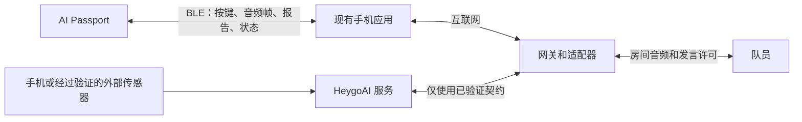
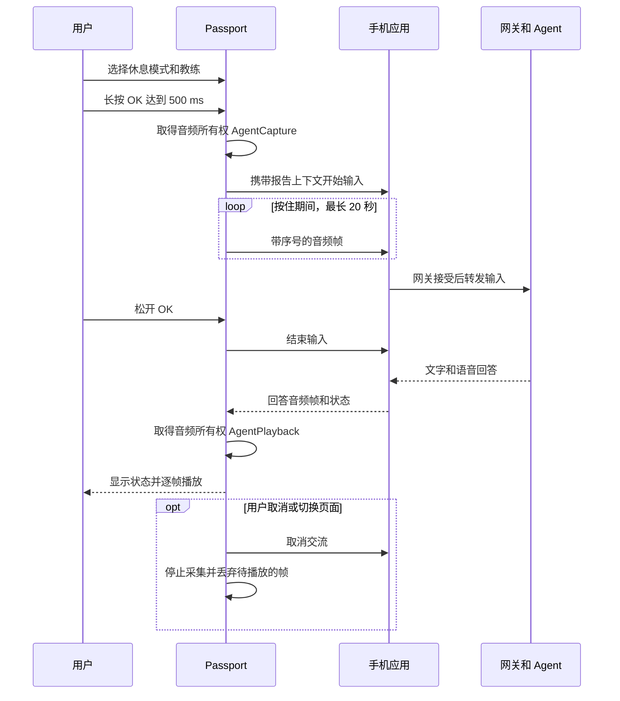
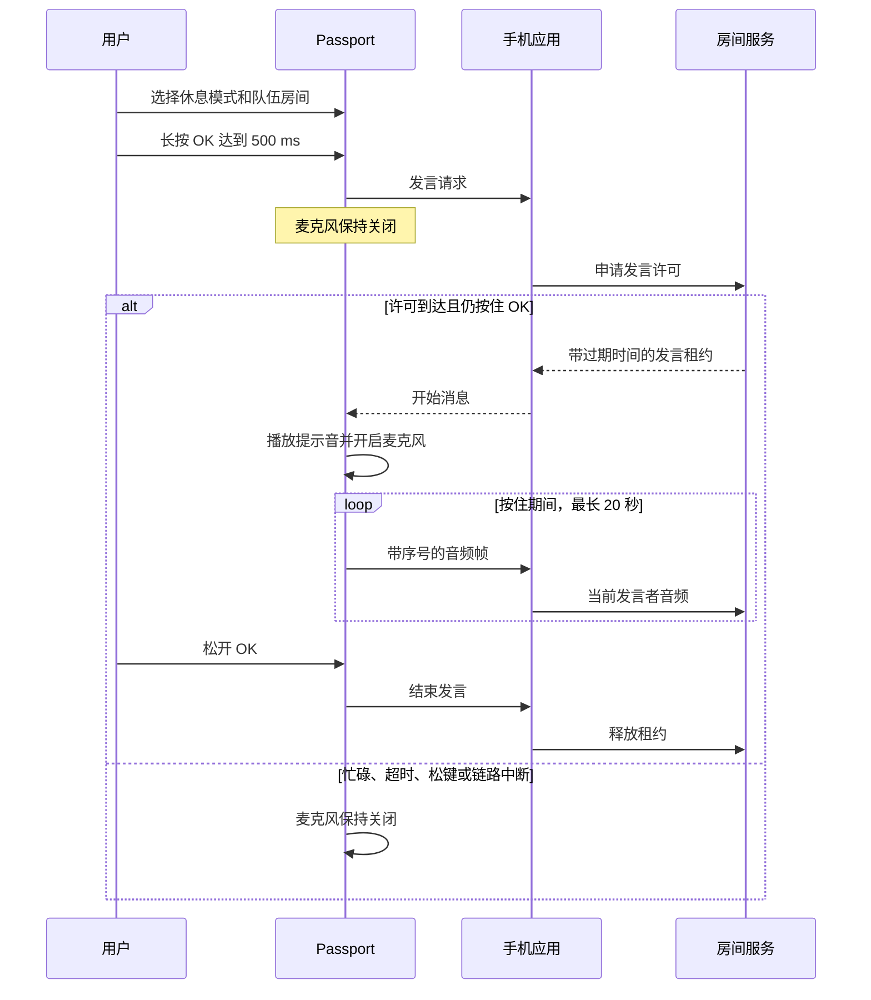

**简体中文** · [English](02-architecture.md)

# HeygoAI × AI Passport：架构方案

版本：0.2

日期：2026-10-16

状态：工程评审草案

本文提出架构方案。本文不表示联动功能已经实现。
需求编号见[产品需求](01-product-requirements.zh_CN.md)。
交付顺序见 [Scrum 待办列表](03-scrum-backlog.zh_CN.md)。
待定事项和检查方法见[验证与决策](04-validation-and-decisions.zh_CN.md)。
已确认的决策见[决策修订](05-decision-amendments.zh_CN.md)。

## 1. 证据与限制

| 状态 | 证据或方案 | 设计影响 |
|---|---|---|
| 产品资料已确认 | ESP32-C3、8 MB Flash、无 PSRAM | 限制内存和消息大小。 |
| 产品资料已确认 | 240 × 320 屏幕、RGB565 | 使用按键和紧凑页面。 |
| BSP 源码已确认 | UP、DOWN、OK 共用 ADC 输入 | 不设计同时按多个键的操作。 |
| BSP 源码已确认 | 默认长按阈值为 500 ms | 首轮交互使用 500 ms 阈值。 |
| BSP 源码已确认 | ES8311 麦克风和扬声器接口支持 16 kHz、16 bit、单声道 PCM | 在实际雪场条件下验证语音。 |
| 产品资料已确认 | 电池容量为 500 mAh | 实测续航。不能仅凭容量推导续航。 |
| 有条件支持 | 电量计可能不存在，也可能返回 `-1` | 显示未知状态，不显示虚假百分比。 |
| 基线行为已确认 | BLE 广播 | 设备到手机应用的链路还需要开发。设备不使用 Wi-Fi（D-08）。 |
| 仅为本地参考 | 存在未提交的 BLE 对讲代码 | 复用前需要评审。复用前需要测试。 |
| 团队说明 | 已有手机应用，由另一个团队开发。 | 遵循它的蓝牙接口。Q-13 跟踪该接口。 |
| 实测构建 | 去掉 Wi-Fi 的构建，静态 D/IRAM 剩余 180,840 字节。 | 以此作为起始预算。运行时堆另行测量。 |
| 未验证 | HeygoAI API、报告字段、权限和语音契约 | 使用适配器。契约明确前阻止真实集成。 |
| 未验证 | 当前检查硬件的 IMU、GNSS、气压计、运动感知和触摸接口 | 使用经过验证的数据来源和按键控制。 |
| 未验证 | 防水、低温、风噪、手套、日照、无线距离和续航 | 纳入试用验收。 |

NTAG213 是无源标签。目前没有已验证的 MCU 访问接口。
不能将其作为实时传感器或设备通信通道。
麦克风和扬声器接口可同时工作，不代表系统具备声学回声消除能力。

来源基线：`/Users/dylan/AI-passport`，提交 `3d685a90bdb96dd8526d84edde1e63fec25b460e`，以及本次查看的工作文件。
工作文件可能与该提交不同。
本地对讲代码不代表已经发布的功能，也不代表已经存在手机应用或通过设备测试。

主要证据路径：

- `docs/hardware-design/specifications.md`
- `components/bsp/include/bsp_pins.h`
- `components/bsp/include/bsp_display.h`
- `components/bsp/src/bsp_display_lvgl.c`
- `components/bsp/include/bsp_audio.h`
- `components/bsp/src/bsp_audio.c`
- `sdkconfig.defaults`
- 当前本地工作区中的 `docs/development/engineering/passport-intercom.md`

这些路径属于 `/Users/dylan/AI-passport`。它们不属于当前新仓库。

## 2. 系统边界



D-08 选定 BLE 手机桥接。
设备作为 BLE 外设。现有手机应用作为中心。
设备不连 Wi-Fi，也不需要配网界面。

D-12 让首版链路保持开放。
链路不加密、不用配对码、不做绑定校验。
附近任何蓝牙客户端都能连接。首版接受这项风险。
设备同一时间只接受一部手机连接。基线配置已经设定了这个上限。

现有手机应用属于另一个团队。它的蓝牙接口尚不清楚。
Q-13 跟踪该接口。
设备协议必须遵循该接口。因此本文定义设备行为，不定义线上格式。

队伍 PTT 指队员之间的网络语音对讲。
队伍 PTT 需要以下条件：

- 可用的手机链路。
- 可达的房间服务。
- 有效的房间成员身份。

它不是离线无线电对讲机。

### 职责分工

D-14 把设备限定为四件事：

1. 把按键事件告诉手机。
2. 把麦克风帧流式发给手机。
3. 播放手机流式发来的音频帧。
4. 显示手机提供的状态、文字和报告。

| 组件 | 负责 | 不作出的承诺 |
|---|---|---|
| HeygoAI | 契约验证后的账号、滑雪分析、报告和教练能力 | 未公开 API 或可获得的原始传感器数据 |
| 手机应用 | 设备连接、账号、语音识别、语音合成、网关请求、重试、房间选择和发言权限 | 保证后台执行 |
| 网关和适配器 | 契约转换、设备会话路由、房间服务和过期控制 | 在缺少有效来源时产生新的滑雪测量值 |
| Passport 应用 | 设备的四件事、页面、按键状态、有界缓存和音频所有权 | 本地语音识别、本地大模型或已验证的运动感知 |
| Passport BSP | 屏幕、按键、音频格式、音量、总线和其他板级操作 | 产品页面或教练逻辑 |
| 外部数据源 | 带时间戳的样本和声明的测量质量 | 在缺少来源身份和验证时直接获得信任 |

HeygoAI 专用字段保留在适配器内部。
Passport 仅接收和使用标准化消息。
接入真实账号前，先用合成样例测试适配器。

## 3. 模式、按键和页面布局

### 明确的模式

设备开机后进入滑行模式。
滑行模式仅显示简要状态，不提供详细图表和语音交互。
试用版本仅在休息模式开放报告浏览和语音交互。
设备无法验证用户是否停止移动。

D-15 提出休息模式的进出手势。用户接受之前，这些手势仍是提议。

- 在滑行模式中长按 OK，进入休息模式。
- 休息模式打开后停在报告页。
- 在休息模式顶层长按 DOWN，弹出确认。再短按 OK，返回滑行模式。

进入休息模式用长按，因为滑行时戴手套容易误触按键。
报告页忽略长按 OK。因此用来进入休息模式的那次长按不会启动采集。

休息模式提供报告、教练和队伍页面。
教练页面将语音发送给 AI Agent。
队伍页面将语音发送给当前房间中的人。
开始录音前和交流期间，持续显示接收对象。
同时使用文字和图标。不仅依靠颜色表达状态。

| 输入 | 拟定行为 |
|---|---|
| 在滑行模式中长按 OK 至少 500 ms | 进入休息模式。此手势是 D-15 的提议。 |
| 短按 UP 或 DOWN | 移动焦点、翻页或选择报告。 |
| 短按 OK | 确认当前项目。 |
| 在教练页长按 OK 至少 500 ms | 开始采集。把每一帧流式发给手机。 |
| 在队伍页长按 OK 至少 500 ms | 向手机发出发言请求。手机返回开始消息后才开始采集。 |
| 在报告页长按 OK | 不录音。 |
| 录音后松开 OK | 停止采集。告诉手机输入已结束。 |
| 持续录音达到 20 秒 | 停止录音。显示时长上限。 |
| 长按 UP 至少 500 ms | 取消当前音频所有者。没有音频所有者时不做任何事。 |
| 长按 DOWN 至少 500 ms | 返回上一页。在休息模式顶层，弹出退出确认。 |

这些时间值是拟定验收值。
长按 OK 后松开按键，不得再次触发短按 OK。
长按 UP 不得再次触发短按 UP。
长按 DOWN 不得再次触发短按 DOWN。
UP 长按达到 500 ms 时，应用识别取消操作。

200 ms 播放停止预算从达到该阈值时开始计算。
从按下 UP 到播放停止的总目标时间不超过 700 ms。
识别取消操作后，录音必须在 100 ms 内停止。
正常松开 OK 时，100 ms 录音停止预算从松键时开始计算。

按键回调只发送事件，然后立即返回。
任务负责链路、存储和音频操作。

### 拟定的 240 × 320 报告页面

页面使用全新的应用设计，不复用演示菜单或其视觉框架。
坐标单位为屏幕像素，左上角为原点。
当前显示实现包含半径为 30 像素的圆角遮罩。
关键文字必须避开遮罩区域。

| 区域 | 范围 | 内容 |
|---|---|---|
| 状态栏 | `x=32..207, y=0..35` | 休息模式、连接状态和电量状态 |
| 报告标识 | `x=12..227, y=36..67` | 滑雪会话日期、报告标题和缓存标识 |
| 指标行 | `x=12..227, y=68..103` | 两至三个可用指标及单位 |
| 主图区域 | `x=12..227, y=104..247` | 一张图表或一个弯型视图 |
| 上下文 | `x=12..227, y=248..283` | 当前弯、来源质量或数据缺失提示 |
| 按键提示 | `x=32..207, y=284..319` | UP/DOWN 操作和短按 OK 操作 |

滑雪会话摘要、趋势图和单弯详情各用一个页面。
不把所有指标放在同一页。
比较两个弯时使用相同的显示比例。
如果比例变化，显示变化提示。

教练页面显示 Agent 接收对象，以及录音、等待、播放或失败状态。
队伍页面显示房间、当前发言者、发言权限和麦克风状态。
录音期间始终显示麦克风工作标识。
队伍页面断网时禁用录音。

检查全部中文界面文字的字形覆盖。
为每个控件选择预期的中文字库。
UTF-8 输入和编译成功不能证明显示正确。
需要验证戴手套操作和户外文字可读性。

## 4. 数据来源与展示语义

每份报告包含来源、契约版本、报告修订号、采集时间段和生成时间。
每个指标包含单位和质量状态。
未知值使用 `null`。不能将未知值替换成零。
不支持的字段显示为不可用。

| 数据 | 允许的来源 | 展示要求 |
|---|---|---|
| 滑雪会话摘要 | 已验证的 HeygoAI 报告契约 | 显示报告日期和缓存状态。 |
| 速度、距离或海拔 | 具名的手机或外部传感器来源 | 显示单位和缺失区间。 |
| 教练文字 | 经适配器返回的 HeygoAI 响应 | 标明这是 AI 建议。 |
| 转弯方向或阶段 | 有文档的 HeygoAI 算法或已验证来源 | 保留算法版本和置信度含义。 |
| 转弯轨迹 | 带明确坐标系的有效位置样本 | 标明实测或估算。 |
| 弯型示意 | 合成点或形状模板 | 显示“示意图”。不显示米制单位。 |
| 演示内容 | 合成样例 | 在每个相关页面显示“演示数据”。 |

系统不得虚构滑雪评分、立刃角、转弯半径或姿态测量值。
新增派生指标必须提供公式、输入、限制和测试。
除非提供方明确说明，否则置信度不等于概率。

### 时间、缺口和图表

传输和存储使用 UTC 时间戳。
手机提供用户的显示时区。
来源时间戳与接收时间戳分别保留。
数据源缺少统一时钟时，记录时钟不确定性。

图表必须标明坐标轴、单位和时间范围。
不跨越未知区间连接折线。
图表降采样必须保留重要极值和数据缺口。
选中样本时仍可查看精确值。
缓存报告显示生成时间和距今时长。
如果时钟不能确定距今时长，则显示时长未知。

### 转弯坐标和方向

只有来源明确坡面坐标系时，实测弯型才使用局部坡面坐标。
原点为当前弯的第一个有效样本。
`y` 轴正方向沿参考下坡方向。
滑雪者面向参考下坡方向时，`x` 轴正方向朝右。
距离单位为米。

航向角定义为 `atan2(dx, dy)`，单位为度。
从参考下坡方向顺时针旋转，航向角为正。
展开后的航向角变化为正，表示右转。
展开后的航向角变化为负，表示左转。
使用滑雪者行进方向的变化来判断转弯方向。
不能根据曲线位于图中左侧或右侧来判断转弯方向。

只有提供方的方向定义符合本契约时，适配器才保留原始方向标签。
否则，适配器将方向标为未知，或执行经过评审的转换。
仅凭图形不能证明刻滑、立刃角或身体姿态。

示意图使用 0 至 1 的无量纲 `u`、`v` 坐标。
示意图不得暗示实测距离、半径或位置。
缺少坐标系时，不展示实测轨迹。
界面仍可以显示带标签的示意图或已有转弯指标。

每个弯包含开始时间、结束时间、方向、来源和质量状态。
实测点包含 `x_m`、`y_m` 和 `t_ms`。
示意点包含 `u`、`v` 和 `t_ms`。
`t_ms` 表示从当前弯开始时刻经过的毫秒数。
来源缺少时序时使用 `null`。
同一片段内的已知点时间必须递增。

拒绝相互冲突的时间顺序。不得虚构样本时间。
来源缺少时序时，显示静态形状或明确标注的示意步骤。
缺少样本时序时，不宣称按真实时间回放。

缺失区间将轨迹拆分为多个片段。
传感器中断期间不插值补线。
标记裁剪、稀疏采样和不确定方向。

## 5. 拟定的标准化契约

以下名称属于设计方案，不是已验证的 HeygoAI 接口。
探索任务完成后，适配器再映射实际契约。

### 消息封装

| 字段 | 含义 |
|---|---|
| `schema_version` | 契约主版本和次版本，初始为 `1.0` |
| `type` | 报告、控制、Agent 事件、音频帧或房间事件 |
| `message_id` | 用于去重的唯一消息标识 |
| `session_id` | 已授权设备会话 |
| `epoch` | 每次重连后产生的新连接代次 |
| `exchange_id` | 适用时填写 Agent 交流标识 |
| `room_id` | 适用时填写已授权的队伍房间 |
| `lease_id` | 适用时填写当前发言权限标识 |
| `sequence` | 当前流内单调递增的序号 |
| `created_at` / `expires_at` | UTC 有效时间范围 |
| `payload` | 与声明类型一致的有界内容 |

接收方先验证设备会话身份，再接收内容。
消息中的房间或账号字段不能替代服务端授权。
拒绝过期内容。拒绝来自旧设备会话或旧连接代次的内容。
序号缺口产生可见的质量状态或音频丢失事件。

D-13 把授权推迟到首版之后。
首版仍使用 `session_id`、`epoch` 和 `expires_at`，因为这些字段可以拒绝过期消息。
上面前两条规则适用于加入授权的后续版本。

次版本可以增加可选字段。
字段含义或必填字段变化时，升级主版本。
传输首份报告或首帧音频前，协商支持的版本。
忽略未知的可选字段。拒绝不支持的主版本。
在契约中记录枚举扩展规则和必填字段。

`schema_version` 表示契约版本。
`report_revision` 表示报告修订号。
提供方或适配器为同一 `report_id` 分配递增修订号。
拟定的 `generated_at` 字段记录该报告修订版本的生成时间。
该字段与 HeygoAI 数据的映射仍待验证。

每个报告修订版本只应用一次。忽略更早的版本。

如果报告标识和修订号相同，但内容不同，则拒绝该内容。
相同的重复消息不得重置当前页面或音频上下文。

Agent 上下文包含选中的 `report_id`、`report_revision` 和可选的 `selected_turn_id`。
`selected_turn_id` 标识一个滑雪转弯。
`exchange_id` 标识一次 Agent 交流。
同一次 Agent 交流期间，上下文保持不变。
新报告不得静默替换正在进行的交流上下文。

### 合成报告示例

此示例仅描述示意图，不包含实测滑雪轨迹。
全部标识和值均为合成内容。

```json
{
  "schema_version": "1.0",
  "type": "report.snapshot",
  "message_id": "demo-message-001",
  "session_id": "demo-device-session-001",
  "epoch": 1,
  "sequence": 1,
  "created_at": "2026-10-16T03:00:00Z",
  "expires_at": "2026-10-16T04:00:00Z",
  "payload": {
    "synthetic": true,
    "report_id": "demo-report-001",
    "report_revision": 1,
    "generated_at": "2026-10-16T03:00:00Z",
    "activity_id": "demo-ski-session-001",
    "source": {
      "provider": "synthetic_fixture",
      "algorithm_version": "fixture-1",
      "captured_from": "2026-10-16T02:50:00Z",
      "captured_to": "2026-10-16T02:50:04Z"
    },
    "metrics": [
      {"key": "speed_mean", "value": null, "unit": "m/s", "quality": "unavailable"}
    ],
    "turns": [
      {
        "turn_id": "demo-turn-001",
        "started_at": "2026-10-16T02:50:00Z",
        "ended_at": "2026-10-16T02:50:04Z",
        "direction": "right",
        "quality": "synthetic",
        "confidence": null,
        "path_kind": "schematic",
        "coordinate_frame": "normalized_uv",
        "unit": "1",
        "segments": [
          [{"u": 0.2, "v": 0.1, "t_ms": 0}, {"u": 0.4, "v": 0.5, "t_ms": 2000}, {"u": 0.8, "v": 0.9, "t_ms": 4000}]
        ]
      }
    ]
  }
}
```

`unit: "1"` 表示无量纲。界面不为此示意图显示物理单位。
缓存报告分别保存内容和来源时间，不沿用传输有效期。
传输过期控制用于防重放，不用于隐藏明确标记的历史报告。
缓存仍遵循账号访问和保留期限规则。

### 候选上限

| 项目 | 初始上限 | 超限行为 |
|---|---|---|
| 控制消息 | 1 KiB | 拒绝超限内容。返回明确错误类型。 |
| 单页报告 | 编码后 8 KiB | 请求下一页。不得分配无限大的文档缓冲。 |
| 缓存报告 | 3 份摘要和一个选中的详情页，总计不超过 64 KiB | 删除缓存中最早的报告。 |
| 单弯轨迹 | 当前弯最多 128 个点 | 请求保留缺口的简化片段。 |
| 并发 Agent 交流 | 1 次 | 先取消或完成上一次交流。 |
| 并发队伍发言者 | 每个房间 1 人 | 由手机和房间服务执行该上限。 |
| 单次按住录音 | 20 秒 | 停止录音。释放音频所有权。 |

这些上限需要堆内存测量和真实报告样本验证。
不得通过拆分超大消息来形成无限增长的重组缓冲。

## 6. Agent 与队伍音频状态

应用只有一个音频所有者：None、AgentCapture、AgentPlayback、TeamCapture 或 TeamPlayback。
每个所有者仅控制一个音频方向。
切换页面或模式前，应用先取消当前音频所有者。
试用版本不同时录音和播放。

D-11 让设备成为手机的流式麦克风和扬声器。
设备最多保存几帧，绝不保存整句问题或整段回答。
D-09 规定帧格式：16 kHz、单声道的 IMA ADPCM，每帧 20 ms。

### 教练流程



长按 OK 达到 500 ms 时，麦克风开启。
设备立即把每一帧流式发给手机。
设备不等待网关。
手机保存输入，直到网关接受。
这条规则保留了问题的开头几个字。

语音识别和语音合成由手机完成。
识别失败时，手机报告失败。设备显示一条简短的重说提示。
设备不提供转写编辑界面，因为三个按键无法编辑文字。

用户可以在采集或播放期间取消。
取消会结束本次交流。之后到达的帧，设备一律丢弃。
旧交流的迟到回答不得播放。
重连会取消上一次交流。

### 队伍 PTT 流程



队伍页不提前开始采集。
提前采集会让收听者每个字都听得更晚。
授权延迟的第 95 百分位可达 800 ms，仅这一项就超过 500 ms 的音频目标。
因此用户听到提示音后再开口。

房间、发言租约、当前发言者和重连都由手机和房间服务负责。
拟定的发言租约在授予后 25 秒内过期。
出现以下任一情况时，设备停止采集：

- 录音达到 20 秒。
- 用户松开 OK。
- 交流取消。
- 手机报告租约已结束。
- 蓝牙链路中断。

如果开始消息到达时用户已经松开 OK，设备忽略该消息。
设备告诉手机。手机释放租约。

不得缓存队伍语音以便稍后投递。
丢弃迟到的音频帧。不得重播旧语音。

队伍播放要求同时满足以下条件：

- 休息模式处于启用状态。
- 队伍页面处于打开状态。
- 音频属于当前房间。
- 音频所有权处于空闲状态。

其他队员发言时，设备播放收到的帧，并保持麦克风关闭。
队伍语音不得混入 Agent 输入或回答。
切换房间前先停止录音。
即使松键事件丢失，20 秒录音上限仍必须生效。

## 7. 设备边界与资源

使用现有 BSP 执行硬件操作。
页面、协议状态和应用任务属于应用层。
LVGL 任务之外的代码访问 LVGL 对象前，必须持有 `bsp_lvgl_lock()`。
删除界面前，停止会访问该界面的任务、定时器、回调和事件处理器。

通过 BSP API 修改音频编解码器、时钟或采样格式。
不得在按键处理器或应用页面中直接修改编解码器寄存器。
改变现有硬件配置前，先测量音频行为。

### 初始内存预算

16 kHz、单声道、16 bit PCM 每秒使用 32,000 字节。
20 秒音频需要 640,000 字节，且尚未包含协议开销。
设备没有 PSRAM，不应在 RAM 中保存完整音频。
流式传输让设备不必保存完整音频。

一次真实构建测量了静态内存。按 D-08 的要求，该构建不含 Wi-Fi。
结果是静态 D/IRAM 剩余 180,840 字节。
这个数字不包含蓝牙协议栈运行时申请的堆。

| 分配项 | 初始设计 | 证据或限制 |
|---|---|---|
| LVGL 绘制缓冲 | 单个 40 行 RGB565 缓冲 | 当前源码使用 19,200 字节。 |
| LVGL 内存池 | 24 KiB | 当前 `sdkconfig.defaults` 配置。 |
| 音频帧 | 每个方向最多 8 帧，每帧 20 ms | 拟定值。8 帧 PCM 使用 5,120 字节。8 帧 ADPCM 约使用 1,300 字节。 |
| 控制队列 | 8 项，每项不超过 1 KiB | 拟定值。拒绝超量消息。 |
| 报告解析 | 单页不超过 8 KiB | 拟定值。测量时计入解析器开销。 |
| 弯型坐标 | 最多 128 个点 | 拟定值。片段数和点数都设置固定上限。 |
| 蓝牙协议栈、任务栈、字库和固件 | 在硬件上测量 | 不宣称剩余内存已经足够。 |

每个帧队列都必须定义溢出策略。
音频溢出时，根据通道规则丢弃过期帧或停止交流。
不得因为链路缓慢而扩大队列。

当前源码使用 80 MHz SPI 时钟。
这个值不能证明屏幕帧率或可用链路吞吐量。
旧版指南提到 20 行缓冲。本方案以当前实现为准。

### 音频帧格式

D-09 选定 16 kHz、单声道的 IMA ADPCM。
每帧承载 20 ms 音频。
设备编码麦克风帧，解码收到的帧。

| 格式 | 每秒字节数 | 设备开销 |
|---|---|---|
| 裸 PCM | 32,000 | 无编解码工作。链路负载是 ADPCM 的 4 倍。 |
| IMA ADPCM | 8,000 | 每个采样几步整数运算。状态只有几个字节。 |
| Opus | 约 3,000 | 需要新增库。这块板上的一个 Opus 参考实现，编码任务栈用了 24 KB。 |

一帧 20 ms 的 ADPCM 约承载 164 字节音频数据。
本地 BLE 参考使用同一格式，并要求 ATT MTU 至少为 172。
具体帧头必须遵循手机应用接口。

协议保留裸 PCM 帧类型作为回退。
Opus 留作后续升级。只有 ADPCM 跑通、团队量过它的 CPU 和 RAM 开销之后，才考虑 Opus。

当前音频配置使用六个 DMA 描述符，每个包含 240 帧。
该容量不能证明完整链路的语音延迟。

### Flash 与存储数据

默认分区保持精简：NVS、PHY 数据和一个 factory 应用分区。
按 8 MB Flash 容量验证全部镜像。
不能假设字库和固件之外仍能容纳两个 OTA 应用槽。
OTA 需要单独的容量决策和恢复测试。

持久化报告缓存需要明确的存储决策。
不得把新增缓存分区当作模板的隐含要求。
限制缓存大小。
存储设计必须在断网和重启后保留一份完整的报告，否则 REQ-13 阻止试用验收。

新缓存快照以原子方式提交。更新失败时保留上一份完整快照。
64 KiB 缓存上限不代表当前分区表已经预留这些空间。
如果仍满足 REQ-13，选定布局可以使用更小的缓存。

## 8. 访问与失败处理

D-12 和 D-13 把安全和隐私工作排除在首版之外。
蓝牙链路不加密、不用配对码、不做绑定校验。
设备不做访问控制，也不做数据删除流程。
账号由手机应用处理。
设备不保存账号凭据，也不保存网关令牌。

这些决策带来以下已知限制：

- 附近任何蓝牙客户端都能连接设备。
- 任何已连接的客户端都能读取报告和音频帧。
- 设备无法按远程请求删除缓存报告。

后续版本加入配对、加密或删除功能之前，需要单独决策。

| 故障 | 设备行为 | 手机或服务端行为 |
|---|---|---|
| 链路中断 | 停止录音。显示离线状态和缓存报告时间。 | 使请求和发言租约过期。 |
| Agent 超时 | 结束交流。等待用户重新发起操作。 | 拒绝迟到或已取消的输出。 |
| 识别失败 | 显示简短的重说提示。 | 把失败报告给设备。 |
| 队伍房间忙碌 | 麦克风保持关闭。显示当前发言者。 | 维持唯一有效发言者。 |
| 报告无效 | 保留最近一次有效页面。标明不可用字段。 | 返回明确错误类型。 |
| 音频队列溢出 | 按通道规则丢弃过期帧或停止。 | 记录有界丢失。不得重放。 |
| 内存不足 | 在分配失败前停止音频。显示可恢复错误。 | 停止向失效交流推送数据。 |
| 电量未知 | 显示未知电量状态。 | 不推导电量百分比。 |
| 房间变化 | 停止音频。结束旧上下文。 | 拒绝旧房间权限。 |

离线模式仅支持本地已有的报告内容和基础界面。
离线模式不代表支持离线 AI 推理、语音识别或队伍 PTT。

## 9. 评审门槛与需求映射

| 领域 | 需求 | 试用验收前需要的证据 |
|---|---|---|
| 报告、图表和弯型 | REQ-03、REQ-04、REQ-05 | 真实契约样本、来源定义和合成界面评审 |
| 麦克风和语音播放 | REQ-06、REQ-07 | 与手机应用的流式传输测试、延迟、噪声和资源实测 |
| 教练交互 | REQ-08 | 取消交流和拒绝旧响应的测试 |
| 队伍 PTT | REQ-09 | 手机与房间服务原型、独占发言租约测试和重连测试 |
| 离线报告 | REQ-13 | 缓存设计和断电测试 |
| 按键与字库 | REQ-15 | 长按和松键测试、字形检查和手套测试 |
| 设备资源 | REQ-16 | 堆峰值、最大空闲块、任务栈、Flash 和续航实测 |
| 明确模式 | REQ-17 | 休息模式限制和接收对象可见性测试 |
| 诊断 | REQ-20 | 故障状态和重连测试 |

架构门槛按以下顺序推进：

1. 选定传输方案。D-08 已关闭这道门槛。
2. 记录手机应用的蓝牙接口。
3. 确认 HeygoAI 契约和报告语义。
4. 确认设备资源预算和安全限制。
5. 在真实硬件上验收完整的休息模式试用版本。

以下事项仍待确定：

- 手机应用的蓝牙接口。
- 手机平台。
- 提供方 API。
- 网关归属。
- 语音服务。
- 缓存存储。
- 已授权传感器来源。

在[验证与决策](04-validation-and-decisions.zh_CN.md)中跟踪决策。
架构图、合成样例和编译成功都不能替代硬件验证。
