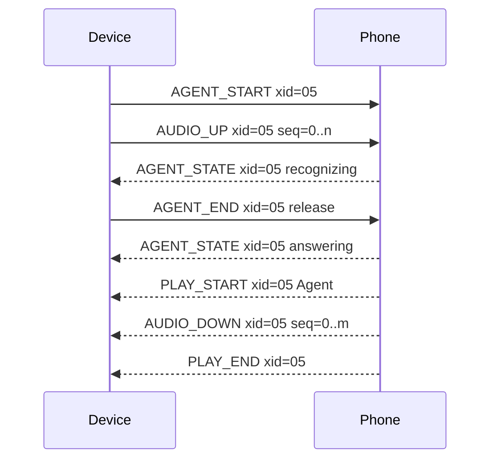
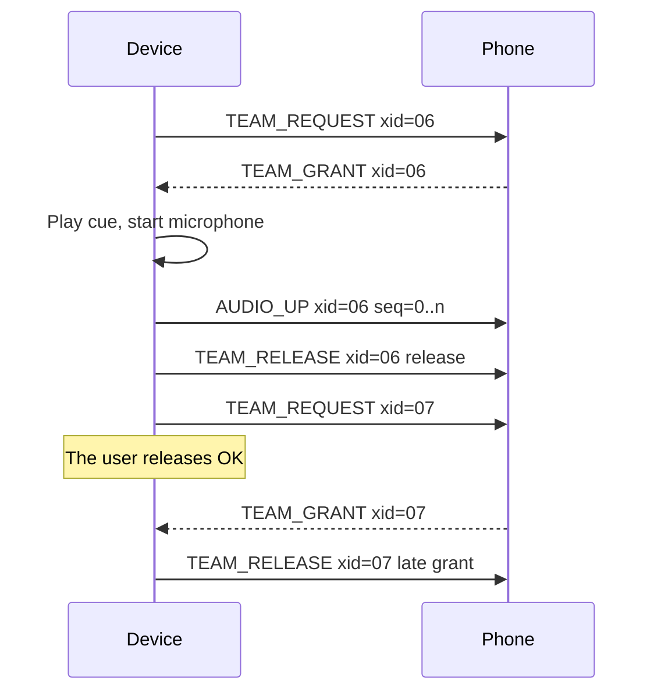
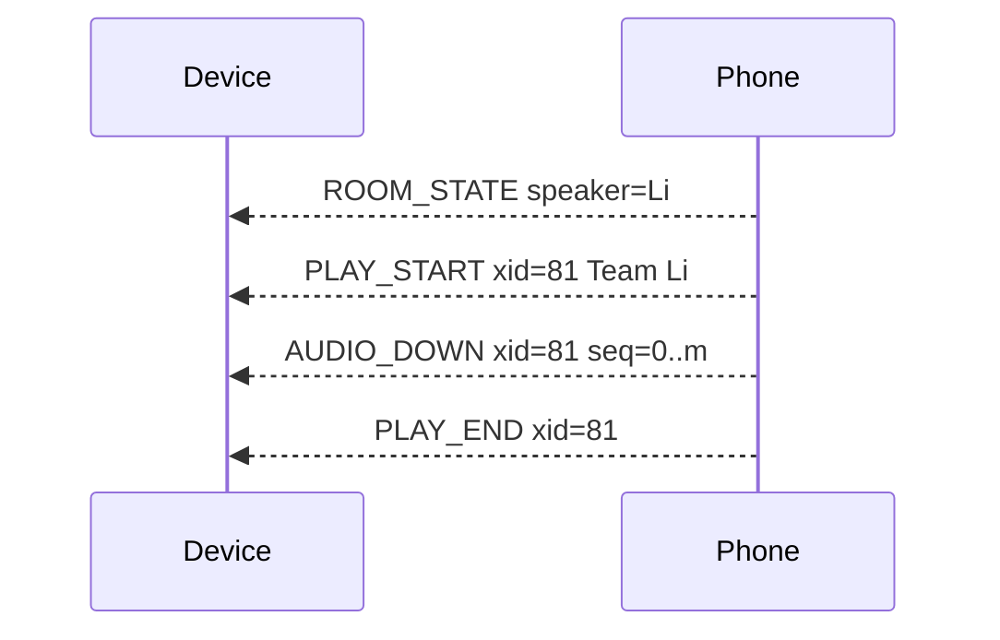

**English** · [简体中文](07-ble-protocol-draft.zh_CN.md)

# BLE Protocol Draft

Version: 0.1. Date: 2026-10-16. Status: draft from the device team. The phone application team must review it.

## 1. Purpose and scope

This draft defines the BLE link between AI Passport and the phone application.
D-14 limits the device to four tasks. This protocol carries the data for those four tasks.
The phone application team owns the other side of the link.
Q-13 stays open until that team accepts or replaces this draft.

The draft follows three rules:

1. The device does no work beyond its own capability.
2. Each packet fits in one ATT packet. The device reassembles nothing except one report page.
3. The phone makes every decision about the gateway, the room, and retries.

## 2. Roles and connection

- The device acts as the GATT server and the BLE peripheral.
- The phone application acts as the GATT client and the BLE central.
- The device accepts one connection at a time. It stops advertising while a phone stays connected.
- D-12 applies. The link uses no encryption, no pairing, and no bonding. Any nearby BLE client can connect.

The device advertises as a connectable device.
The advertising data carries the service UUID. The scan response carries the device name.
The name has the form `HeygoPP-XXXX`. `XXXX` holds the last two bytes of the device address in hexadecimal.

The device uses its public address. The baseline configuration disables host-based privacy.
The address therefore stays the same after a restart. Check this behavior on hardware.
The phone application can therefore remember a device by its address.

The proposed advertising interval is 100 ms for 30 seconds after start-up or disconnection. After that, the interval becomes 1,000 ms.

## 3. GATT layout

Service UUID: `6e400001-b5a3-f393-e0a9-e50e24dcca9e`.

| Characteristic | UUID | Direction | Property |
| --- | --- | --- | --- |
| RX | `6e400002-b5a3-f393-e0a9-e50e24dcca9e` | Phone to device | Write Without Response |
| TX | `6e400003-b5a3-f393-e0a9-e50e24dcca9e` | Device to phone | Notify |

This layout follows the Nordic UART Service. Generic BLE tools can therefore read the link.
A reference on this board used the same UUIDs.

## 4. Link setup

1. The phone connects.
2. The phone requests an ATT MTU of 247. The device needs at least 172.
3. The phone subscribes to TX notifications.
4. The device sends HELLO.
5. The phone answers with HELLO_ACK within 2 seconds.

The device disables voice features in these cases:

- The MTU stays below 172.
- No HELLO_ACK arrives within 2 seconds.
- The phone reports an unsupported major version.

Reports still work in these cases, because report pages use fragments.
The device shows a short message that names the cause.

### Connection parameters

| Mode | Interval | Peripheral latency | Supervision timeout |
| --- | --- | --- | --- |
| Rest mode | 15 ms to 30 ms | 0 | 4 seconds |
| Ski mode | 150 ms to 300 ms | 0 | 6 seconds |

The device requests the Rest mode values when the user enters Rest mode.
The device requests the Ski mode values when the user leaves Rest mode.
Each phone platform limits these values. The phone application team must check them on the target phones.

## 5. Packet format

Each write and each notification carries exactly one packet.
A packet never spans two ATT packets. Two packets never share one ATT packet.

| Offset | Size | Field | Meaning |
| --- | --- | --- | --- |
| 0 | 1 | `type` | Message type. Section 6 lists the values. |
| 1 | 1 | `flags` | Bit 0 marks the last fragment. The other bits stay zero. |
| 2 | 1 | `xid` | Exchange ID. Zero means no exchange. |
| 3 | 1 | `seq` | Sequence number inside the exchange. It wraps after 255. |
| 4 | 0 to MTU − 7 | `payload` | Content for the type. |

The ATT packet length gives the payload length. The packet carries no length field.
Multi-byte numbers use little-endian order. Text uses UTF-8.

**Why this format differs from the board reference.**
The reference used a magic word, a length field, and a stream parser.
It needed them, because one notification could carry several frames, and one frame could span several notifications.
This draft forbids both cases. The device therefore needs no stream parser.
The phone must obey the one-packet rule.

### Exchange IDs

- The device starts exchanges with `xid` values from 0x01 to 0x7F.
- The phone starts exchanges with `xid` values from 0x80 to 0xFE.
- Zero means no exchange. 0xFF stays reserved.
- Each side increments its own `xid` for each new exchange, and wraps inside its own range.
- An Agent answer uses the `xid` of the Agent question.

The device keeps one current `xid` for each audio owner.
The device drops each audio packet and each state packet that carries another `xid`.
A cancellation clears the current `xid`. The device then drops every late packet for that exchange.

A new BLE connection resets every `xid`.
Packets from an old connection cannot arrive on a new connection. The link therefore needs no epoch field.

### Versions

This draft is protocol version 0.1. Major version 0 marks a draft, and incompatible changes stay allowed.
A receiver ignores extra bytes at the end of a payload. A minor version can therefore add fields at the end.
A receiver answers an unknown type with ERROR, and ignores the packet.

## 6. Message types

D means the device. P means the phone.

### Link

| Type | Name | Direction | Payload | When |
| --- | --- | --- | --- | --- |
| 0x01 | HELLO | D to P | Major (1), minor (1), codec mask (1), MTU (2), firmware version (text) | After the phone subscribes to TX |
| 0x02 | HELLO_ACK | P to D | Major (1), minor (1), UTC time in seconds (4), application version (text) | Within 2 seconds of HELLO |
| 0x03 | PHONE_STATUS | P to D | UTC time (4), network online (1), gateway reachable (1), application in background (1) | On each change, and at least every 5 seconds |
| 0x04 | DEVICE_STATUS | D to P | Battery percent (1, 0xFF when unknown), mode (1), page (1), free heap in KiB (2) | On each change, and every 30 seconds |
| 0x0F | ERROR | Both | Error code (1), referenced type (1), referenced `xid` (1) | After a packet that the receiver rejects |

The codec mask uses bit 0 for IMA ADPCM and bit 1 for raw PCM.
The device needs the UTC time from the phone. It has no other clock source for the report age.

| Error code | Meaning |
| --- | --- |
| 1 | Unknown type |
| 2 | Wrong length |
| 3 | Unsupported version |
| 4 | Content too large |
| 5 | Sequence gap |
| 6 | Type not valid in the current state |

### Context

| Type | Name | Direction | Payload | When |
| --- | --- | --- | --- | --- |
| 0x10 | CONTEXT | D to P | Mode (1), page (1), report revision (4), report ID length (1), report ID (text), turn ID (text, empty for none) | On each change of mode, page, report, or turn |

The phone puts this context into each Agent request. REQ-08 needs it.

### Agent

| Type | Name | Direction | Payload | When |
| --- | --- | --- | --- | --- |
| 0x20 | AGENT_START | D to P | Codec (1), sample rate in kHz (1) | At the 500 ms OK hold on the Coach page |
| 0x21 | AGENT_END | D to P | Reason (1): 0 release, 1 the 20-second limit | When capture stops |
| 0x22 | AGENT_CANCEL | D to P | None | At an UP hold, a page change, or a mode change |
| 0x23 | AGENT_STATE | P to D | State (1), failure code (1), text (optional) | On each change of the exchange state |

AGENT_START uses a new device `xid`. AUDIO_UP packets follow at once. The device does not wait for an answer.
AGENT_CANCEL ends the whole exchange. The phone drops the input, and stops the answer.

| State value | Meaning |
| --- | --- |
| 1 | Accepted |
| 2 | Recognizing |
| 3 | Thinking |
| 4 | Answering |
| 5 | Done |
| 6 | Failed. The failure code gives the cause: 1 recognition, 2 timeout, 3 gateway. |

The optional text can hold a transcript or a short answer. It must fit in the packet.
With an MTU of 172, the text holds at most 163 bytes.

### Audio

| Type | Name | Direction | Payload | When |
| --- | --- | --- | --- | --- |
| 0x30 | AUDIO_UP | D to P | One audio block | Every 20 ms while capture runs |
| 0x31 | AUDIO_DOWN | P to D | One audio block | At real-time pace during playback |
| 0x32 | PLAY_START | P to D | Channel (1): 0 Agent, 1 Team. Codec (1). Speaker name (text, Team only). | Before the first AUDIO_DOWN of an answer or a Team speech |
| 0x33 | PLAY_END | P to D | None | After the last AUDIO_DOWN |
| 0x34 | PLAY_STOP | D to P | None | At an UP hold during Team playback |

Each audio packet carries the `xid` of its exchange. `seq` increases by one for each block.
After PLAY_END, the device plays the frames in its queue, and then frees the audio owner.
At an UP hold during Agent playback, the device sends AGENT_CANCEL.
At an UP hold during Team playback, the device sends PLAY_STOP.
In both cases the device stops the speaker at once. It does not wait for the phone.

### Team

| Type | Name | Direction | Payload | When |
| --- | --- | --- | --- | --- |
| 0x50 | TEAM_REQUEST | D to P | None | At the 500 ms OK hold on the Team page |
| 0x51 | TEAM_GRANT | P to D | Lease length in ms (2) | After the room service grants the floor |
| 0x52 | TEAM_DENY | P to D | Reason (1), current speaker (text) | When the phone cannot grant the floor |
| 0x53 | TEAM_RELEASE | D to P | Reason (1) | When capture stops, or after a late grant |
| 0x54 | TEAM_REVOKE | P to D | Reason (1): 1 lease expired, 2 room closed | When the lease ends early |
| 0x55 | ROOM_STATE | P to D | Room available (1), member count (1), room name length (1), room name (text), current speaker (text, empty for nobody) | On each change of the room |

TEAM_REQUEST uses a new device `xid`. The microphone stays closed.
On TEAM_GRANT, the device checks two conditions: OK is still held, and the `xid` is current.
If both conditions hold, the device plays the cue, starts the microphone, and sends AUDIO_UP packets.
If either condition fails, the device sends TEAM_RELEASE with reason 3, and keeps the microphone closed.

| TEAM_DENY reason | Meaning |
| --- | --- |
| 1 | Another member speaks. The text names that member. |
| 2 | No room |
| 3 | Timeout |
| 4 | Gateway error |

| TEAM_RELEASE reason | Meaning |
| --- | --- |
| 0 | The user released OK |
| 1 | The 20-second limit |
| 2 | Cancellation |
| 3 | Late grant |
| 4 | Link problem |

### Reports

| Type | Name | Direction | Payload | When |
| --- | --- | --- | --- | --- |
| 0x60 | REPORT_REQUEST | D to P | Page index (1), report ID (text, empty for the session list) | When the user opens a report or a page |
| 0x61 | REPORT_PAGE | P to D | Fragment of one JSON page | In answer to REPORT_REQUEST, or when the phone pushes a new report |
| 0x62 | REPORT_ACK | D to P | Result (1) | After the last fragment, or after a rejection |

Each REPORT_PAGE transfer uses a new phone `xid`. `seq` holds the fragment index, from zero.
The first fragment starts with the total length (2). JSON bytes follow.
The last fragment sets bit 0 of `flags`.

The device reassembles a page in one fixed buffer of 8,192 bytes.
The device rejects the transfer in these cases:

- The total length exceeds 8,192 bytes.
- A fragment index skips a value.
- The JSON does not parse.
- The report revision is older than the cached revision.

| REPORT_ACK result | Meaning |
| --- | --- |
| 0 | Accepted |
| 1 | Too large |
| 2 | Sequence gap |
| 3 | Parse error |
| 4 | Stale revision |

A new transfer `xid` cancels an incomplete transfer. The phone can retry a rejected transfer once.
The report page follows the JSON contract in architecture section 5.
The session list uses this JSON form: `{"sessions":[{"id":"...","date":"...","title":"..."}]}`.

## 7. Audio blocks

### IMA ADPCM block

| Offset | Size | Field |
| --- | --- | --- |
| 0 | 2 | Predictor, signed 16-bit |
| 2 | 1 | Step index, from 0 to 88 |
| 3 | 1 | Reserved, zero |
| 4 | 160 | 320 samples, 4 bits each, low nibble first |

One block holds 20 ms at 16 kHz, mono. The block uses 164 bytes. With the header, one packet uses 168 bytes.
The predictor and the step index give the decoder state before the first sample. The block therefore codes all 320 samples.
Each block carries its own state. A lost block therefore does not corrupt the next block.

This layout differs from the IMA ADPCM block in WAV files. A WAV block stores the first sample in its header.
Do not reuse a WAV decoder without a change.
Use the standard IMA step table with 89 entries, and the standard index table.

### Raw PCM block

The raw PCM fallback uses 16 kHz, 16-bit little-endian, mono samples.
One block holds 5 ms, which is 80 samples or 160 bytes.
The fallback uses four times the packet rate of ADPCM. Use it for diagnostics only.

### Pacing and queues

- The device sends one AUDIO_UP block every 20 ms while capture runs.
- The phone sends AUDIO_DOWN blocks at real-time pace. It never runs more than 8 blocks ahead of playback.
- The device starts the speaker after 3 blocks arrive. That gives a 60 ms jitter margin.
- The device TX queue holds 8 audio packets. On overflow, the device drops the oldest audio packet.
- Control packets go before audio packets. A control packet never waits behind audio.
- The device playback queue holds 8 packets. On overflow, the device drops the oldest packet.
- After a sequence gap, the device plays nothing for the missing block. The next block header resets the decoder.

## 8. Timing rules

| Rule | Value | Owner |
| --- | --- | --- |
| HELLO_ACK after HELLO | At most 2 seconds | Phone |
| Interval between PHONE_STATUS packets | At most 5 seconds | Phone |
| Silence before the device shows that the phone application does not respond | 15 seconds | Device |
| TEAM_GRANT or TEAM_DENY after TEAM_REQUEST | At most 1,500 ms. After that, the device treats the request as a timeout. | Device |
| First AGENT_STATE after AGENT_END | At most 10 seconds. After that, the device shows a timeout. | Device |
| Capture stop after OK release or cancellation | At most 100 ms | Device |
| Speaker stop after the cancellation command | At most 200 ms | Device |
| One capture | At most 20 seconds | Device |

The 1,500 ms value comes from the local intercom reference.
TC-09 targets 800 ms for a grant at the 95th percentile. The timeout covers the slow tail.

## 9. Sequences

### Coach question

### Team speech, and a late grant

### Speech from another member

## 10. Device memory cost

| Item | Bytes |
| --- | --- |
| TX control queue, 4 packets of 172 bytes | 688 |
| TX audio queue, 8 packets of 172 bytes | 1,376 |
| Playback queue, 8 packets of 172 bytes | 1,376 |
| Report page buffer | 8,192 |
| Total | 11,632 |

The ADPCM codec state adds a few bytes for each direction.
The NimBLE host and controller need extra memory. Measure them on hardware.

## 11. What the phone application must do

1. Request an ATT MTU of 247, and accept no less than 172 for voice.
2. Subscribe to TX notifications, and answer HELLO within 2 seconds.
3. Send one packet in each write. Never join two packets. Never split one packet.
4. Send PHONE_STATUS at least every 5 seconds.
5. Hold the Agent input until the gateway accepts it. D-11 requires this.
6. Send AUDIO_DOWN at real-time pace, never more than 8 blocks ahead.
7. Decode and encode the ADPCM block layout in section 7.
8. Drop the input and the answer after AGENT_CANCEL.
9. Request the floor after TEAM_REQUEST, and answer within 1,500 ms.
10. Release the floor after TEAM_RELEASE.
11. Split each report page into fragments that fit the MTU.

## 12. Open items

- The phone application team accepts or replaces this draft. Q-13 tracks this item.
- Measure the MTU, the connection interval, and the throughput on the target phones.
- Check the background behavior of the phone application while a voice exchange runs.
- Fix the JSON report schema with real HeygoAI data. Q-01 tracks this item.
- Measure the battery cost of the Rest mode interval.

## 13. Related documents

- [System Architecture](02-architecture.md).
- [Validation and Decisions](04-validation-and-decisions.md).
- [Decision Amendments](05-decision-amendments.md).
- [Sprint 0 Two-Day Plan](06-sprint-0-two-day-plan.md).
- [Folder Index](README.md).
