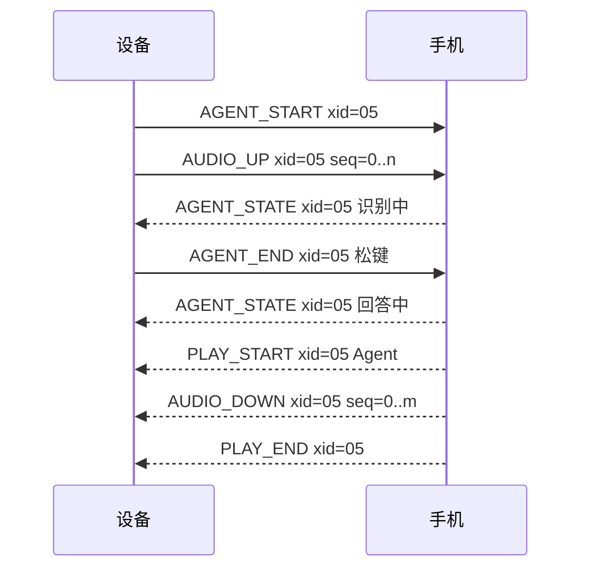
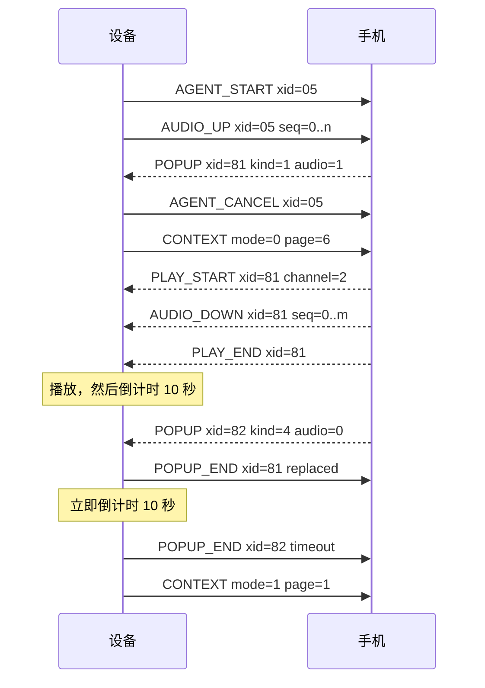
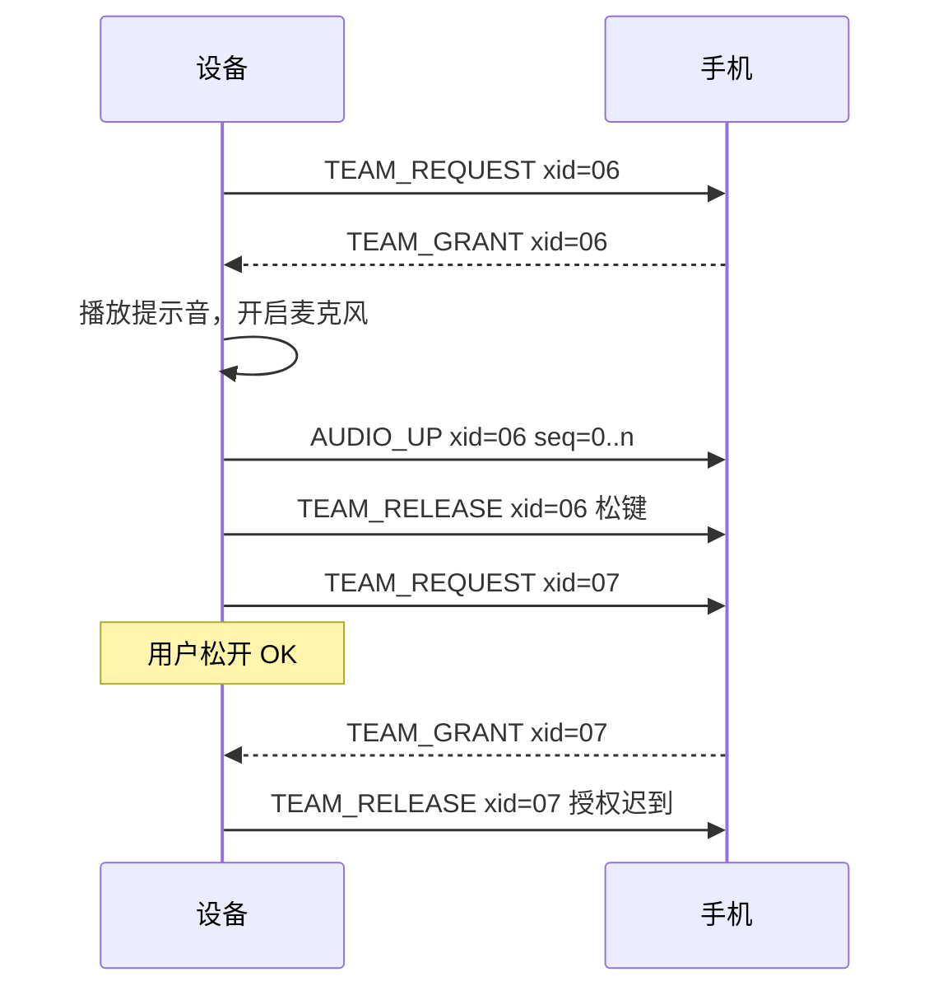
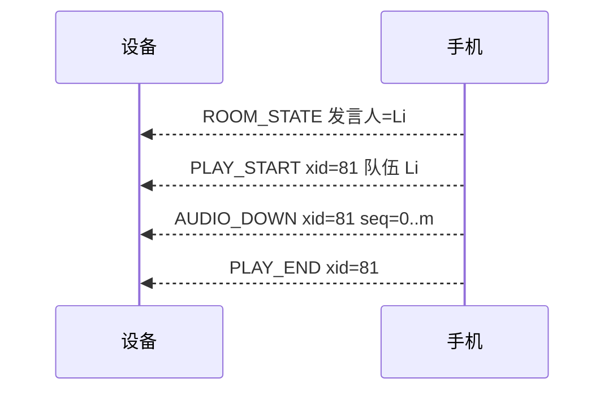

**简体中文** · [English](07-ble-protocol-draft.md)

# 蓝牙协议草案

版本：0.12。日期：2026-10-17。状态：手机应用团队已确认协议 0.2。0.7 版的 SHOW_PAGE、0.8 版的字段含义和 0.9 版的三条弯型消息需要该团队确认。0.10 版加入了手机应用团队要求的设备规则。0.11 版的两条弹窗消息和 0.12 版的 RUN_START 也需要该团队确认。

## 1. 目的与范围

本草案定义 AI Passport 与手机应用之间的蓝牙链路。
D-14 把设备限定为四件事。本协议承载这四件事需要的数据。
链路的另一端归手机应用团队负责。
在该团队接受或替换本草案之前，Q-13 保持开放。

0.2 版把队伍和报告两组消息标为 P1，因为 D-17 把对讲和报告移出了 P0。
首版只实现 P0 消息。

文档 0.3 版定义协议版本 0.1，并确定手机应用需要的全部字段取值。

0.3 版遵循 D-18。首版申请最佳性能的链路参数，不考虑功耗。
广播间隔固定不变。

0.4 版加入 Sprint 1 固件采用的六条规则。它不改变任何包格式，所以协议版本仍是 0.1。
第 13 节列出这六条规则。

0.5 版按 D-20 加入第七条规则：手机收到 AGENT_END 之后才开始回答。协议版本仍是 0.1。
第 14 节列出这条规则。

0.6 版按 D-23、D-24 和 D-26 加入增量 2 的两种滑行数据消息 LIVE_STATS 和 RUN_REPORT，协议版本升为 0.2。
第 15 节列出这些变更。
0.8 版按 D-29 去掉滑行模式和休息模式。模式字段和页面字段的取值不变，含义改变。协议版本仍是 0.2。
第 16 节列出这些变更。

0.9 版按 D-30 加入增量 3 的消息 TURN_SHAPE、TURN_GROUP、TURN_REQUEST 和弯型页。协议版本保持 0.2。
第 17 节列出这些变更。

0.11 版按 D-31 加入增量 4 的消息 POPUP、POPUP_END、弹窗语音通道和弹窗页。协议版本保持 0.2。
第 19 节列出这些变更。

0.12 版按 D-32 加入 RUN_START。手机开始滑行时，设备打开实时数据页。协议版本保持 0.2。
第 20 节列出这些变更。

本草案遵循三条原则：

1. 设备不做超出自身能力的事。
2. 每个包都装进一个 ATT 包。设备不做任何重组。
3. 网关、房间和重试的所有决定都由手机做。

## 2. 角色与连接

- 设备是 GATT 服务端，也是 BLE 外设。
- 手机应用是 GATT 客户端，也是 BLE 中心。
- 设备同一时间只接受一个连接。有手机连着时，设备停止广播。
- 适用 D-12。链路不加密、不配对、不绑定。附近任何蓝牙客户端都能连接。

设备以可连接方式广播。
广播数据携带服务 UUID。扫描响应携带设备名。
设备名格式为 `HeygoPP-XXXX`，`XXXX` 是设备地址最后两个字节的十六进制。

设备使用公共地址。基线配置关闭了 host-based privacy。
因此地址在重启后保持不变。需要在硬件上检查这一行为。
手机应用可以按地址记住设备。

设备以固定的 100 ms 间隔广播。省电用的慢速间隔由 D-18 推迟。

## 3. GATT 结构

服务 UUID：`6e400001-b5a3-f393-e0a9-e50e24dcca9e`。

| 特征 | UUID | 方向 | 属性 |
| --- | --- | --- | --- |
| RX | `6e400002-b5a3-f393-e0a9-e50e24dcca9e` | 手机到设备 | Write Without Response |
| TX | `6e400003-b5a3-f393-e0a9-e50e24dcca9e` | 设备到手机 | Notify |

这个结构沿用 Nordic UART Service，所以通用蓝牙工具可以直接读取链路。
这块板上的一个参考实现用的就是这组 UUID。

## 4. 建立链路

1. 手机发起连接。
2. 手机申请 247 的 ATT MTU。设备至少需要 172。设备不发起 MTU 交换。
3. 手机订阅 TX 通知。
4. 设备发送 HELLO。
5. 手机在 2 秒内回复 HELLO_ACK。

以下情况下，设备关闭语音功能：

- MTU 低于 172。
- 2 秒内没有收到 HELLO_ACK。
- 手机报告的主版本不受支持。

这些情况下链路保持连接。MTU 低于 172 时，滑行数据仍然可用：LIVE_STATS 只需要 19 的 MTU，RUN_REPORT 需要 110。版本不受支持时，设备也忽略这两种消息。
设备显示一条简短消息，说明原因。

### 链路参数

首版只申请一组最佳性能参数。按 D-18，不考虑功耗。

| 参数 | 设备申请值 | 理由 |
| --- | --- | --- |
| 连接间隔 | 最小 7.5 ms，最大 15 ms | 间隔越短，延迟越低，每秒能传的包越多。7.5 ms 是 BLE 规范允许的最小值。 |
| 外设延迟 | 0 | 设备在每个连接事件都响应。 |
| 监督超时 | 4 秒 | 链路断开几秒内就能发现。 |
| PHY | LE 2M，回退到 LE 1M | LE 2M 让每个包的空中时间减半。 |
| 链路层数据长度 | 251 字节 | 一个 168 字节的音频包装进一个链路层包。默认长度 27 字节会把它拆成 7 片。 |
| ATT MTU | 247 字节 | 一个包装下一整块音频。 |

链路建立后，设备申请一次这组参数，两种模式下都保持不变。
最终取值由手机决定。各平台都会限制连接间隔，有些手机不支持 LE 2M。
例如苹果的配件设计指南规定，大多数配件的连接间隔最小为 15 ms。
设备在日志中记录手机实际给出的取值。手机应用团队必须在目标手机上检查。

## 5. 包格式

每次写入和每次通知都只携带一个包。
一个包不跨两个 ATT 包。两个包不共用一个 ATT 包。

| 偏移 | 长度 | 字段 | 含义 |
| --- | --- | --- | --- |
| 0 | 1 | `type` | 消息类型，取值见第 6 节。 |
| 1 | 1 | `flags` | 第 0 位留给分片使用。协议版本 0.2 没有分片消息，所以第 0 位为零。其他位也为零。 |
| 2 | 1 | `xid` | 交流编号。零表示不属于任何交流。 |
| 3 | 1 | `seq` | 交流内的序号。超过 255 后回绕。 |
| 4 | 0 至 MTU − 7 | `payload` | 该类型的内容。 |

载荷长度由 ATT 包长度给出，包内不带长度字段。
多字节数字使用小端序。文本使用 UTF-8。

**为什么和板上参考实现的格式不同。**
参考实现使用魔数、长度字段和流解析器。
它需要这些，是因为一次通知可能带多帧，一帧也可能跨多次通知。
本草案禁止这两种情况，所以设备不需要流解析器。
手机必须遵守"一次一个包"的规则。

### 交流编号

- 设备发起的交流使用 0x01 至 0x7F 的 `xid`。
- 手机发起的交流使用 0x80 至 0xFE 的 `xid`。
- 零表示不属于任何交流。0xFF 保留。
- 每次新建连接后，设备先用 0x01，手机先用 0x80。
- 每一方每发起一次新交流，自己的 `xid` 加一。设备在 0x7F 之后回到 0x01，手机在 0xFE 之后回到 0x80。
- Agent 回答使用对应提问的 `xid`。

设备为每个音频所有者保存一个当前 `xid`。
`xid` 不同的音频包和状态包，设备一律丢弃。
取消会清空当前 `xid`。之后该交流迟到的每个包，设备都会丢弃。

新的蓝牙连接会重置所有 `xid`。
旧连接的包不可能出现在新连接上，因此链路不需要连接代次字段。

### 序号

- 每段音频流的第一块 `seq` 为 0，之后每块加一，超过 255 后回到 0。
- 其他所有包的 `seq` 都为 0。

### 协议版本

文档 0.3 版至 0.5 版定义协议版本 0.1。文档 0.6 版定义协议版本 0.2。
因此 HELLO 和 HELLO_ACK 携带主版本 0、次版本 2。
协议版本 0.2 等于 0.1 加上 LIVE_STATS 和 RUN_REPORT。
更早的文档版本没有实现，所以没有协议版本号。

主版本为 0 时，协议仍是草案，允许不兼容的修改。
因此双方的主版本和次版本都必须相同。
任何不同都视为版本不受支持。设备发送错误码 3 的 ERROR，并关闭语音功能。

从主版本 1 开始，新的次版本只在载荷末尾追加字段。
接收方忽略载荷末尾多出的字节。
接收方遇到未知类型时回复错误码 1 的 ERROR，并忽略该包。

## 6. 消息类型

D 表示设备，P 表示手机。

### 字段取值

| 字段 | 长度 | 取值 |
| --- | --- | --- |
| 模式 | 1 字节 | 0 实时数据页、报告页、弯型页或弹窗页。1 教练页。D-29 之前表示滑行模式和休息模式，取值不变。 |
| 页面 | 1 字节 | 0 实时数据页。1 教练页。2 不再使用（原退出确认）。3 报告页。4 队伍页，P1。5 弯型页，增量 3（D-30）。6 弹窗页，增量 4（D-31）。 |
| 编码 | 1 字节 | 0 IMA ADPCM。1 裸 PCM。 |
| 编码掩码 | 1 字节 | 第 0 位 IMA ADPCM，第 1 位裸 PCM。第 n 位对应编码值 n。 |
| 采样率 | 1 字节 | 16，单位 kHz。没有其他有效值。 |
| 是否标志 | 1 字节 | 0 否。1 是。 |
| 电量百分比 | 1 字节 | 0 至 100。0xFF 表示未知。 |
| UTC 时间 | 4 字节 | Unix 秒数，无符号。 |
| 文本 | 载荷剩余部分 | UTF-8，不带结尾的零字节。版本文本最多 32 字节。 |

接收方把未知的页面值当作未知页面，不为此发送 ERROR。
接收方遇到未知的编码值时，回复错误码 7 的 ERROR。

### 链路

| 类型 | 名称 | 方向 | 载荷 | 时机 |
| --- | --- | --- | --- | --- |
| 0x01 | HELLO | D 到 P | 主版本 (1)、次版本 (1)、编码掩码 (1)、MTU (2)、固件版本（文本） | 手机订阅 TX 之后 |
| 0x02 | HELLO_ACK | P 到 D | 主版本 (1)、次版本 (1)、UTC 秒数 (4)、应用版本（文本） | HELLO 之后 2 秒内 |
| 0x03 | PHONE_STATUS | P 到 D | UTC 秒数 (4)、网络在线 (1)、网关可达 (1)、应用在后台 (1) | 每次变化时，且至少每 5 秒一次 |
| 0x04 | DEVICE_STATUS | D 到 P | 电量百分比 (1，未知为 0xFF)、模式 (1)、页面 (1)、空闲堆 KiB (2) | 每次变化时，且每 30 秒一次 |
| 0x0F | ERROR | 双向 | 错误码 (1)、相关类型 (1)、相关 `xid` (1) | 接收方拒绝一个包之后 |

编码掩码的第 0 位表示 IMA ADPCM，第 1 位表示裸 PCM。
设备需要手机提供的 UTC 时间，因为它没有别的时钟来源。

| 错误码 | 含义 |
| --- | --- |
| 1 | 未知类型 |
| 2 | 长度错误 |
| 3 | 版本不受支持 |
| 4 | 内容过大 |
| 5 | 序号缺口 |
| 6 | 当前状态下不接受该类型 |
| 7 | 未知的字段取值 |

### 上下文

| 类型 | 名称 | 方向 | 载荷 | 时机 |
| --- | --- | --- | --- | --- |
| 0x10 | CONTEXT | D 到 P | 模式 (1)、页面 (1) | 页面每次变化时 |

P0 中，手机自己把当前滑雪会话附在每次 Agent 请求上。
设备在报告页时，CONTEXT 的页面字段为 3。在弯型页时为 5。弹窗期间，模式字段为 0，页面字段为 6。

### Agent

| 类型 | 名称 | 方向 | 载荷 | 时机 |
| --- | --- | --- | --- | --- |
| 0x20 | AGENT_START | D 到 P | 编码 (1)、采样率 kHz (1) | 教练页长按 OK 达到 500 ms 时 |
| 0x21 | AGENT_END | D 到 P | 原因 (1)：0 松键，1 达到 20 秒上限 | 采集停止时 |
| 0x22 | AGENT_CANCEL | D 到 P | 无 | 翻页时，或用新问题取消旧交流时 |
| 0x23 | AGENT_STATE | P 到 D | 状态 (1)、失败码 (1)、文本（可选） | 交流状态每次变化时 |

AGENT_START 使用新的设备 `xid`。AUDIO_UP 包紧接着发出，设备不等待回复。
AGENT_CANCEL 结束整次交流。手机丢弃输入，并停止回答。

| 状态值 | 含义 |
| --- | --- |
| 1 | 已接受 |
| 2 | 识别中 |
| 3 | 思考中 |
| 4 | 回答中 |
| 5 | 完成 |
| 6 | 失败。失败码给出原因：1 识别失败，2 超时，3 网关错误。 |

其他状态的失败码一律为 0。

失败码 2 时设备显示超时。失败码 1 和 3 时设备提示用户重说。
回答开始之前，每个非失败的 AGENT_STATE 都会让设备的 10 秒等待重新计时。

可选文本可以是转写结果或简短回答，必须装得进一个包。
MTU 为 172 时，文本最多 163 字节。

### 音频

| 类型 | 名称 | 方向 | 载荷 | 时机 |
| --- | --- | --- | --- | --- |
| 0x30 | AUDIO_UP | D 到 P | 一个音频块 | 采集期间每 20 ms 一个 |
| 0x31 | AUDIO_DOWN | P 到 D | 一个音频块 | 播放期间按实时节奏发送 |
| 0x32 | PLAY_START | P 到 D | 通道 (1)：0 Agent，1 队伍，2 弹窗（D-31）。编码 (1)。发言人名字（文本，仅队伍）。 | 一段回答、一段队伍语音或一个弹窗的第一个 AUDIO_DOWN 之前 |
| 0x33 | PLAY_END | P 到 D | 无 | 最后一个 AUDIO_DOWN 之后 |
| 0x34 | PLAY_STOP | D 到 P | 无 | 队伍播放期间翻页时。P1。 |

每个音频包都带所属交流的 `xid`。每个块的 `seq` 加一。
收到 PLAY_END 后，设备播完队列中的帧，然后释放音频所有者。
Agent 播放期间翻页，设备发送 AGENT_CANCEL。
队伍播放期间翻页，设备发送 PLAY_STOP。
两种情况下设备都立即停止喇叭，不等待手机。

首版在 HELLO 中只声明 IMA ADPCM。codec 为 1 的 PLAY_START，设备回复错误码 7 的 ERROR。
手机收到 AGENT_END 之后，才能发送这次交流的 PLAY_START。设备在录音时丢弃 PLAY_START。
首版没有队伍音频所有者。设备忽略队伍通道的 PLAY_START。
弹窗通道的规则见"弹窗"一节。

### 队伍（P1）

首版不实现这组消息。

| 类型 | 名称 | 方向 | 载荷 | 时机 |
| --- | --- | --- | --- | --- |
| 0x50 | TEAM_REQUEST | D 到 P | 无 | 队伍页长按 OK 达到 500 ms 时 |
| 0x51 | TEAM_GRANT | P 到 D | 租约时长 ms (2) | 房间服务授予发言权之后 |
| 0x52 | TEAM_DENY | P 到 D | 原因 (1)、当前发言人（文本） | 手机无法授予发言权时 |
| 0x53 | TEAM_RELEASE | D 到 P | 原因 (1) | 采集停止时，或收到迟到的授权之后 |
| 0x54 | TEAM_REVOKE | P 到 D | 原因 (1)：1 租约到期，2 房间关闭 | 租约提前结束时 |
| 0x55 | ROOM_STATE | P 到 D | 房间可用 (1)、成员数 (1)、房间名长度 (1)、房间名（文本）、当前发言人（文本，空表示无人） | 房间每次变化时 |

TEAM_REQUEST 使用新的设备 `xid`。此时麦克风保持关闭。
收到 TEAM_GRANT 时，设备检查两个条件：OK 仍被按住，且 `xid` 是当前值。
两个条件都满足时，设备播放提示音、开启麦克风，并发送 AUDIO_UP 包。
任一条件不满足时，设备发送原因 3 的 TEAM_RELEASE，并保持麦克风关闭。

| TEAM_DENY 原因 | 含义 |
| --- | --- |
| 1 | 其他队员正在发言，文本给出其名字 |
| 2 | 没有房间 |
| 3 | 超时 |
| 4 | 网关错误 |

| TEAM_RELEASE 原因 | 含义 |
| --- | --- |
| 0 | 用户松开 OK |
| 1 | 达到 20 秒上限 |
| 2 | 取消 |
| 3 | 授权迟到 |
| 4 | 链路问题 |

### 滑行数据（增量 2）

D-23 规定由设备团队定义这组字段，手机应用团队负责计算和发送。
文档 0.6 版用 LIVE_STATS 和 RUN_REPORT 取代 0.3 版的 JSON 报告消息 REPORT_REQUEST、REPORT_PAGE 和 REPORT_ACK。
那三种消息从未实现。

| 类型 | 名称 | 方向 | 载荷 | 时机 |
| --- | --- | --- | --- | --- |
| 0x60 | LIVE_STATS | P 到 D | 下表的 12 字节 | 手机判定开始滑行后，每 1 秒一帧，直到这一趟结束 |
| 0x61 | RUN_REPORT | P 到 D | 7 字节固定字段，后跟两段文本 | 每一趟结束后一次 |

RUN_START（0x68）标记一趟的开始，见"开始滑行（D-32）"一节。

两种消息的 `xid` 和 `seq` 都为 0。设备不回复确认。

**LIVE_STATS 载荷**

| 偏移 | 长度 | 字段 | 单位 | 未知值 |
| --- | --- | --- | --- | --- |
| 0 | 1 | 滑行状态：0 未知，1 滑行中，2 静止，3 本趟结束 | 无 | 0 |
| 1 | 1 | 今日第几趟，从 1 开始 | 趟 | 0xFF |
| 2 | 2 | 当前速度 | 0.1 km/h | 0xFFFF |
| 4 | 2 | 本趟落差 | 米 | 0xFFFF |
| 6 | 2 | 本趟滑行距离 | 米 | 0xFFFF |
| 8 | 2 | 本趟转弯数 | 次 | 0xFFFF |
| 10 | 2 | 本趟滑行时间 | 秒 | 0xFFFF |

手机没有速度时，发送未知值。

**RUN_REPORT 载荷**

| 偏移 | 长度 | 字段 | 单位 | 未知值 |
| --- | --- | --- | --- | --- |
| 0 | 1 | 第几趟，与 LIVE_STATS 相同 | 趟 | 0xFF |
| 1 | 2 | 滑行距离 | 米 | 0xFFFF |
| 3 | 2 | 转弯次数 | 次 | 0xFFFF |
| 5 | 1 | Heygo IQ，0 至 200 | 分 | 0xFF |
| 6 | 1 | 核心问题的字节数 n，最多 36 | 字节 | 0 表示没有 |
| 7 | n | 核心问题，UTF-8，最多 12 个汉字 | 无 | 空 |
| 7 + n | 其余 | 小建议，UTF-8，最多 20 个汉字，即 60 字节 | 无 | 空 |

一个 RUN_REPORT 最长 107 字节，需要不低于 110 的 MTU。

手机遵守以下规则：

- 一趟从手机判定"开始滑行"起，到手机判定"这一趟结束"止。判定规则由手机应用团队决定。
- 一趟开始时，手机先发 RUN_START（D-32）。
- 一趟进行中，手机每 1 秒发送一个 LIVE_STATS。
- 一趟结束时，手机发送一个滑行状态为 3 的 LIVE_STATS。然后停止发送 LIVE_STATS，直到下一趟开始。
- 手机在一趟结束后发送这一趟的 RUN_REPORT。报告可以晚于结束帧到达。
- 手机不能算出的字段，填未知值。手机绝不用 0 代替未知值。

设备遵守以下规则：

- 设备只保存最后一个 LIVE_STATS 和最后一个 RUN_REPORT。新包完整替换旧包。
- 设备把未知值显示为"--"。
- 设备把未知的滑行状态值当作 0。设备不为此发送 ERROR。
- LIVE_STATS 短于 12 字节时，设备回复错误码 2 的 ERROR，并保留旧包。
- RUN_REPORT 的文本超过上限时回复错误码 4，长度越界时回复错误码 2，Heygo IQ 超过 200 或文本不是有效 UTF-8 时回复错误码 7。三种情况都保留旧报告。
- 数据是否过期，设备用自己收到包的时刻判断，不用手机时间。
- 链路断开后，设备保留两种数据，屏幕继续显示。

### 页面跳转（D-28）

| 类型 | 名称 | 方向 | 载荷 | 时机 |
| --- | --- | --- | --- | --- |
| 0x62 | SHOW_PAGE | P 到 D | 页面 (1)：只能是 3，即报告页 | 手机要让设备显示报告页时 |

`xid` 和 `seq` 都为 0。设备不回复确认。

设备遵守以下规则：

- 设备在实时数据页（LIVE）或教练页空闲（READY）时收到 SHOW_PAGE 3，切换到报告页。
- 设备正在录音、等回答或播放时，忽略 SHOW_PAGE，不打断用户。设备不为此发送 ERROR。
- 设备已经在报告页时，不做任何事。
- 页面值不是 3 时，设备回复错误码 7 的 ERROR，并留在原页面。
- 只有收到同一协议版本的 HELLO_ACK 之后，设备才接受 SHOW_PAGE。

切换之后，CONTEXT 报告模式 0、页面 3。

### 弯型（D-30）

| 类型 | 名称 | 方向 | 负载 | 时机 |
| --- | --- | --- | --- | --- |
| 0x63 | TURN_SHAPE | 手机到设备 | 3 字节 | 每个 RUN_REPORT 之后一次 |
| 0x64 | TURN_GROUP | 手机到设备 | 4 个固定字节，然后是弯，然后是点 | 设备请求的每一组各一次 |
| 0x65 | TURN_REQUEST | 设备到手机 | 3 字节 | 设备缺少它要保存的组时 |

三条消息的 `xid` 和 `seq` 都是 0，都不回确认。
8 个弯为一组：第 g 组是这一趟的第 8g 至 8g + 7 个弯。最后一组可以少于 8 个弯。
设备最多保存 3 组：屏幕上的这一组，以及它前后两组。
设备缺哪一组就请求哪一组。手机保存上一趟的所有组。

**TURN_SHAPE 负载**

| 偏移 | 大小 | 字段 | 未知值 |
| --- | --- | --- | --- |
| 0 | 1 | 第几趟，与 RUN_REPORT 相同 | 0xFF |
| 1 | 1 | 来源：0 实测轨迹，1 示意弯型 | 无 |
| 2 | 1 | 整趟的弯数 n，0 至 255 | 无 |

**TURN_REQUEST 负载**

| 偏移 | 大小 | 字段 |
| --- | --- | --- |
| 0 | 1 | 最后一个 TURN_SHAPE 的第几趟 |
| 1 | 1 | 起始组号 |
| 2 | 1 | 组数，1 至 3 |

**TURN_GROUP 负载**

| 偏移 | 大小 | 字段 |
| --- | --- | --- |
| 0 | 1 | 最后一个 TURN_SHAPE 的第几趟 |
| 1 | 1 | 组号 g |
| 2 | 1 | 本组弯数 k，1 至 8。除最后一组外都是 8 |
| 3 | 1 | 本组点数 m，2 至 33 |
| 4 | 6k | 弯。一个弯的格式见下表 |
| 4 + 6k | 2m | 点。每个点先 x（1 字节）后 y（1 字节），取值 0 至 255 |

**一个弯**

| 偏移 | 大小 | 字段 | 单位 | 未知值 |
| --- | --- | --- | --- | --- |
| 0 | 1 | 弯在本组中的第一个点的序号 | 无 | 无 |
| 1 | 1 | 最后一个点的序号，大于第一个点的序号，小于 m | 无 | 无 |
| 2 | 1 | 边刃：0 前刃（toe side），1 后刃（heel side） | 无 | 0xFF |
| 3 | 1 | 弯中速度 | km/h | 0xFF |
| 4 | 1 | 立刃角，0 至 90 | 度 | 0xFF |
| 5 | 1 | 转弯半径 | 米 | 0xFF |

y 轴沿坡向下，x 轴横穿雪道。
每组的点各用自己的缩放。设备把每个轴的 0 至 255 映射到屏幕上的整个画框。
所以每组的缩放由手机决定，每组都铺满画框。

绘制区是 200 × 76 像素：画框 220 × 96 像素，四边各留 10 像素。
设备按下面的公式把点放到画框的像素上，除法取整：

- 屏幕 x = 10 + (y × 200 + 127) / 255。沿坡向下对应向右。
- 屏幕 y = 10 + (x × 76 + 127) / 255。横穿雪道对应向下。

如果两个轴要用同一个比例 k（每米多少像素），手机发送：

- y = d × k × 255 / 200
- x = s × k × 255 / 76

其中 d 是沿坡向下的距离，s 是横穿雪道的距离，单位是米，从这一组的角点算起。

TURN_GROUP 连包头最多 122 字节，在语音要求的 MTU 172 之内。

手机遵守以下规则：

- 每个 RUN_REPORT 之后，手机发送同一趟的 TURN_SHAPE。
- 每收到一个 TURN_REQUEST，手机按顺序为每个请求的组发送一个 TURN_GROUP。
- 手机在 300 ms 内回复。这个时限是提议，需要手机应用团队确认。
- 每个弯最多 4 段，所以一组最多 33 个点。
- 弯型不是来自实测轨迹时，手机把来源设为 1。设备随后在页面上显示"示意"。
- 算不出某个弯的数值时，手机发送未知值，绝不用 0 代替未知值。

设备遵守以下规则：

- 新的 TURN_SHAPE 替换旧的，并清空缓存。设备随后一次请求第 0 至 2 组。
- 屏幕显示第 g 组时，设备保存第 g − 1 至 g + 1 组。
- 在一趟的开头和结尾，设备保存最前 3 组或最后 3 组。
- 设备丢掉其他组，并用一个 TURN_REQUEST 请求缺少的组。
- 1 秒内没有收到时，设备再请求一次。
- 重新连接并收到 HELLO_ACK 后，设备再次请求缺少的组。
- 收到不需要保存的组时，设备丢掉它，不回复 ERROR。
- 设备自己画一组，每 40 ms 一个点。一组 33 个点用时 1.32 秒。
- TURN_SHAPE：来源大于 1 时回复错误码 7。
- TURN_GROUP：负载长度不等于 4 + 6k + 2m 时回复错误码 2。k 大于 8 或 m 大于 33 时回复错误码 4。
- TURN_GROUP：k 为 0、m 小于 2、弯的序号不符合规则时回复错误码 7。
- 边刃大于 1、立刃角大于 90 也回复错误码 7。未知值 0xFF 有效。
- 还没有 TURN_SHAPE，或第几趟不一致时，TURN_GROUP 回复错误码 6。
- 组号超出这一趟，或弯数与这一趟不符时，回复错误码 7。
- 每次回复 ERROR 后，设备保留旧弯型和已缓存的组。
- 只有收到同一协议版本的 HELLO_ACK 之后，设备才接受这些消息。
- 新一趟的 RUN_REPORT 会清空弯型缓存。弯型页随即显示这一趟，并在它的 TURN_SHAPE 到达前显示"加载中"。在 TURN_SHAPE 到达前，设备不为这一趟发送 TURN_REQUEST。
- 与缓存同一趟的 RUN_REPORT 保留缓存。
- 弯数为 0 的 TURN_SHAPE，在这一趟显示"暂无弯型数据"。标题只显示第几趟，不显示弯数。
- RUN_REPORT 之后 90 秒内没有收到 TURN_SHAPE，页面也显示"暂无弯型数据"。之后这一趟的 TURN_SHAPE 仍然照常接收。
- 等待期间蓝牙断开时，页面显示"蓝牙断开"。
- 没有弯可显示时，弯型页上的 OK 和两个长按没有动作。

### 弹窗（D-31）

| 类型 | 名称 | 方向 | 负载 | 时机 |
| --- | --- | --- | --- | --- |
| 0x66 | POPUP | P 到 D | 3 个固定字节，然后是标题和正文 | 手机要设备立即弹窗时 |
| 0x67 | POPUP_END | D 到 P | 原因 (1) | 设备上的弹窗关闭时 |

POPUP 使用新的手机 `xid`（0x80 至 0xFE），`seq` 为 0。POPUP_END 使用对应 POPUP 的 `xid`。
弹窗语音也使用同一个 `xid`。

**POPUP 负载**

| 偏移 | 大小 | 字段 |
| --- | --- | --- |
| 0 | 1 | 类型：1 摔倒提醒，2 语音播报，3 问题报告，4 成就报告 |
| 1 | 1 | 语音标志：0 无语音，1 之后有通道 2 的 PLAY_START |
| 2 | 1 | 标题字节数 t，最多 36 |
| 3 | t | 标题，UTF-8，最多 12 个汉字。t 为 0 时，设备显示该类型的默认标题 |
| 3 + t | 其余部分 | 正文，UTF-8，最多 120 字节，即 40 个汉字 |

一个 POPUP 最多 163 字节，需要 MTU 不小于 166。

| POPUP_END 原因 | 含义 |
| --- | --- |
| 0 | 超时。倒计时结束，没有人按键。 |
| 1 | 按键。用户按了键。 |
| 2 | 被替换。新的 POPUP 替换了这个弹窗。 |

手机遵守以下规则：

- 收到 HELLO_ACK 之后，手机可以随时发送 POPUP，任何页面、任何状态都可以。
- 带语音的弹窗：手机用通道 2 和弹窗的 `xid` 发送 PLAY_START，然后用同一个 `xid` 发送 AUDIO_DOWN 和 PLAY_END。
- 手机在 POPUP 之后 5 秒内发送 PLAY_START。超过 5 秒，设备开始倒计时，并丢弃语音。
- 收到 POPUP_END 后，手机停止发送这个弹窗的语音。
- 摔倒提醒的升级处理由手机负责。设备和其他类型一样，10 秒后关闭摔倒弹窗。

设备遵守以下规则：

- POPUP 立即打断任何状态。录音中，设备停止录音并发送 AGENT_CANCEL。等回答时，发送 AGENT_CANCEL。播放中，停止喇叭并发送 AGENT_CANCEL。
- 已经有弹窗时，设备先为旧弹窗发送 POPUP_END，原因 2，再显示新弹窗。这个包由链路核心发送。
- 通道 2 的 PLAY_START 只在 `xid` 等于当前弹窗、且语音标志为 1 时接受。其他的包丢弃，不回复 ERROR。
- 设备播放弹窗语音。收到 PLAY_END 并播完最后一块后，倒计时 10 秒。
- 语音标志为 0 时，立即开始倒计时。语音标志为 1 但 5 秒内没有 PLAY_START，也开始倒计时。
- 倒计时结束时，设备发送 POPUP_END，原因 0。按键时，发送 POPUP_END，原因 1，并停止弹窗语音。
- 然后设备回到弹窗前的页面。从教练页弹出时，回到就绪状态。
- 链路中断时，设备保留弹窗并开始倒计时，不发送 POPUP_END。新连接会重置所有 `xid`，所以手机把这个弹窗当作已关闭。
- 类型不在 1 至 4、语音标志大于 1，或文本不是有效的 UTF-8 时，回复错误码 7。
- POPUP 使用设备的 `xid`（0x00 至 0x7F）或 `xid` 0xFF 时，也回复错误码 7。
- 标题超过 36 字节或正文超过 120 字节时，回复错误码 4。标题长度超出负载末尾，或负载不足 3 字节时，回复错误码 2。
- 每次回复 ERROR 后，设备不显示新内容。已经显示的弹窗保留。
- 只有收到同一协议版本的 HELLO_ACK 之后，设备才接受 POPUP。在此之前，设备忽略这个包，不回复 ERROR。

### 开始滑行（D-32）

| 类型 | 名称 | 方向 | 负载 | 时机 |
| --- | --- | --- | --- | --- |
| 0x68 | RUN_START | P 到 D | 趟数（1） | 手机判定开始滑行时，在这一趟第一个 LIVE_STATS 之前 |

`xid` 为 0，`seq` 为 0。设备不回复确认。

**RUN_START 负载**

| 偏移 | 长度 | 字段 |
| --- | --- | --- |
| 0 | 1 | 今日第几趟，1 到 254，与 LIVE_STATS 相同。0 和 0xFF 无效。 |

手机遵守以下规则：

- 每一趟开始时，手机发一个 RUN_START，然后照常每 1 秒发一个 LIVE_STATS。
- RUN_START 的趟数，就是之后 LIVE_STATS 的趟数。
- 手机在任何页面、任何状态都可以发 RUN_START。什么时候换页由设备决定。

设备遵守以下规则：

- 设备立即把这一趟写进实时数据：滑行状态 1（滑行中）、趟数，其他字段都是未知值。实时数据页显示"第 N 趟 · 滑行中"和"--"。
- 实时数据里已经是同一趟、且这一趟还没结束时，数据不变。
- 在报告页、弯型页或教练页就绪时，设备立即打开实时数据页。已经在实时数据页时，只刷新数据。
- 录音、等回答或播放中，设备记下开始滑行，不取消任何操作。和教练的对话结束后，设备打开实时数据页。
- 弹窗中，弹窗不动。弹窗关闭后，设备打开实时数据页，不回弹窗前的页面。
- 换页之后，CONTEXT 报告 mode 0、page 0。
- 趟数为 0 或 0xFF 时，回复错误码 7。负载为空时，回复错误码 2。回复 ERROR 后，页面和数据都不变。
- 只有收到同一协议版本的 HELLO_ACK 之后，设备才接受 RUN_START。在此之前，设备忽略这个包，不回复 ERROR。

## 7. 音频块

### IMA ADPCM 块

| 偏移 | 长度 | 字段 |
| --- | --- | --- |
| 0 | 2 | 预测值，有符号 16 位 |
| 2 | 1 | 步长索引，0 至 88 |
| 3 | 1 | 保留，为零 |
| 4 | 160 | 320 个采样，每个 4 位，低半字节在前 |

一个块承载 16 kHz、单声道的 20 ms 音频，占 164 字节。加上包头，一个包占 168 字节。
预测值和步长索引是解码第一个采样之前的解码器状态，因此一个块编码全部 320 个采样。
每个块自带状态，所以丢失一个块不会破坏下一个块。

这个格式和 WAV 文件里的 IMA ADPCM 块不同。WAV 块把第一个采样存在块头里。
不要不加修改地复用 WAV 解码器。
使用标准的 89 项 IMA 步长表和标准索引表。

### 裸 PCM 块

裸 PCM 回退使用 16 kHz、16 位小端、单声道采样。
一个块承载 5 ms，即 80 个采样、160 字节。
回退的包速率是 ADPCM 的 4 倍，只用于诊断。

### 最后一块

每一块的大小都固定：IMA ADPCM 为 164 字节，裸 PCM 为 160 字节。
一段流的最后一块通常装不满真实采样。
发送方用值为 0 的采样把这一块补满，然后编码整块。
接收方把补充部分当作最多 20 ms 的静音播放。

设备发出最后一个上行块之后，再发送 AGENT_END 或 TEAM_RELEASE。
手机发出最后一个下行块之后，再发送 PLAY_END。
大小不对的块，接收方用错误码 2 的 ERROR 拒绝。

### 开始播放

以下事件中最先发生的一个触发设备开始播放：

1. 播放队列中已有 3 块。这留出 60 ms 抖动余量。
2. 收到 PLAY_END。设备立即播放队列中的块，即使不足 3 块。
3. 第一块到达后已过 60 ms，第三块仍未到达。这条规则应对手机发送停顿。

如果收到 PLAY_END 时队列中没有任何块，设备不播放，并释放音频所有者。

开始播放后，设备不再重新等待 3 块。
如果在 PLAY_END 之前队列播空，设备播放静音，直到下一块到达。
如果 2 秒内既没有新块也没有 PLAY_END，设备结束播放并释放音频所有者。

### 节奏与队列

- 采集期间，设备每 20 ms 发送一个 AUDIO_UP 块。
- 手机按实时节奏发送 AUDIO_DOWN 块，领先播放不超过 8 个块。
- 设备按上一节的规则开始播放。
- 设备发送队列容纳 8 个音频包。溢出时，设备丢弃最旧的音频包。
- 控制包优先于音频包，从不排在音频后面等待。
- 只有一个例外：AGENT_END 排在本次交流最后一个 AUDIO_UP 块之后。"最后一块"一节要求这个顺序。
- 设备播放队列容纳 8 个包。溢出时，设备丢弃最旧的包。
- 出现序号缺口时，设备对缺失的块不播放任何声音。下一个块头会重置解码器。

## 8. 时间规则

| 规则 | 取值 | 负责方 |
| --- | --- | --- |
| HELLO 之后回复 HELLO_ACK | 不超过 2 秒 | 手机 |
| PHONE_STATUS 的发送间隔 | 不超过 5 秒 | 手机 |
| 设备显示"手机应用无响应"之前的静默时长 | 15 秒 | 设备 |
| 一趟进行中，LIVE_STATS 的发送间隔 | 1 秒 | 手机 |
| 滑行中标明数据过期之前的静默时长 | 5 秒没有 LIVE_STATS | 设备 |
| 报告显示收到时间之前的时长 | RUN_REPORT 到达后 60 秒 | 设备 |
| 从收到 LIVE_STATS 或 RUN_REPORT 到屏幕更新 | 第 95 百分位不超过 300 ms | 设备 |
| 没有对话、没有弹窗时，从收到 RUN_START 到切到实时数据页 | 第 95 百分位不超过 300 ms | 设备 |
| P1：TEAM_REQUEST 之后收到 TEAM_GRANT 或 TEAM_DENY | 不超过 1,500 ms，超过后设备按超时处理 | 设备 |
| 回答开始之前：从 AGENT_END 到第一个 AGENT_STATE，以及两个 AGENT_STATE 之间 | 不超过 10 秒，超过后设备显示超时并发送 AGENT_CANCEL | 设备 |
| 松开 OK 或取消后停止采集 | 不超过 100 ms | 设备 |
| 取消命令后停止喇叭 | 不超过 200 ms | 设备 |
| 单次采集 | 不超过 20 秒 | 设备 |
| 开始播放 | 满 3 块、收到 PLAY_END，或第一块到达后 60 ms | 设备 |
| 播放中断流 | 2 秒内既无新块也无 PLAY_END，则结束播放 | 设备 |
| 语音标志为 1 的 POPUP 之后，通道 2 的 PLAY_START | 不超过 5 秒，超过后设备开始倒计时 | 手机 |
| 弹窗倒计时 | 弹窗语音结束后 10 秒，或不带语音的 POPUP 之后 10 秒 | 设备 |

1,500 ms 来自本地对讲参考实现。
TC-09 的授权目标是第 95 百分位不超过 800 ms，这个超时覆盖慢的长尾。

## 9. 时序示例

### 教练提问

### 提问时收到带语音的弹窗（D-31）

这个例子里，弹窗出现在教练页，所以设备回到教练页的就绪状态。

### 队伍发言，以及迟到的授权（P1）

### 收听其他队员（P1）

## 10. 设备内存开销

| 项目 | P0 字节 | 加上增量 2 |
| --- | --- | --- |
| 发送控制队列，4 个 172 字节的包 | 688 | 688 |
| 发送音频队列，8 个 172 字节的包 | 1,376 | 1,376 |
| 播放队列，8 个 172 字节的包 | 1,376 | 1,376 |
| 最后一个 LIVE_STATS 和最后一个 RUN_REPORT，以及收到时刻 | 无 | 128 |
| 合计 | 3,440 | 3,568 |

增量 3 增加约 4.0 KB 静态内存。3 组缓存约 365 字节，屏幕用的副本 359 字节。
弯型页视图有两份，每份 816 字节。线的点和各段长度占 1,584 字节。
小精灵图占 25.6 KB Flash，不占 RAM。
这些大小来自固件构建的符号表。

增量 4 约增加 0.7 KB 静态内存：当前弹窗的三份拷贝（每份 161 字节）和弹窗页文字。这个值是按结构体大小估算的，未实测。

ADPCM 编解码状态每个方向只增加几个字节。
NimBLE 主机和控制器另需内存，要在硬件上测量。

## 11. 手机应用必须做的事

1. 申请 247 的 ATT MTU。语音功能要求不低于 172。
2. 订阅 TX 通知，并在 2 秒内回复 HELLO。
3. 每次写入只发一个包。不合并两个包，也不拆分一个包。
4. 至少每 5 秒发送一次 PHONE_STATUS。
5. 保存 Agent 输入，直到网关接受。D-11 要求这一点。
6. 按实时节奏发送 AUDIO_DOWN，领先不超过 8 个块。
7. 按第 7 节的块格式进行 ADPCM 编码和解码。
8. 收到 AGENT_CANCEL 后，丢弃输入和回答。
9. P1：收到 TEAM_REQUEST 后申请发言权，并在 1,500 ms 内回复。
10. P1：收到 TEAM_RELEASE 后释放发言权。
11. 增量 2：一趟进行中每 1 秒发送一个 LIVE_STATS。一趟结束时发送结束帧，再发送这一趟的 RUN_REPORT。
12. 在 HELLO_ACK 中发送主版本 0、次版本 2。
13. 用静音把最后一个下行块补满到整块大小。
14. 回答开始之前，至少每 10 秒发送一次 AGENT_STATE。
15. 要让设备显示报告页时，发送 SHOW_PAGE 3。设备只在实时数据页或教练页空闲时切换。
16. 增量 3：每个 RUN_REPORT 之后，发送这一趟的 TURN_SHAPE。弯型不是来自实测轨迹时，把来源设为 1。
17. 保存上一趟的所有组。每收到一个 TURN_REQUEST，为每个请求的组发送一个 TURN_GROUP。
18. 增量 4：要弹窗时，用新的手机 `xid` 发送 POPUP。带语音的弹窗，5 秒内在通道 2 发送 PLAY_START。
19. 读取 POPUP_END。摔倒提醒可能以原因 0 结束，没有人按键。摔倒提醒的升级处理在手机上启动。
20. 每一趟开始时，在第一个 LIVE_STATS 之前发送 RUN_START，带趟数（D-32）。

## 12. 待定事项

- 手机应用团队接受或替换本草案。Q-13 跟踪这一项。
- 在目标手机上测量 MTU、连接间隔和吞吐量。
- 检查语音交流期间手机应用在后台的行为。
- 手机应用团队确认 LIVE_STATS 和 RUN_REPORT 的每个字段都能算出来，并给出一趟开始和结束的判定规则。Q-16 跟踪这一项。
- 记录每台目标手机实际给出的连接间隔、PHY 和数据长度。
- 后续版本测量链路参数的耗电。D-18 推迟了这一项。
- 手机应用团队找到实测轨迹的来源，并决定每组的缩放。Q-02 跟踪这一项。
- 手机应用团队决定每种弹窗何时发送，以及摔倒提醒如何升级处理。
- 在开发板上实测：弹窗打断回答时，弹窗语音的开头几块能否播出。
- 在开发板上实测从 RUN_START 到实时数据页的时间（TC-23）。

## 13. 0.4 版的变更

Sprint 1 固件遵守以下规则。它们都不改变包格式。

| 序号 | 规则 | 章节 |
| --- | --- | --- |
| 1 | AGENT_END 排在本次交流最后一个 AUDIO_UP 块之后。其他控制包都排在音频之前。 | 7 |
| 2 | HELLO 只声明 IMA ADPCM。codec 为 1 的 PLAY_START 收到错误码 7 的 ERROR。 | 6 |
| 3 | 回答开始之前，每个非失败的 AGENT_STATE 都让 10 秒等待重新计时。 | 6、8 |
| 4 | 设备不发起 MTU 交换，由手机申请 MTU。 | 4 |
| 5 | 设备自己 10 秒超时后，发送 AGENT_CANCEL。 | 8 |
| 6 | 设备忽略队伍通道的 PLAY_START，因为队伍语音属于 P1。 | 6 |

设备还把失败码 2 对应到超时提示，把失败码 1 和 3 对应到重说提示。

## 14. 0.5 版的变更

| 序号 | 规则 | 章节 |
| --- | --- | --- |
| 7 | 手机收到 AGENT_END 之后，才能发送这次交流的 PLAY_START。设备在录音时丢弃 PLAY_START 和随后的 AUDIO_DOWN 块，随后显示超时。 | 6 |

这条规则来自 D-20。它不改变包格式，所以协议版本仍是 0.1。
手机应用团队需要确认这条规则。

## 15. 0.6 版的变更

| 序号 | 变更 | 章节 |
| --- | --- | --- |
| 1 | 新增 LIVE_STATS（0x60）和 RUN_REPORT（0x61），方向都是手机到设备。 | 6 |
| 2 | 删除从未实现的 REPORT_REQUEST、REPORT_PAGE 和 REPORT_ACK，以及报告分片规则。 | 5、6 |
| 3 | 协议版本从 0.1 升为 0.2。HELLO 和 HELLO_ACK 携带次版本 2。 | 5 |
| 4 | 新增滑行数据的四条时间规则。 | 8 |
| 5 | 设备内存开销去掉 8,192 字节的报告页缓冲，加上 128 字节。 | 10 |
| 6 | 0.7 版新增 SHOW_PAGE（0x62），手机到设备。按 D-28，设备在实时数据页或教练页空闲时打开报告页。 | 6 |

主版本仍为 0，所以双方的次版本必须相同。
只支持 0.1 的手机应用连接 0.2 的固件时，设备回复错误码 3，并关闭语音功能。
因此手机应用团队和固件要同时切换到 0.2。D-24 规定了切换时机。

SHOW_PAGE 只增加一种消息，不改变已有的包，所以协议版本仍是 0.2。
不发送 SHOW_PAGE 的手机应用不受影响。提交 `31e511c` 及更早的固件会对 SHOW_PAGE 回复错误码 1。

## 16. 0.8 版的变更

D-29 去掉了滑行模式和休息模式，改为三个平级页面。包格式和取值都不变。

| 序号 | 变更 | 章节 |
| --- | --- | --- |
| 1 | 模式字段：0 表示实时数据页或报告页，1 表示教练页。 | 6 |
| 2 | 页面字段：0 实时数据页，1 教练页，3 报告页。设备不再发送 2（原退出确认）。 | 6 |
| 3 | 设备在翻页时发送 AGENT_CANCEL，不再用长按 UP。 | 6 |
| 4 | SHOW_PAGE 只在实时数据页和教练页空闲时生效。 | 6 |

手机应用团队需要按新含义读取 CONTEXT 和 DEVICE_STATUS。

## 17. 0.9 版的变更

D-30 为增量 3 加入弯型页和三条弯型消息。

| 序号 | 变更 | 章节 |
| --- | --- | --- |
| 1 | 新增手机到设备的 TURN_SHAPE（0x63）和 TURN_GROUP（0x64）。 | 6 |
| 2 | 新增设备到手机的 TURN_REQUEST（0x65）。这是第一条由设备请求数据的消息。 | 6 |
| 3 | 新增页面 5：弯型页。在弯型页时模式字段为 0。 | 6 |
| 4 | 弯型缓存和页面约增加 4.0 KB 静态内存。 | 10 |
| 5 | RUN_REPORT 里的 Heygo IQ 取值改为 0 至 200，原来是 0 至 100（D-27）。提交 `49573f9` 及更早的固件对超过 100 的值回复错误码 7。 | 6 |

弯型消息只新增消息，不改任何现有的包，所以协议版本保持 0.2。
提交 `bedcf1a` 及更早的固件会对 TURN_SHAPE 和 TURN_GROUP 回复错误码 1。不认识页面 5 的手机应用把它当作未知页面。

## 18. 0.10 版的变更

手机应用团队在 2026-10-17 提出这些设备规则，让弯型页和报告页显示同一趟。
包格式不变，协议版本保持 0.2。

| 序号 | 变更 | 章节 |
| --- | --- | --- |
| 1 | 新一趟的 RUN_REPORT 清空弯型缓存。TURN_SHAPE 到达前页面显示"加载中"。 | 6 |
| 2 | 弯数为 0 的 TURN_SHAPE 显示"暂无弯型数据"。标题不再显示"0 弯"。 | 6 |
| 3 | 等待 TURN_SHAPE 最多 90 秒，超时后显示"暂无弯型数据"。 | 6 |
| 4 | 补充 200 × 76 像素的绘制区，以及点的映射公式。 | 6 |

提交 `98f80ef` 及更早的固件，在新的 TURN_SHAPE 到达前仍显示上一趟的弯型，弯数为 0 时显示"0 弯"。

## 19. 0.11 版的变更

D-31 为增量 4 加入手机弹窗。

| 序号 | 变更 | 章节 |
| --- | --- | --- |
| 1 | 新增手机到设备的 POPUP（0x66）。 | 6 |
| 2 | 新增设备到手机的 POPUP_END（0x67），原因 0 超时、1 按键、2 被替换。 | 6 |
| 3 | PLAY_START 新增通道 2：弹窗语音。 | 6 |
| 4 | 新增页面 6：弹窗页。在弹窗页时模式字段为 0。 | 6 |
| 5 | 新增弹窗语音的 5 秒等待和 10 秒倒计时。 | 8 |
| 6 | 弹窗约增加 0.7 KB 静态内存。 | 10 |

弹窗只新增消息和一个通道值，不改任何现有的包，所以协议版本保持 0.2。
提交 `421b15c` 及更早的固件会对 POPUP 回复错误码 1，并忽略通道 2 的 PLAY_START。不认识页面 6 的手机应用把它当作未知页面。

## 20. 0.12 版的变更

D-32 让手机在设备上开始一趟。这项变更属于增量 2。

| 序号 | 变更 | 章节 |
| --- | --- | --- |
| 1 | 新增手机到设备的 RUN_START（0x68），带趟数。 | 6 |
| 2 | 收到 RUN_START，设备打开实时数据页。和教练对话中，对话结束后再打开。弹窗中，弹窗关闭后回到实时数据页。 | 6 |
| 3 | 新增 RUN_START 之后换页的 300 ms 时限。 | 8 |

RUN_START 只新增一条消息，不改任何现有的包，所以协议版本保持 0.2。
提交 `8515ef3` 及更早的固件对 RUN_START 回复错误码 1（未知类型）。手机应用可以忽略这个错误，这时页面只能用按键切换。

## 21. 相关文档

- [系统架构](02-architecture.zh_CN.md)。
- [验证与决策](04-validation-and-decisions.zh_CN.md)。
- [决策修订](05-decision-amendments.zh_CN.md)。
- [Sprint 0 计划](06-sprint-0-plan.zh_CN.md)。
- [4 小时 Sprint 路线图](08-sprint-roadmap.zh_CN.md)。
- [文档入口](README.zh_CN.md)。
