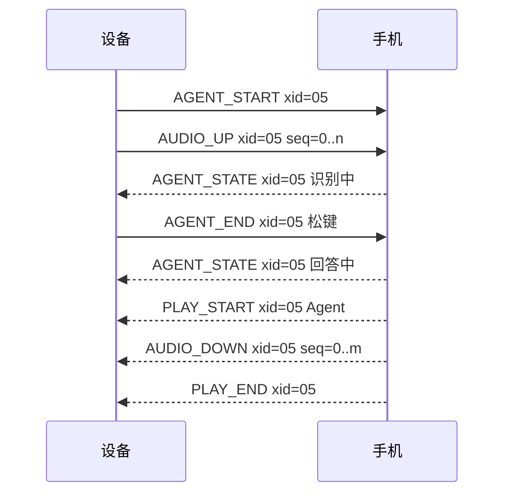
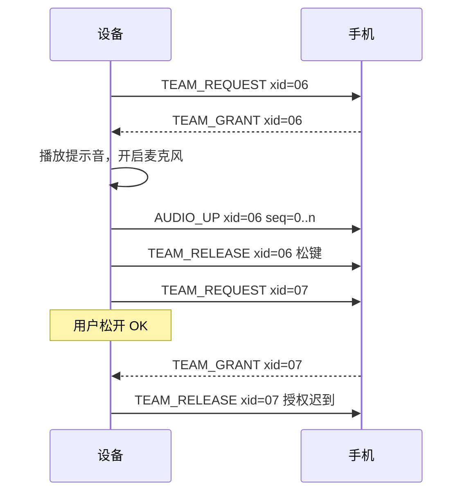
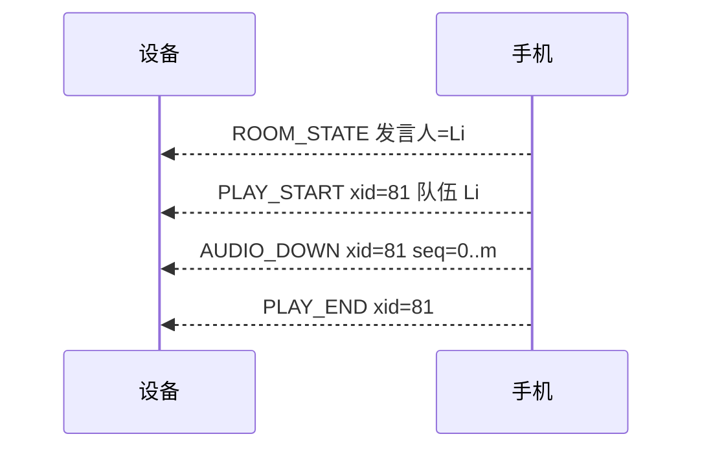

**简体中文** · [English](07-ble-protocol-draft.md)

# 蓝牙协议草案

版本：0.5。日期：2026-10-17。状态：设备团队起草。手机应用团队必须评审。

## 1. 目的与范围

本草案定义 AI Passport 与手机应用之间的蓝牙链路。
D-14 把设备限定为四件事。本协议承载这四件事需要的数据。
链路的另一端归手机应用团队负责。
在该团队接受或替换本草案之前，Q-13 保持开放。

0.2 版把队伍和报告两组消息标为 P1，因为 D-17 把对讲和报告移出了 P0。
首版只实现 P0 消息。

文档 0.3 版定义协议版本 0.1，并确定手机应用需要的全部字段取值。

0.3 版遵循 D-18。首版申请最佳性能的链路参数，不考虑功耗。
广播间隔固定不变。

0.4 版加入 Sprint 1 固件采用的六条规则。它不改变任何包格式，所以协议版本仍是 0.1。
第 13 节列出这六条规则。

0.5 版按 D-20 加入第七条规则：手机收到 AGENT_END 之后才开始回答。协议版本仍是 0.1。
第 14 节列出这条规则。

本草案遵循三条原则：

1. 设备不做超出自身能力的事。
2. 每个包都装进一个 ATT 包。除了一页报告，设备不做任何重组。
3. 网关、房间和重试的所有决定都由手机做。

## 2. 角色与连接

- 设备是 GATT 服务端，也是 BLE 外设。
- 手机应用是 GATT 客户端，也是 BLE 中心。
- 设备同一时间只接受一个连接。有手机连着时，设备停止广播。
- 适用 D-12。链路不加密、不配对、不绑定。附近任何蓝牙客户端都能连接。

设备以可连接方式广播。
广播数据携带服务 UUID。扫描响应携带设备名。
设备名格式为 `HeygoPP-XXXX`，`XXXX` 是设备地址最后两个字节的十六进制。

设备使用公共地址。基线配置关闭了 host-based privacy。
因此地址在重启后保持不变。需要在硬件上检查这一行为。
手机应用可以按地址记住设备。

设备以固定的 100 ms 间隔广播。省电用的慢速间隔由 D-18 推迟。

## 3. GATT 结构

服务 UUID：`6e400001-b5a3-f393-e0a9-e50e24dcca9e`。

| 特征 | UUID | 方向 | 属性 |
| --- | --- | --- | --- |
| RX | `6e400002-b5a3-f393-e0a9-e50e24dcca9e` | 手机到设备 | Write Without Response |
| TX | `6e400003-b5a3-f393-e0a9-e50e24dcca9e` | 设备到手机 | Notify |

这个结构沿用 Nordic UART Service，所以通用蓝牙工具可以直接读取链路。
这块板上的一个参考实现用的就是这组 UUID。

## 4. 建立链路

1. 手机发起连接。
2. 手机申请 247 的 ATT MTU。设备至少需要 172。设备不发起 MTU 交换。
3. 手机订阅 TX 通知。
4. 设备发送 HELLO。
5. 手机在 2 秒内回复 HELLO_ACK。

以下情况下，设备关闭语音功能：

- MTU 低于 172。
- 2 秒内没有收到 HELLO_ACK。
- 手机报告的主版本不受支持。

这些情况下链路保持连接。P1 的报告仍然可用，因为报告页使用分片。
设备显示一条简短消息，说明原因。

### 链路参数

首版只申请一组最佳性能参数。按 D-18，不考虑功耗。

| 参数 | 设备申请值 | 理由 |
| --- | --- | --- |
| 连接间隔 | 最小 7.5 ms，最大 15 ms | 间隔越短，延迟越低，每秒能传的包越多。7.5 ms 是 BLE 规范允许的最小值。 |
| 外设延迟 | 0 | 设备在每个连接事件都响应。 |
| 监督超时 | 4 秒 | 链路断开几秒内就能发现。 |
| PHY | LE 2M，回退到 LE 1M | LE 2M 让每个包的空中时间减半。 |
| 链路层数据长度 | 251 字节 | 一个 168 字节的音频包装进一个链路层包。默认长度 27 字节会把它拆成 7 片。 |
| ATT MTU | 247 字节 | 一个包装下一整块音频。 |

链路建立后，设备申请一次这组参数，两种模式下都保持不变。
最终取值由手机决定。各平台都会限制连接间隔，有些手机不支持 LE 2M。
例如苹果的配件设计指南规定，大多数配件的连接间隔最小为 15 ms。
设备在日志中记录手机实际给出的取值。手机应用团队必须在目标手机上检查。

## 5. 包格式

每次写入和每次通知都只携带一个包。
一个包不跨两个 ATT 包。两个包不共用一个 ATT 包。

| 偏移 | 长度 | 字段 | 含义 |
| --- | --- | --- | --- |
| 0 | 1 | `type` | 消息类型，取值见第 6 节。 |
| 1 | 1 | `flags` | 第 0 位标记最后一个分片。其他位为零。 |
| 2 | 1 | `xid` | 交流编号。零表示不属于任何交流。 |
| 3 | 1 | `seq` | 交流内的序号。超过 255 后回绕。 |
| 4 | 0 至 MTU − 7 | `payload` | 该类型的内容。 |

载荷长度由 ATT 包长度给出，包内不带长度字段。
多字节数字使用小端序。文本使用 UTF-8。

**为什么和板上参考实现的格式不同。**
参考实现使用魔数、长度字段和流解析器。
它需要这些，是因为一次通知可能带多帧，一帧也可能跨多次通知。
本草案禁止这两种情况，所以设备不需要流解析器。
手机必须遵守"一次一个包"的规则。

### 交流编号

- 设备发起的交流使用 0x01 至 0x7F 的 `xid`。
- 手机发起的交流使用 0x80 至 0xFE 的 `xid`。
- 零表示不属于任何交流。0xFF 保留。
- 每次新建连接后，设备先用 0x01，手机先用 0x80。
- 每一方每发起一次新交流，自己的 `xid` 加一。设备在 0x7F 之后回到 0x01，手机在 0xFE 之后回到 0x80。
- Agent 回答使用对应提问的 `xid`。

设备为每个音频所有者保存一个当前 `xid`。
`xid` 不同的音频包和状态包，设备一律丢弃。
取消会清空当前 `xid`。之后该交流迟到的每个包，设备都会丢弃。

新的蓝牙连接会重置所有 `xid`。
旧连接的包不可能出现在新连接上，因此链路不需要连接代次字段。

### 序号

- 每段音频流的第一块 `seq` 为 0，之后每块加一，超过 255 后回到 0。
- 每页报告的第一个分片 `seq` 为 0。
- 其他所有包的 `seq` 都为 0。

### 协议版本

文档 0.3 版和 0.4 版定义协议版本 0.1。
因此 HELLO 和 HELLO_ACK 携带主版本 0、次版本 1。
更早的文档版本没有实现，所以没有协议版本号。

主版本为 0 时，协议仍是草案，允许不兼容的修改。
因此双方的主版本和次版本都必须相同。
任何不同都视为版本不受支持。设备发送错误码 3 的 ERROR，并关闭语音功能。

从主版本 1 开始，新的次版本只在载荷末尾追加字段。
接收方忽略载荷末尾多出的字节。
接收方遇到未知类型时回复错误码 1 的 ERROR，并忽略该包。

## 6. 消息类型

D 表示设备，P 表示手机。

### 字段取值

| 字段 | 长度 | 取值 |
| --- | --- | --- |
| 模式 | 1 字节 | 0 滑行模式。1 休息模式。 |
| 页面 | 1 字节 | 0 滑行状态页。1 教练页。2 退出确认。3 报告页，P1。4 队伍页，P1。 |
| 编码 | 1 字节 | 0 IMA ADPCM。1 裸 PCM。 |
| 编码掩码 | 1 字节 | 第 0 位 IMA ADPCM，第 1 位裸 PCM。第 n 位对应编码值 n。 |
| 采样率 | 1 字节 | 16，单位 kHz。没有其他有效值。 |
| 是否标志 | 1 字节 | 0 否。1 是。 |
| 电量百分比 | 1 字节 | 0 至 100。0xFF 表示未知。 |
| UTC 时间 | 4 字节 | Unix 秒数，无符号。 |
| 文本 | 载荷剩余部分 | UTF-8，不带结尾的零字节。版本文本最多 32 字节。 |

接收方把未知的页面值当作未知页面，不为此发送 ERROR。
接收方遇到未知的编码值时，回复错误码 7 的 ERROR。

### 链路

| 类型 | 名称 | 方向 | 载荷 | 时机 |
| --- | --- | --- | --- | --- |
| 0x01 | HELLO | D 到 P | 主版本 (1)、次版本 (1)、编码掩码 (1)、MTU (2)、固件版本（文本） | 手机订阅 TX 之后 |
| 0x02 | HELLO_ACK | P 到 D | 主版本 (1)、次版本 (1)、UTC 秒数 (4)、应用版本（文本） | HELLO 之后 2 秒内 |
| 0x03 | PHONE_STATUS | P 到 D | UTC 秒数 (4)、网络在线 (1)、网关可达 (1)、应用在后台 (1) | 每次变化时，且至少每 5 秒一次 |
| 0x04 | DEVICE_STATUS | D 到 P | 电量百分比 (1，未知为 0xFF)、模式 (1)、页面 (1)、空闲堆 KiB (2) | 每次变化时，且每 30 秒一次 |
| 0x0F | ERROR | 双向 | 错误码 (1)、相关类型 (1)、相关 `xid` (1) | 接收方拒绝一个包之后 |

编码掩码的第 0 位表示 IMA ADPCM，第 1 位表示裸 PCM。
设备需要手机提供的 UTC 时间，因为它没有别的时钟来源。

| 错误码 | 含义 |
| --- | --- |
| 1 | 未知类型 |
| 2 | 长度错误 |
| 3 | 版本不受支持 |
| 4 | 内容过大 |
| 5 | 序号缺口 |
| 6 | 当前状态下不接受该类型 |
| 7 | 未知的字段取值 |

### 上下文

| 类型 | 名称 | 方向 | 载荷 | 时机 |
| --- | --- | --- | --- | --- |
| 0x10 | CONTEXT | D 到 P | 模式 (1)、页面 (1) | 模式或页面每次变化时 |

P0 中，手机自己把当前滑雪会话附在每次 Agent 请求上。
P1 会在这段载荷末尾追加报告字段。

### Agent

| 类型 | 名称 | 方向 | 载荷 | 时机 |
| --- | --- | --- | --- | --- |
| 0x20 | AGENT_START | D 到 P | 编码 (1)、采样率 kHz (1) | 教练页长按 OK 达到 500 ms 时 |
| 0x21 | AGENT_END | D 到 P | 原因 (1)：0 松键，1 达到 20 秒上限 | 采集停止时 |
| 0x22 | AGENT_CANCEL | D 到 P | 无 | 长按 UP、切换页面或切换模式时 |
| 0x23 | AGENT_STATE | P 到 D | 状态 (1)、失败码 (1)、文本（可选） | 交流状态每次变化时 |

AGENT_START 使用新的设备 `xid`。AUDIO_UP 包紧接着发出，设备不等待回复。
AGENT_CANCEL 结束整次交流。手机丢弃输入，并停止回答。

| 状态值 | 含义 |
| --- | --- |
| 1 | 已接受 |
| 2 | 识别中 |
| 3 | 思考中 |
| 4 | 回答中 |
| 5 | 完成 |
| 6 | 失败。失败码给出原因：1 识别失败，2 超时，3 网关错误。 |

其他状态的失败码一律为 0。

失败码 2 时设备显示超时。失败码 1 和 3 时设备提示用户重说。
回答开始之前，每个非失败的 AGENT_STATE 都会让设备的 10 秒等待重新计时。

可选文本可以是转写结果或简短回答，必须装得进一个包。
MTU 为 172 时，文本最多 163 字节。

### 音频

| 类型 | 名称 | 方向 | 载荷 | 时机 |
| --- | --- | --- | --- | --- |
| 0x30 | AUDIO_UP | D 到 P | 一个音频块 | 采集期间每 20 ms 一个 |
| 0x31 | AUDIO_DOWN | P 到 D | 一个音频块 | 播放期间按实时节奏发送 |
| 0x32 | PLAY_START | P 到 D | 通道 (1)：0 Agent，1 队伍。编码 (1)。发言人名字（文本，仅队伍）。 | 一段回答或一段队伍语音的第一个 AUDIO_DOWN 之前 |
| 0x33 | PLAY_END | P 到 D | 无 | 最后一个 AUDIO_DOWN 之后 |
| 0x34 | PLAY_STOP | D 到 P | 无 | 队伍播放期间长按 UP 时。P1。 |

每个音频包都带所属交流的 `xid`。每个块的 `seq` 加一。
收到 PLAY_END 后，设备播完队列中的帧，然后释放音频所有者。
Agent 播放期间长按 UP，设备发送 AGENT_CANCEL。
队伍播放期间长按 UP，设备发送 PLAY_STOP。
两种情况下设备都立即停止喇叭，不等待手机。

首版在 HELLO 中只声明 IMA ADPCM。codec 为 1 的 PLAY_START，设备回复错误码 7 的 ERROR。
手机收到 AGENT_END 之后，才能发送这次交流的 PLAY_START。设备在录音时丢弃 PLAY_START。
首版没有队伍音频所有者。设备忽略队伍通道的 PLAY_START。

### 队伍（P1）

首版不实现这组消息。

| 类型 | 名称 | 方向 | 载荷 | 时机 |
| --- | --- | --- | --- | --- |
| 0x50 | TEAM_REQUEST | D 到 P | 无 | 队伍页长按 OK 达到 500 ms 时 |
| 0x51 | TEAM_GRANT | P 到 D | 租约时长 ms (2) | 房间服务授予发言权之后 |
| 0x52 | TEAM_DENY | P 到 D | 原因 (1)、当前发言人（文本） | 手机无法授予发言权时 |
| 0x53 | TEAM_RELEASE | D 到 P | 原因 (1) | 采集停止时，或收到迟到的授权之后 |
| 0x54 | TEAM_REVOKE | P 到 D | 原因 (1)：1 租约到期，2 房间关闭 | 租约提前结束时 |
| 0x55 | ROOM_STATE | P 到 D | 房间可用 (1)、成员数 (1)、房间名长度 (1)、房间名（文本）、当前发言人（文本，空表示无人） | 房间每次变化时 |

TEAM_REQUEST 使用新的设备 `xid`。此时麦克风保持关闭。
收到 TEAM_GRANT 时，设备检查两个条件：OK 仍被按住，且 `xid` 是当前值。
两个条件都满足时，设备播放提示音、开启麦克风，并发送 AUDIO_UP 包。
任一条件不满足时，设备发送原因 3 的 TEAM_RELEASE，并保持麦克风关闭。

| TEAM_DENY 原因 | 含义 |
| --- | --- |
| 1 | 其他队员正在发言，文本给出其名字 |
| 2 | 没有房间 |
| 3 | 超时 |
| 4 | 网关错误 |

| TEAM_RELEASE 原因 | 含义 |
| --- | --- |
| 0 | 用户松开 OK |
| 1 | 达到 20 秒上限 |
| 2 | 取消 |
| 3 | 授权迟到 |
| 4 | 链路问题 |

### 报告（P1）

首版不实现这组消息。

| 类型 | 名称 | 方向 | 载荷 | 时机 |
| --- | --- | --- | --- | --- |
| 0x60 | REPORT_REQUEST | D 到 P | 页码 (1)、报告 ID（文本，空表示会话列表） | 用户打开报告或翻页时 |
| 0x61 | REPORT_PAGE | P 到 D | 一页 JSON 的一个分片 | 回应 REPORT_REQUEST，或手机推送新报告时 |
| 0x62 | REPORT_ACK | D 到 P | 结果 (1) | 收到最后一个分片后，或拒绝之后 |

每次 REPORT_PAGE 传输使用新的手机 `xid`。`seq` 是分片序号，从零开始。
第一个分片以总长度 (2) 开头，后面跟 JSON 字节。
最后一个分片设置 `flags` 的第 0 位。

设备用一块固定的 8,192 字节缓冲重组一页。
以下情况设备拒绝该次传输：

- 总长度超过 8,192 字节。
- 分片序号跳号。
- JSON 无法解析。
- 报告修订号比缓存中的旧。

| REPORT_ACK 结果 | 含义 |
| --- | --- |
| 0 | 已接受 |
| 1 | 过大 |
| 2 | 序号缺口 |
| 3 | 解析错误 |
| 4 | 修订号过旧 |

新的传输 `xid` 会取消未完成的传输。手机可以把被拒绝的传输重试一次。
报告页遵循架构第 5 节的 JSON 契约。
会话列表使用这个 JSON 格式：`{"sessions":[{"id":"...","date":"...","title":"..."}]}`。

## 7. 音频块

### IMA ADPCM 块

| 偏移 | 长度 | 字段 |
| --- | --- | --- |
| 0 | 2 | 预测值，有符号 16 位 |
| 2 | 1 | 步长索引，0 至 88 |
| 3 | 1 | 保留，为零 |
| 4 | 160 | 320 个采样，每个 4 位，低半字节在前 |

一个块承载 16 kHz、单声道的 20 ms 音频，占 164 字节。加上包头，一个包占 168 字节。
预测值和步长索引是解码第一个采样之前的解码器状态，因此一个块编码全部 320 个采样。
每个块自带状态，所以丢失一个块不会破坏下一个块。

这个格式和 WAV 文件里的 IMA ADPCM 块不同。WAV 块把第一个采样存在块头里。
不要不加修改地复用 WAV 解码器。
使用标准的 89 项 IMA 步长表和标准索引表。

### 裸 PCM 块

裸 PCM 回退使用 16 kHz、16 位小端、单声道采样。
一个块承载 5 ms，即 80 个采样、160 字节。
回退的包速率是 ADPCM 的 4 倍，只用于诊断。

### 最后一块

每一块的大小都固定：IMA ADPCM 为 164 字节，裸 PCM 为 160 字节。
一段流的最后一块通常装不满真实采样。
发送方用值为 0 的采样把这一块补满，然后编码整块。
接收方把补充部分当作最多 20 ms 的静音播放。

设备发出最后一个上行块之后，再发送 AGENT_END 或 TEAM_RELEASE。
手机发出最后一个下行块之后，再发送 PLAY_END。
大小不对的块，接收方用错误码 2 的 ERROR 拒绝。

### 开始播放

以下事件中最先发生的一个触发设备开始播放：

1. 播放队列中已有 3 块。这留出 60 ms 抖动余量。
2. 收到 PLAY_END。设备立即播放队列中的块，即使不足 3 块。
3. 第一块到达后已过 60 ms，第三块仍未到达。这条规则应对手机发送停顿。

如果收到 PLAY_END 时队列中没有任何块，设备不播放，并释放音频所有者。

开始播放后，设备不再重新等待 3 块。
如果在 PLAY_END 之前队列播空，设备播放静音，直到下一块到达。
如果 2 秒内既没有新块也没有 PLAY_END，设备结束播放并释放音频所有者。

### 节奏与队列

- 采集期间，设备每 20 ms 发送一个 AUDIO_UP 块。
- 手机按实时节奏发送 AUDIO_DOWN 块，领先播放不超过 8 个块。
- 设备按上一节的规则开始播放。
- 设备发送队列容纳 8 个音频包。溢出时，设备丢弃最旧的音频包。
- 控制包优先于音频包，从不排在音频后面等待。
- 只有一个例外：AGENT_END 排在本次交流最后一个 AUDIO_UP 块之后。"最后一块"一节要求这个顺序。
- 设备播放队列容纳 8 个包。溢出时，设备丢弃最旧的包。
- 出现序号缺口时，设备对缺失的块不播放任何声音。下一个块头会重置解码器。

## 8. 时间规则

| 规则 | 取值 | 负责方 |
| --- | --- | --- |
| HELLO 之后回复 HELLO_ACK | 不超过 2 秒 | 手机 |
| PHONE_STATUS 的发送间隔 | 不超过 5 秒 | 手机 |
| 设备显示"手机应用无响应"之前的静默时长 | 15 秒 | 设备 |
| P1：TEAM_REQUEST 之后收到 TEAM_GRANT 或 TEAM_DENY | 不超过 1,500 ms，超过后设备按超时处理 | 设备 |
| 回答开始之前：从 AGENT_END 到第一个 AGENT_STATE，以及两个 AGENT_STATE 之间 | 不超过 10 秒，超过后设备显示超时并发送 AGENT_CANCEL | 设备 |
| 松开 OK 或取消后停止采集 | 不超过 100 ms | 设备 |
| 取消命令后停止喇叭 | 不超过 200 ms | 设备 |
| 单次采集 | 不超过 20 秒 | 设备 |
| 开始播放 | 满 3 块、收到 PLAY_END，或第一块到达后 60 ms | 设备 |
| 播放中断流 | 2 秒内既无新块也无 PLAY_END，则结束播放 | 设备 |

1,500 ms 来自本地对讲参考实现。
TC-09 的授权目标是第 95 百分位不超过 800 ms，这个超时覆盖慢的长尾。

## 9. 时序示例

### 教练提问

### 队伍发言，以及迟到的授权（P1）

### 收听其他队员（P1）

## 10. 设备内存开销

| 项目 | P0 字节 | 加上 P1 报告 |
| --- | --- | --- |
| 发送控制队列，4 个 172 字节的包 | 688 | 688 |
| 发送音频队列，8 个 172 字节的包 | 1,376 | 1,376 |
| 播放队列，8 个 172 字节的包 | 1,376 | 1,376 |
| 报告页缓冲 | 无 | 8,192 |
| 合计 | 3,440 | 11,632 |

ADPCM 编解码状态每个方向只增加几个字节。
NimBLE 主机和控制器另需内存，要在硬件上测量。

## 11. 手机应用必须做的事

1. 申请 247 的 ATT MTU。语音功能要求不低于 172。
2. 订阅 TX 通知，并在 2 秒内回复 HELLO。
3. 每次写入只发一个包。不合并两个包，也不拆分一个包。
4. 至少每 5 秒发送一次 PHONE_STATUS。
5. 保存 Agent 输入，直到网关接受。D-11 要求这一点。
6. 按实时节奏发送 AUDIO_DOWN，领先不超过 8 个块。
7. 按第 7 节的块格式进行 ADPCM 编码和解码。
8. 收到 AGENT_CANCEL 后，丢弃输入和回答。
9. P1：收到 TEAM_REQUEST 后申请发言权，并在 1,500 ms 内回复。
10. P1：收到 TEAM_RELEASE 后释放发言权。
11. P1：把每页报告拆成装得进 MTU 的分片。
12. 在 HELLO_ACK 中发送主版本 0、次版本 1。
13. 用静音把最后一个下行块补满到整块大小。
14. 回答开始之前，至少每 10 秒发送一次 AGENT_STATE。

## 12. 待定事项

- 手机应用团队接受或替换本草案。Q-13 跟踪这一项。
- 在目标手机上测量 MTU、连接间隔和吞吐量。
- 检查语音交流期间手机应用在后台的行为。
- 用真实 HeygoAI 数据确定 JSON 报告结构。Q-01 跟踪这一项。
- 记录每台目标手机实际给出的连接间隔、PHY 和数据长度。
- 后续版本测量链路参数的耗电。D-18 推迟了这一项。

## 13. 0.4 版的变更

Sprint 1 固件遵守以下规则。它们都不改变包格式。

| 序号 | 规则 | 章节 |
| --- | --- | --- |
| 1 | AGENT_END 排在本次交流最后一个 AUDIO_UP 块之后。其他控制包都排在音频之前。 | 7 |
| 2 | HELLO 只声明 IMA ADPCM。codec 为 1 的 PLAY_START 收到错误码 7 的 ERROR。 | 6 |
| 3 | 回答开始之前，每个非失败的 AGENT_STATE 都让 10 秒等待重新计时。 | 6、8 |
| 4 | 设备不发起 MTU 交换，由手机申请 MTU。 | 4 |
| 5 | 设备自己 10 秒超时后，发送 AGENT_CANCEL。 | 8 |
| 6 | 设备忽略队伍通道的 PLAY_START，因为队伍语音属于 P1。 | 6 |

设备还把失败码 2 对应到超时提示，把失败码 1 和 3 对应到重说提示。

## 14. 0.5 版的变更

| 序号 | 规则 | 章节 |
| --- | --- | --- |
| 7 | 手机收到 AGENT_END 之后，才能发送这次交流的 PLAY_START。设备在录音时丢弃 PLAY_START 和随后的 AUDIO_DOWN 块，随后显示超时。 | 6 |

这条规则来自 D-20。它不改变包格式，所以协议版本仍是 0.1。
手机应用团队需要确认这条规则。

## 15. 相关文档

- [系统架构](02-architecture.zh_CN.md)。
- [验证与决策](04-validation-and-decisions.zh_CN.md)。
- [决策修订](05-decision-amendments.zh_CN.md)。
- [Sprint 0 计划](06-sprint-0-plan.zh_CN.md)。
- [文档入口](README.zh_CN.md)。
